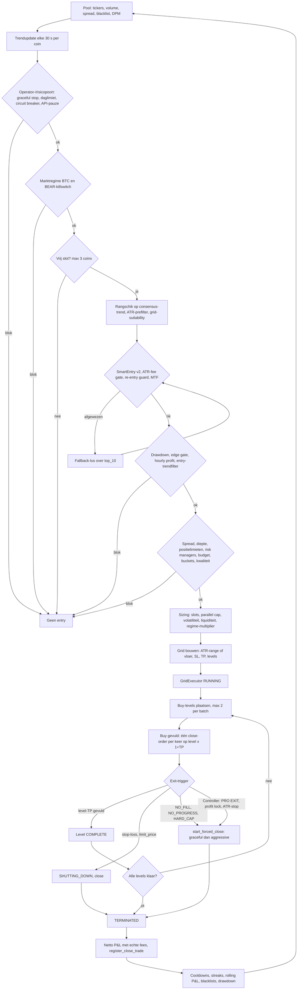

# Tradingstrategie — Multi Coin Grid Pro (geïmplementeerde werkelijkheid)

| | |
|---|---|
| Repository / branch | `/home/mo/repos/hummingbot` / `branch_20251109` |
| Code-stand | Bijgewerkt op HEAD `4d4728604` (2026-11-02), gelijk aan `origin/branch_20251109`. Hoofdstuk 1–6 en 8–11 zijn opgesteld op `7d1d060d4`; regelnummers (`≈L…`) komen uit die stand (controller sindsdien ca. +330 regels) en zijn alleen als functienaam leidend |
| Onderhoud | Permanent onderhouden document. Elke wijziging die tradinggedrag, risicobeheer, fees, P&L of strategie-YAML raakt, werkt dit bestand in dezelfde wijziging bij (regel in `.github/copilot-instructions.md`, check in `.github/scripts/check_trading_strategy_docs.py`). Wijzigingen staan onderaan onder `Strategiewijzigingen` |
| Doel van dit document | Feitelijke beschrijving van wat de code en configuratie nu doen, voor onafhankelijke review |
| Wat dit document niet is | Geen verbetervoorstellen, geen nieuwe strategie, geen winstclaims |
| Methode | Code gelezen (controller, executor, risicomodules), effectieve configuratie berekend door de drie YAML's in de Pydantic-modellen te laden (alleen lezen, geen bot gestart), executor-configs gevalideerd in de SQLite-databases (`Executors.config`, sinds 2026-10-18) |

## 0. Leeswijzer

### 0.1 Statuslabels

| Label | Betekenis |
|---|---|
| ENABLED | Actief en kan een beslissing blokkeren, sturen of uitvoeren |
| DISABLED | Uitgeschakeld in de effectieve configuratie |
| SHADOW | Berekent en logt, maar beïnvloedt geen beslissing |
| UNKNOWN / ONBEKEND | Niet vastgesteld met de beschikbare bronnen (zie hoofdstuk 12) |
| AFGELEID | Uit code en configuratie afgeleid, niet runtime-gemeten |
| GEVERIFIEERD (DB) | Bevestigd in `Executors.config` of andere databasedata |

### 0.2 Afkortingen en bronnen

| Code | Bot | YAML (bron van alle `U`/`B`/`O`-waarden) | Model | Status bot |
|---|---|---|---|---|
| U | Kraken USD | `multi_coin_grid_pro/config/spot_grid_kraken_usd.yaml` | `MultiCoinGridConfig` | Recent actief (laatste executor 2026-11-01 05:06 UTC, 610 executors totaal) |
| B | Bitget Spot (USDT) | `multi_coin_grid_pro/spot_bitget/config/spot_grid_bitget.yaml` | `SpotGridBitgetConfig` | Recent actief (laatste executor 2026-10-30 16:11 UTC, 1108 executors totaal) |
| O | OKX Spot (USDC) | `multi_coin_grid_pro/spot_okx/config/spot_grid_okx.yaml` | `SpotGridOKXConfig` | Inactief (laatste executor 2026-08-22 16:45 UTC, 35 executors totaal) |

Kraken EUR is inactief (laatste executor 2026-02-05) en wordt niet behandeld. Bij controle op 2026-11-01 (na 23:20) draaide geen botproces; alleen `momentum_signal_service` was actief. Of dit tijdelijk is, is `ONBEKEND`.

Alle regelnummers verwijzen naar de bestanden op HEAD en zijn indicatief (±20 regels bij latere bewerkingen).

- `CTRL` = `multi_coin_grid_pro/controllers/multi_coin_grid_controller.py`
- `CFG` = `multi_coin_grid_pro/controllers/multi_coin_grid_config.py`
- `EXE` = `hummingbot/strategy_v2/executors/grid_executor/grid_executor.py`
- `TC` = `multi_coin_grid_pro/utils/trend_calculator.py`
- `SE` = `multi_coin_grid_pro/logic/smart_entry.py`

### 0.3 Eenheden (cruciaal voor lezen van YAML)

De YAML's mengen fracties (`0.02` = 2%) en percentages (`2.0` = 2%). Per veld is in dit document de eenheid benoemd zoals de code het leest, niet zoals de YAML-opmerking het bedoelt. Afwijkingen staan in hoofdstuk 12.2. Uitzondering: `max_exposure_per_coin_pct` en `max_total_exposure_pct` worden sinds `855a1871b` bij het laden genormaliseerd naar fracties (7.1).

### 0.4 Implementatiestatus

| Status | Betekenis | Nu |
|---|---|---|
| GECOMMIT | In `HEAD` en gepusht naar `origin/branch_20251109`; alles in dit document is gecommit tenzij anders vermeld | HEAD `4d4728604` |
| LOKAAL | Alleen in de werkmap, nog niet gecommit | Documentatie, onderhoudsregel en doc-check (`.github/`); daarnaast het kapitaaladaptieve risicomodel (live equity als referentie, slotcaps, bucket-evidence, saldo-versheid, stortingen/opnames; 7.1a, 7.8), de verwijderde nominale referenties in de Bitget- en Kraken-USD-YAML en `startup_reconcile_locked_tolerance_quote` |
| ONDERZOCHT | Beoordeeld maar niet geïmplementeerd; staat in 7.8 en 12.4 | Zie 7.8 en 12.4 |

Gecommit betekent niet dat een draaiend proces de wijziging bevat: een herstart door de operator is nodig en het procesgebruik is niet geverifieerd (12.4).

---

## 1. Strategieoverzicht

### 1.1 Wat de bot werkelijk doet

Long-only spot-strategie op één exchange per bot. Per cyclus:

1. Een pool van liquide `…-QUOTE`-paren wordt gemonitord (hoofdstuk 2).
2. Elke 30 s wordt per coin een trendscore bijgewerkt uit prijs-ticks en 5-minutencandles.
3. Alleen coins met een positieve consensus-trend en een reeks filters (hoofdstuk 3) komen in aanmerking.
4. Voor de gekozen coin wordt een `GridExecutor` aangemaakt met uitsluitend BUY-kant (limit-buys onder en rond de huidige prijs). Elke gevulde buy-level krijgt een eigen limit-sell op `level_prijs × (1 + TP)` (hoofdstukken 4 en 5).
5. De executor sluit door per-level take-profit, of door een van de stop-/timeout-/risicoroutes (hoofdstuk 6).
6. Het resultaat gaat naar risicomodules die cooldowns, pauzes en blacklists sturen (hoofdstukken 7 en 8).

Het is dus een **trendgeselecteerde coin met een mean-reversion-grid erin**. Er is geen short-kant, geen margin en geen futures in dit pad. Alle drie de bots gebruiken dezelfde controller (`CTRL`) en dezelfde executor (`EXE`); verschillen zitten in YAML, exchange-specifieke configklassen en enkele connector-checks in code (o.a. `_fees_in_base_token`, CTRL ≈L10478, alleen `True` voor Bitget).

### 1.2 Entry-model in één zin

Een nieuwe grid wordt alleen gemaakt als er een vrij slot is, de coin de rangschikking op consensus-trend haalt, alle ENABLED gates (hoofdstuk 3) slagen en risico-, budget- en sizinglagen een geldige positie-omvang opleveren.

### 1.3 Exit-model in één zin

Normaal sluit elke buy-level via zijn eigen limit-sell; een grid wordt vroegtijdig beëindigd door stop-loss, timeouts (no-fill, no-progress, hard cap), controller-exits (PRO EXIT, profit lock, ATR-stop) of handmatige/graceful stop.

### 1.4 Gedeeld versus verschillend

| Onderdeel | Gedeeld (`CTRL`/`EXE`) | Per exchange (YAML/connector) |
|---|---|---|
| Pad coin → gates → executor | Ja | Drempels en enabled-vlaggen |
| Grid-opbouw en executor-levenscyclus | Ja | Aantal grids, ranges, TP/SL-waarden |
| Fee-gebruik in P&L | Echte fills | Fee-aannames in gates (`fee_aware_filter`) |
| Base-token fee (buy-fee in basisvaluta) | Code in `EXE` | Alleen Bitget (`_fees_in_base_token`) |
| Momentum-sleeve | Gedeelde module | U: paper, B: detect_only, O: paper (geen echte orders) |

---

## 2. Coin-selectie

### 2.1 Pool-opbouw (welke coins worden gemonitord)

| Stap | Functie / bron | Regel | Werking |
|---|---|---|---|
| Initiële discovery | `update_processed_data` (CTRL ≈L3440–3600) | – | Alle paren met `quote_asset` van de connector; volume/spread uit tickers; filter op blacklist en volumedrempel |
| Tickerbron | `_get_ticker_data_safe` (CTRL ≈L1634) | – | Kraken-formaat; Bitget heeft een eigen tickerfetcher (`_get_bitget_ticker_data`); OKX: `ONBEKEND` |
| Periodieke refresh | `_refresh_coin_pool` (CTRL ≈L3852) → `_update_monitored_coins_from_pool` (≈L3922) | – | Sorteert kandidaten op 24u-volume (aflopend), spreadlimiet vast **0,5%** (`spread_limit = 0.005`, hard-coded), neemt top `max_coins_to_monitor` (30). Coins met actieve positie blijven altijd. |
| Volumedrempel pool | `min_24h_volume_usdt` indien aanwezig, anders `min_24h_volume_eur` (CTRL ≈L3938) | – | U: 500 000 (`min_24h_volume_eur`, YAML-alias `min_24h_volume_quote`). B en O: 1 000 000 (schema-veld `min_24h_volume_usdt`, `spot_bitget/config_schema.py:33`, `spot_okx/config_schema.py:33`) |
| Rotatie | `_rotate_underperforming_coins` (CTRL ≈L4052) | – | Vervangt coins zonder trades na `rotation_threshold` updates door volumekandidaten; actieve coins nooit |
| Dynamic Pair Manager (DPM) | `_run_dynamic_pair_scan` (CTRL ≈L7979), `DynamicPairManager` (`utils/dynamic_pair_manager.py`) | – | `use_dynamic_pair_discovery` en `use_dynamic_pair_manager` zijn effectief `true` (alle drie). Voegt toe, verwijdert nooit: `monitored_coins = huidig ∪ DPM-selectie ∪ actieve coins` (CTRL ≈L8018). DPM-composite-score 0,4 / 0,4 / 0,2 (componenten niet verder getraceerd). Volumedrempel DPM = `min_24h_volume_eur` (CTRL ≈L1978): U 500 000, B 2 000 000, O 1 000 000 |
| Handmatige lijst | `manual_trading_pairs` | – | Effectief leeg (alle drie) |
| Blacklist | `get_effective_blacklist(connector)` | – | Config-blacklist (U 54, B 41, O 6 coins) + `auto_blacklisted_coins` + sessieblacklist + persistente NL-restrictielijst (`conf/nl_restricted_{connector}.json`) |

Gevolg voor Bitget (AFGELEID): het YAML-veld `min_24h_volume_quote: 2000000` (YAML-regel 198, opmerking "TUNED 2026-04-03: 500k→2M") is alias voor `min_24h_volume_eur`. Dat veld wordt alleen door de DPM gebruikt. De pool-refresh en `CoinSelector` lezen `min_24h_volume_usdt` (schemadefault 1 000 000). Voor de refreshpad is de effectieve Bitget-vloer dus 1 000 000, niet 2 000 000.

Overige intervals (`coin_discovery_refresh_interval_seconds`, `pair_scan_interval_seconds`, `pool_membership_cooldown_seconds`): effectieve waarde niet vastgelegd, `ONBEKEND` (codedefault DPM-scan: 300 s).

### 2.2 Trendberekening per coin

`TrendCalculator` (`TC`) werkt elke `price_update_interval` = **30 s** (alle drie) bij (CTRL ≈L3724 → `_update_coin_trend_with_price`, TC ≈L865).

**Bitget-prijsbudget (LOKAAL, 2026-11-03).** `BitgetExchange.get_last_traded_prices` gebruikt
`GET /api/v2/spot/market/tickers` zonder `symbol`, conform de officiële Bitget-v2-specificatie: één
gethrottlede response met alle spot-tickers, waarna de connector via de Hummingbot-symbolmapping
filtert. Een cyclus met 29 symbolen daalt daarmee van 29 outbound tickerrequests naar 1; overlappende
calls binnen 3 s gebruiken de connectorcache. De trendcalculator bewaart succesvolle prijzen maximaal
90 s voor een gedegradeerde refresh. Bij HTTP 429 respecteert hij `Retry-After` (begrensd op 300 s), of
gebruikt hij exponentiële back-off van 5–60 s plus jitter. Tijdens back-off zijn er nul nieuwe requests.
Een partiële response, timeout of 429 start op Bitget nooit de generieke per-symbol fallback of de
high-failure retry; ontbrekende of stale prijzen worden expliciet gelogd en niet als verse data behandeld.
Kraken houdt zijn bestaande multi-tickerpad.

| Grootheid | Definitie (code) | Eenheid |
|---|---|---|
| `price_history` | Eén tick-snapshot per update, max 1500 entries (`MAX_PRICE_HISTORY`); `has_sufficient_data` = ≥ 20 punten | – |
| `consensus_trend_pct` (TC ≈L2208) | `0,40·EMA(30 vs 60 ticks) + 0,40·lineaire-regressieslope·n + 0,15·(trend/volatiliteit, dimensieloos) + 0,05·ruwe trend` | percent |
| `trend_score` (multi-timeframe) | `0,2·trend_60m + 0,4·trend_240m + 0,4·trend_1440m`; tijdens warmup (bot-uptime < min(lange lookback, `warmup_max_minutes` = 120)) wordt `trend_1440m = (trend_240m + trend_60m)/2` en `long_trend_warmup = True` | percent |
| `volatility` | Standaarddeviatie van tick-op-tick procentuele veranderingen | percent |
| `atr_pct` (selectie) | 5m-candle ATR14 / prijs, alleen bijgewerkt als `atr_coin_selection` actief is | percent |

Opmerking (AFGELEID): de term `trend/volatiliteit` is dimensieloos en kan veel groter zijn dan de procenttermen; met gewicht 0,15 kan die term de rangschikking domineren. Niet runtime-gemeten.

### 2.3 Rangschikking en kandidaatselectie

`get_top_n_coins` (TC ≈L1530), aangeroepen vanuit `determine_executor_actions`:

1. Uitsluitingen: coins met actieve executor, auto-/config-/sessieblacklist, exit-cooldown (`risk_manager.coins_in_exit_cooldown`), insufficient-balance-cooldown.
2. Voorfilters: ≥ 20 prijspunten; orderboek-diepte (modus `live`, een onbekende diepte blokkeert hier niet); ATR-softprefilter (`atr_pct ≥ required_atr_pct × prefilter_ratio`, ratio 0,5 effectief) indien `atr_coin_selection` enabled (U en B: ENABLED, O: DISABLED).
3. Drempel: `consensus_trend_pct ≥ trend_min_change_pct`. **Eenheid: percent.** U: 0,007 (= 0,007%), B en O: 0,0015 (= 0,0015%). In de praktijk dus vrijwel "elke positieve consensus". De YAML-opmerking bij B en O ("0,15%") klopt niet met de code-eenheid.
4. Rangschikking: aflopend op `consensus_trend_pct`; als `atr_coin_selection.use_as_ranking_signal` aan staat (U en B): `0,70·min(|trend|,20)/20 + 0,30·min(atr/required,2)/2`.
5. Het aantal kandidaten is `slots × grid_suitability_candidate_multiplier` (3) als de grid-suitability scorer actief is (zie 2.4), anders de ruwe top-N. `GridSuitabilityScorer` wordt **niet** aan `get_top_n_coins` meegegeven; de rangschikking zelf is dus niet op grid-geschiktheid gebaseerd.
6. De fallback-lijst `_debug_info['top_10']` bevat alle coins met voldoende data, ook onder de trenddrempel, gesorteerd op trend. Na een afwijzing door SmartEntry of MTF itereert de fallback-lus over `top_10[1:]`; coins onder `trend_min_change_pct` kunnen zo toch geselecteerd worden, waarna alleen nog de MTF-condities (gates 16–17) en de overige gates gelden.

### 2.4 Grid-suitability (ACTIVE)

`GridSuitabilityScorer.filter_coins` (`utils/grid_suitability_scorer.py`; aangeroepen CTRL ≈L4518). Effectief `enabled = true`, `logging_only = false` (alle drie): het filter selecteert actief. Minimale `min_grid_score`: U 0,5, B 0,5, O 0,4; lookback 48 candles. Scorecomponenten niet in dit document uitgewerkt, `ONBEKEND` (niet getraceerd).

### 2.5 Monitoring-timeout en blacklist

`max_coin_monitoring_seconds` = 600 (effectief, alle drie; codedefault 60). Een beste coin die langer dan dat zonder uitvoering de beste blijft, komt op de sessieblacklist voor `session_blacklist_duration_seconds` = 7200 s.

---

## 3. Entry-beslissing

### 3.1 Volgorde en vorm

`determine_executor_actions` (CTRL L4154–6058) draait elke controllertick. Hieronder staat de verifieerde volgorde. "Fail" geeft aan hoe de gate zich gedraagt bij een uitzondering.

Drempels per exchange: **U / B / O**. Eenheden: P = percent, F = fractie.

### 3.2 Gate-tabel (in uitvoervolgorde)

| # | Gate | Functie (regel) | Input | Actieve drempel U / B / O | Status U / B / O | Fail |
|---|---|---|---|---|---|---|
| 1 | Risicostatus synchroniseren | `_sync_risk_state` (≈L4163) | Risk-manager state | – | ENABLED | – |
| 2 | Controller-exitsignalen | `_check_professional_exit_signals` (≈L4169) | Actieve coins | zie hoofdstuk 6 | ENABLED | – |
| 3 | Graceful stop | CTRL ≈L4174 | Runtime-vlag (operator) | – | ENABLED | – |
| 3a | Restartveiligheid (GECOMMIT `4d4728604`) | `_startup_exposure_gate` | Vergrendeld quote en inventory zonder executor in deze run | Blokkeert entries tot niets onverklaards meer staat of de operator het bevestigt (`startup_reconcile_*`); zie 7.8 | ENABLED (alle; `startup_reconcile_enabled` default true) | Fail-closed |
| 3b | Live risicoreferentie (GECOMMIT `4d4728604`) | `_ensure_risk_reference` | Totaal quote bij start, geen executors, geen onverklaarde exposure | Alleen actief als `risk_reference_use_live_balance`; referentie = live equity (optioneel begrensd door `risk_capital_cap_quote`), per tick bijgewerkt bij ≥ 1% wijziging; onleesbaar of verouderd saldo blokkeert entries | ENABLED Kraken USD en Bitget (LOKAAL; geen nominaal bedrag), DISABLED OKX | Fail-closed |
| 4 | Time-based filter | `TimeBasedFilter` (CTRL ≈L4191; `filters/time_based_filter.py` ≈L115/146) | UTC-uur, weekdag | B: lage-liquiditeitsuren [17,18,19,21], hoge [13..16], weekendmult 1,0. Multipliers per uur: `ONBEKEND` | U DISABLED / B ENABLED / O DISABLED | – |
| 5 | Daglimiet verlies | `GlobalRiskManager` (≈L4202) | Daily loss % van `risk_reference_balance` | 3 (P) van referentie: U 300, B **50 000**, O 150 | ENABLED | – |
| 6 | Circuit breaker | CTRL ≈L4223 | Prijsrange actieve coin | ≥ 5% in 60 s (hard-coded) → alleen handmatig hervatten | ENABLED | – |
| 7 | API-error pauze | CTRL ≈L4241 | Opeenvolgende API-fouten | 10 achtereen (pauze), 100 totaal (permanent) | ENABLED | – |
| 8 | Marktregime (BTC) | `market_regime` (CTRL ≈L4275) | BTC 1u/4u/24u, altcoin-breadth | 1u ≥ −2; 4u ≥ **0,0 / −1,5 / −1,5**; 24u ≥ −5; dump −5% → 60 min pauze; breadth ≥ 30% (alle P) | ENABLED (alle) | `ONBEKEND` |
| 9 | BEAR-killswitch | CTRL ≈L4285 | `_last_detected_regime`, regime-score | Blokkeert in BEAR tenzij `bear_allow_meanrev` (effectief **false** alle drie) of BEAR-light (`bear_auto_light`, score > −5,0) | ENABLED | – |
| 10 | Insufficient-balance cooldown | CTRL `__init__` | Eerdere "insufficient funds" | 1800 s (hard-coded) | ENABLED | – |
| 11 | Slotcheck | `_get_current_max_slots` (≈L1392) | Dynamische slots − actieve coins | Max slots U 3 / B 12 / O 12, begrensd door `max_simultaneous_coins` = 3; regime-multipliers BULL 1,5 / CHOP 0,75 / BEAR 0,25 | ENABLED | Bij 0 vrij: SLOT_FULL-denial |
| 12 | Coin-ranking | `get_top_n_coins` (TC ≈L1530) | Trend/ATR/diepte | `trend_min_change_pct` (P): 0,007 / 0,0015 / 0,0015 | ENABLED | – |
| 13 | Grid-suitability | `filter_coins` (≈L4518) | 48 candles | min score 0,5 / 0,5 / 0,4 | ENABLED (logging_only=false) | – |
| 14 | BEAR-light divergentie | CTRL ≈L4300 e.v. | Coin vs BTC 24u | Grootte × 0,5 (`bear_size_multiplier`) | ENABLED | – |
| 15 | SmartEntry (v2) | `_check_smart_entry_filter` (≈L8893) → `_check_smart_entry_v2` (≈L9381) | 5m-candles (≥ 14), orderboek | zie 3.3 | ENABLED | **Fail-closed** |
| 16 | Multi-timeframe buy | `_check_multi_timeframe_buy` (≈L9607) | 1u/4u/24u trend uit ≥ 288 candles | `use_multi_timeframe_buy` = true. 1u ≥ −2,0/−3,0/−3,0; 4u ≥ −1,5/−2,5/−2,5; 24u ≥ −2,5 (alle); crash-reject als 1u < −4,0 én 4u < −2,0 (P) | ENABLED | Fail-closed (False) |
| 17 | MTF-condities | `_check_multi_timeframe_buy_conditions` (≈L11600) | `validate_trend`, trendstrength | zie 3.4 | ENABLED | **Fail-open** (True bij exception) |
| 18 | Monitoring-timeout | CTRL ≈L4800 e.v. | Tijd als beste coin | 600 s → sessieblacklist 7200 s | ENABLED | – |
| 19 | PRO EXIT op actieve coin | `should_exit_position` (≈L11871) | Zie hoofdstuk 6 | – | ENABLED | – |
| 20 | Idle-mode | CTRL ≈L5041 (ST-11) | Geen beste coin | Pauzeert zoeken; sluit niets af | ENABLED | – |
| 21 | Risk-blok nieuwe entries | `_risk_block_new_entries` | Eerdere blokkade | – | ENABLED | – |
| 22 | Drawdown-tracker | `DrawdownTracker.check_drawdown_limits` (≈L5092) | Portfoliowaarde (`_calculate_drawdown_portfolio`) | dag/week/maand (P): 3/7/10 / 3/8/12 / 3/8/12 | ENABLED | **Fail-closed** |
| 23 | Economic edge gate (ST-12) | CTRL ≈L5112 | ATR14 (5m), range, fee-model | `min_edge_pct` (P): 0,10 / 0,08 / 0,15; `include_spread_cost` false; slippagebuffer 0,05 / 0,03 / 0,02 (P); minimale level-spacing 0,8 / 0,75 / 0,6 (P) | ENABLED | **Fail-open** |
| 24 | Verwachte uurwinst (V2-04) | CTRL ≈L5212 (`FeeAwareFilter.estimate_hourly_profit`) | Spread, fills/uur | Blokkeert als `not passed`; formule en blokkeerdrempel niet getraceerd: `ONBEKEND`. Configvlag `hourly_profit_check_enabled`: false / false / true | ENABLED (uitvoering); blokkerend gedrag `ONBEKEND` | Fail-open |
| 25 | Entry trend filter | `_check_entry_trend_filter` (≈L8064) | `trend_score` | `min_entry_trend_score` (P): – / **1,5** / – | DISABLED / ENABLED / DISABLED | – |
| 26 | Nieuwe-grid-check | `_should_create_new_grid` (≈L8105) | Startup, budget, risk | Startupwacht `min_startup_wait_seconds` = 60; budget ≥ `num_grids × min_order_amount_quote`; `risk_manager.can_open_trade` | ENABLED | – |
| 27 | Spread | `_check_spread_acceptable` (≈L10138) | Live bid/ask | `max_entry_spread_pct` (P): 0,5 / 0,5 / 0,35 (SmartEntry-spread); CTRL-fallback 0,5 | ENABLED | Fail-closed |
| 28 | Orderboekdiepte | `_check_order_book_depth` (≈L10257) | Orderboek | `orderbook_liquidity`: modus live, 0,5% range, 10 niveaus, 5× ordergrootte | ENABLED | Fail-closed |
| 29 | Positielimieten (GECOMMIT `855a1871b`, `4d4728604`) | `_check_position_limits` aangeroepen vanuit `_create_grid_action` op het exacte executorbedrag; `RiskGuardV2` | Exposure vs `risk_reference_balance` | `max_exposure_per_coin_pct` 55 / 50 / 50 en `max_total_exposure_pct` 95 / 70 / 70 (YAML-percent) worden bij het laden genormaliseerd naar fracties (0,55/0,95; 0,50/0,70); geen eerste-positie-bypass | ENABLED (bindend; limieten t.o.v. live equity (U, B) resp. referentie 150 (O), zie 7.1a) | **Fail-closed** |
| 30 | Kapitaal-allocatie en sizing | zie 5.1 | Saldo, volatiliteit | zie 5.1 | ENABLED | – |
| 31 | `ProfessionalRiskManager.can_open_new_position` | `risk/professional_risk_manager.py`, via `_professional_risk_allows` | Rolling P&L, win rate, posities, dagverlies / risico-equity | zie 7.3 | ENABLED | **Fail-closed** bij onbekende equity (GECOMMIT `4d4728604`) |
| 32 | Dagelijkse coin-killswitch | CTRL ≈L5673 | Dag-P&L per coin in R | Uitgeschakeld bij < −2R, helft bij < −1R; `r_unit_quote` = 5,0 | ENABLED | – |
| 33 | Session edge detector | CTRL ≈L5706 | Sessie | Details `ONBEKEND` | ENABLED | `ONBEKEND` |
| 34 | Entry gateway | `core/entry_gateway.py` (CTRL ≈L5746) | `GlobalRiskManager.can_open_trade` | zie 7.2 | ENABLED | – |
| 35 | Risk-bucket check | `core/risk_buckets.py` (CTRL ≈L5762) | Bucketexposure | zie 7.4 | ENABLED | `ONBEKEND` voor BLOCKED-bucket |
| 36 | Kwaliteitsscore en sizing | `scoring/trade_quality_scorer.py` (CTRL ≈L5786) | Kwaliteitsfactoren | Multiplier op positiegrootte; details `ONBEKEND` | ENABLED | – |
| 37 | Budget | `BudgetAllocator.check_budget` | Saldo | fee-buffer 0,2%, quote-reserve 5% | ENABLED | – |
| 38 | Re-entry price guard | `_check_reentry_price_guard` (≈L10598), aangeroepen via SmartEntry | Prijs vs laatste exit | Max 0,5% onder laatste exitprijs; types TP/SL/EARLY_STOP | ENABLED (alle) | – |
| 39 | ATR-fee gate (US13) | `_check_atr_fee_gate` (≈L10554), aangeroepen via SmartEntry v2 | 5m ATR14 % | `ATR% ≥ (maker+taker)·100 × 2,0` (model "average") | ENABLED / ENABLED / DISABLED | – |

Het secundaire-coins-pad (extra grids op andere coins) herhaalt gates 15–17, 25–29 voor die coin.

### 3.3 SmartEntry v2 (gate 15), volgorde binnen `allows_entry` (`SE` ≈L534)

Voorafgaand in `_check_smart_entry_filter`: orderboek-subscriptie, pair-health quarantaine (`auto_quarantine`: drempel 10, venster 120, duur 900 — alle ENABLED), staleness guard (prijs maximaal 35 000 ms, orderboek 60 000 ms), re-entry price guard (gate 38) en daarna ATR-fee gate (gate 39).

| Stap | Controle | U / B / O | Status |
|---|---|---|---|
| 0 | Spread (`slippage_check_enabled`) | `max_entry_spread_pct` 0,5 / 0,5 / 0,35 (P) | ENABLED |
| 0B | Diepte (`depth_check_enabled`, `min_depth_multiplier` 5); **fail-closed** zonder orderboek | 5× | ENABLED |
| 1 | RSI | `rsi_block_min` 85 / 85 / 93; `rsi_buy_max` 65 / 65 / 80; `rsi_extreme_low` 18 / 15 / 12 | ENABLED |
| 2 | VWAP-afwijking | `|dev| ≤ vwap_max_deviation_pct` (12; coinprofiel kan afwijken) | ENABLED |
| 3 | Wick-ratio | `min_wick_ratio` = 0,0 (inactief) | DISABLED (waarde 0) |
| 4 | ATR% min / max | min 0,15 / 0,15 / 0,06; max 7 (P) | ENABLED |
| 5 | 5m-spike | `|Δ| ≤ max_5m_spike_pct` 4,0 (P) | ENABLED |
| 6 | Acceleratie (1u − 4u trend) | ≥ −6,0 en ≤ 5,0 (P) | ENABLED |
| 6b | `trend_4h ≤ max_trend_4h_pct` | 2,5 (P) | ENABLED |
| 6c | VWAP-slope guard | `shadow_mode`: false / true / true | **ENABLED (U) / SHADOW (B, O)** |
| 6d | Parabolic detector (cooldown 60 min, persistent) | `shadow_mode`: false / true / true | **ENABLED (U) / SHADOW (B, O)** |
| 7 | `trend_24h` binnen [−10, 15] | – | ENABLED |
| – | `market_exhaustion_enabled` (drempel 0,7, sample 10, cooldown 30 min) | – | Effectief gebruik `ONBEKEND` (niet getraceerd) |

Per-coin `coin_profiles` (U 50, B 90, O 21 profielen) kunnen drempels overschrijven; een adaptieve regime-resolver (RE-01) mag YAML-limieten niet verruimen. De waarden van individuele profielen zijn niet in dit document opgenomen.

Indicatoren komen uit 5m-candles (`CandleIndicatorsCalculator`). SmartEntry-uitzondering → entry geweigerd (fail-closed).

### 3.4 MTF-condities (gate 17) in detail

`_check_multi_timeframe_buy_conditions` (CTRL ≈L11600), alle drie `use_multi_timeframe = true`.

| Fase | Controle | Waarde |
|---|---|---|
| 1 | `trend_calculator.validate_trend` (360 candles, `MIN_TREND_THRESHOLD` ±0,5%) | – |
| 2 | Trend niet ouder dan 3 × `price_update_interval` (90 s) | – |
| 3 | `trend_strength ≥ trend_min_entry_strength` (−0,001 epsilon). **Eenheid: fractie.** U 0,007 (= 0,7%), B en O 0,0015 (= 0,15%) | zie 12.2 |
| 4 | Downtrend-gate: 1u ≥ −1,0, 4u ≥ −0,75, 24u ≥ −0,5 (P) | `downtrend_gate_enabled` true |
| 5 | Bevestiging: aantal timeframes > 0 ≥ `trend_confirmation_timeframes` (1), tenzij `trend_strength ≥ 0,02` | – |
| 6 | Warmup-modus: `warmup_4h_strong_min` U −0,5 / B −2,5 / O −2,5; `warmup_1h_min_if_4h_strong` U −1,5 / B −3,0 / O −3,0 | – |
| 7 | Normaal: 24u > `mtf_24h_min_pct`, 4u > `mtf_4h_min_pct`, 1u ≥ `mtf_1h_min_pct`; declining-reject volgens `mtf_declining_*` | waarden in gate 16 |

Afwijking docstring ↔ code: de docstring noemt vaste drempels (24u > +1%, 4u > +1%, 1u ≥ 0); de code gebruikt de configdrempels. De afwijsreden-teksten in `determine_executor_actions` (≈L4668–4690) noemen hard-coded "≤ +1%"; dat is alleen logtekst.

### 3.5 Entry-trendfilter (gate 25)

Alleen Bitget: `entry_trend_filter.enabled = true`, `min_entry_trend_score` = 1,5 (P, op de composiet `trend_score`). U en O: niet ingesteld (DISABLED).

### 3.6 Per-coin validatie vóór order

Spread- en diepte-checks (gates 27–28), `_is_trading_pair_tradeable` en klaar-zijn van het orderboek gelden direct voor het aanmaken. Orderniveaus worden daarna in de executor tegen `min_notional` en `min_order_amount_quote` getoetst (4.4).

---

## 4. Grid-constructie

### 4.1 Prijsrange (`_create_grid_action`, CTRL ≈L10653–11272)

| Stap | Regel |
|---|---|
| ATR-range | `use_atr_grid_ranges = true` (alle): `start = prijs − ATR × atr_multiplier_down` (1,5), `end = prijs + ATR × atr_multiplier_up` (2,0). Fallback: vaste `grid_range_pct_down/up` (U 4,0/12,0; B 2,0/5,0; O 2,0/5,0 — P) |
| ATR-bron range | `_calculate_atr` (≈L8809): gemiddelde van de laatste 14 **tick-op-tick** true ranges uit `price_history` (30 s-ticks). Dit is **niet** de 5m-candle-ATR die SmartEntry en de edge gate gebruiken |
| Asymmetrie | `use_asymmetric_grids = true`: consensus-trend > +1 → `end` +20% van `(end − prijs)`; < −1 → `start` −20% van `(prijs − start)` |
| Aantal grids | `_calculate_volatility_based_grid_count` (≈L9875), begrensd door `dynamic_grid_sizer` (min/max U 3/5; B 5/10; O 5/10) en `_dynamic_num_grids`; config-`num_grids` U 3 / B 7 / O 7. Wordt verlaagd tot `bedrag_per_level ≥ min_order_amount_quote` (U 15, B 10, O 10); onder dat totaal wordt geweigerd |
| **Minimale range (vloer)** | `min_spread_per_level_pct = taker + maker + min_net_profit` (fee-aware config). U: 0,3+0,3+0,3 = **0,9**; B: 0,2+0,1+0,2 = **0,5**; O: 0,2+0,1+0,4 = **0,7** (alle P). `min_range = max(1,0; (n−1) × min_spread_per_level; min_grid_level_spacing × (n−1))`. Is de range kleiner, dan wordt symmetrisch rond de prijs uitgebreid |
| Prijs buiten range | `start = prijs × 0,995`, `end = prijs × 1,005` |
| `limit_price` (grid-stop) | `start × 0,95` |

Gevolg (GEVERIFIEERD (DB), Executors sinds 2026-10-18; Bitget N = 13, Kraken USD N = 16): de range wordt in de praktijk bepaald door de vloer `(n−1) × min_spread`, niet door ATR. Geobserveerde `range_pct` Bitget mediaan 3,05% (3,05–3,82), Kraken USD mediaan 2,36% (1,82–6,33). `min_spread_between_orders`: B 0,005 (0,5%), U 0,009 (0,9%).

### 4.2 Executor-configuratie die de controller aanmaakt

Bron: `GridExecutorConfig` in `_create_grid_action`; waarden gevalideerd in `Executors.config`.

| Veld | U | B | O | Opmerking |
|---|---|---|---|---|
| `side` | BUY | BUY | BUY | Spot long-only |
| `max_open_orders` | 3 | 2–6 (mediaan 3) | `ONBEKEND` (geen recente executors) | `max(1, min(config, num_grids))`; config U 20 / B 100 / O 100 |
| `max_orders_per_batch` | 2 | 2 | 2 | – |
| `order_frequency` | 3 s | 3 s | 3 s | – |
| `safe_extra_spread` | 0,0001 | 0,0001 | – | – |
| Open-ordertype | LIMIT_MAKER (`use_post_only_orders` true) | LIMIT (`use_post_only_orders` blijft false); connector ondersteunt nu ook LIMIT_MAKER via `force=post_only`, maar dit is niet geactiveerd | LIMIT_MAKER (post-only true) | GEVERIFIEERD (DB) voor U en B; Bitget-capability LOKAAL |
| `deduct_base_fees` | false | **true** | false | `_fees_in_base_token` (CTRL ≈L10478) |
| `limit_price` | `start × 0,95` | idem | idem | – |
| `total_amount_quote` per executor | ≈ 49–65 USD | mediaan 37,6 (28,7–158,9) USDT | – | GEVERIFIEERD (DB) |
| `min_order_amount_quote` | 15 | 10 | 10 | – |
| `activation_bounds` | 6,25–7,5% | 6,25–7,5% | – | Gelijk aan opgeslagen TP (zie 4.3) |
| `time_limit` | niet gezet | niet gezet | niet gezet | Timeouts via `custom_info` (hoofdstuk 6) |

### 4.3 Take-profit en stop-loss zoals de executor ze ontvangt

| Onderdeel | Berekening | Effectieve waarde |
|---|---|---|
| Basis-TP | `take_profit_pct` = 0,05 (F) | Alle drie |
| Dynamische TP (controller) | `use_dynamic_take_profit`: U true, B true, **O false**. Trend > 2 ×1,5; > 1 ×1,25; > 0 ×1,0; > −1 ×0,85; anders ×0,70; geklemd op `[min_take_profit_pct, max_take_profit_pct]` | Opgeslagen TP in DB 0,0625–0,075 (F) = 5% × 1,25 of 1,5 (GEVERIFIEERD (DB), U en B). Config `max_take_profit_pct` 0,08 |
| **Per-level TP in de executor** | Als `custom_info.dynamic_tp_enabled` en `atr_pct > 0`: `tp = clamp(atr_pct × dynamic_tp_atr_multiplier, dynamic_tp_min_pct, dynamic_tp_max_pct)`, daarna `max(step, tp)` (EXE `_generate_grid_levels` ≈L568) | `dynamic_tp_enabled` = true, multiplier 0,6. **U: 1,2% (min = max = 0,012); B: 2% (min = max = 0,02); O: tussen 2% en 4%.** AFGELEID: de controller levert `atr_pct = trend.volatility` (percent-eenheid, bv. 0,37) terwijl de executor een fractie verwacht, waardoor het product de bovenklem raakt |
| Stop-loss | `use_professional_risk_mgmt = true`: `clamp(volatility × atr_stop_multiplier, min_stop_pct, max_stop_pct)` (CTRL ≈L10861; voor Bitget wordt volatiliteit eerst door 100 gedeeld, "Normalize only the Bitget Spot SL input"). Kraken: geen deling, waardoor de klem op `max_stop_pct` valt | **GEVERIFIEERD (DB): alle executors sinds 2026-10-18 hebben `stop_loss = 0,02`** (U en B). Config `stop_loss_pct` (U 0,015, B/O 0,05) is alleen fallback zonder volatiliteitsdata |
| Trailing stop | `trailing_stop_activation_pct` 0,015 / 0,015 / 0,02; `trailing_stop_delta_pct` 0,01 (F) | – |

Stored-TP (6,25–7,5%) stuurt alleen `activation_bounds` en de globale TP-voorwaarde, niet het per-level sell-niveau.

### 4.4 Levelgeneratie (EXE `_generate_grid_levels`, ≈L568)

1. `min_notional = max(min_order_amount_quote, exchange min_notional)` met 5% marge.
2. `n_levels = min(total / min_quote_amount, grid_range / min_step)` met `min_step = max(min_spread_between_orders, tick/prijs)`.
3. Lineaire verdeling `start → end`; gelijke quote-hoeveelheid per level; `step = range/(n−1)`.
4. Level-TP: `max(step, tp)` (bij `coerce_tp_to_step`) of de dynamische TP (4.3).

Levels boven de marktprijs vallen binnen `activation_bounds` en worden door `_get_open_order_candidate` (≈L2817) naar `current_open_quote × (1 − safe_extra_spread)` getrokken: ze worden dus near-market maker-buys. Guardrail B: buyprijs ≤ `mid × (1 − 0,0008)`. BUY-orders buiten `activation_bounds` ten opzichte van mid worden geannuleerd.

---

## 5. Positiemanagement

### 5.1 Kapitaaltoewijzing per nieuwe grid (volgorde)

1. `DynamicSlotManager.calculate_optimal_allocation` (`execution/dynamic_slot_manager.py` ≈L270): bruikbaar kapitaal = `saldo × (1 − 5%)`; minimaal 3 levels × `min_order`; kiest het aantal coins en grids met eerst minimale ordergrootte, dan maximale gridlevels, dan maximale coins. De saldotrappen van `_get_base_slots_from_balance`: `ONBEKEND`. Regime-multipliers BULL 1,5 / CHOP 0,75 / BEAR 0,25.
2. **Parallel-slot-cap** (CTRL ≈L5632): bij meer dan één coin ≤ `0,90 × ruw saldo / max_simultaneous_coins` (3) per slot.
3. Volatiliteitscorrectie `_calculate_volatility_adjusted_position_size` (≈L9951).
4. Liquiditeitscap (`liquidity_aware_sizer`).
5. Tijdgebonden multiplier (Bitget: gate 4) en BEAR-light ×0,5.
6. Kwaliteitsmultiplier (gate 36).
7. Budget (gate 37) en risk-bucket (gate 35).
8. Positielimieten (gate 29) op het uiteindelijke bedrag na alle multipliers, inclusief de kwaliteitsmultiplier tot 1,25×.

`total_amount_quote` in de YAML (U 300 / B 50 000 / O 150) is niet het feitelijk gebruikte kapitaal; allocatie volgt het werkelijke beschikbare saldo. Bij `risk_reference_use_live_balance` (U, B) wordt `total_amount_quote` bij elke referentie-update gelijkgezet aan de live equity (met `risk_capital_cap_quote` als optionele bovengrens). Operator verklaarde op 2026-11-02 dat deze accounts uitsluitend botkapitaal bevatten (geen crypto, geen andere beleggingen).

### 5.2 Levenscyclus van een executor

| Fase | Wat gebeurt er | Bron |
|---|---|---|
| Aanmaak | Controller geeft `CreateExecutorAction`; `register_open_trade` in risk-manager; exposure-tracking | CTRL `_create_grid_action` |
| RUNNING | Elke `control_task`: eerst `_check_timeout_triggers` (EXE ≈L800), daarna levels bijwerken, open orders plaatsen/annuleren, close orders plaatsen, triple-barrier | EXE `control_task` ≈L1661 |
| Buy plaatsen | Max 2 per batch, minimaal 3 s tussen batches, alleen als `n_open < max_open_orders` | `get_open_orders_to_create` ≈L3108 |
| Close plaatsen | Na `_balance_sync_delay` (3 s) na buy-fill. **Eén close-order tegelijk** (serialisatie tegen saldo-races); prijs = `level.price × (1 + level.take_profit)` (nominale levelprijs, niet de werkelijke fillprijs); als ≤ huidige ask: `ask × (1 + safe_extra_spread)`. Guardrail A: minimaal `level.price × (1 + fee_buffer(taker+maker) + 0,15%)`. Closebedrag = uitgevoerde basis − base-fee indien `deduct_base_fees` | `get_close_orders_to_create` ≈L3123 |
| Afsluiten | Zie hoofdstuk 6: `SHUTTING_DOWN` → `control_shutdown_process` ≈L2177 → `TERMINATED` | EXE |
| Stof | Restant < `min_order_size` → `TERMINATED` met "closed with dust" | EXE `place_close_order_and_cancel_open_orders` ≈L3393 |

### 5.3 Meerdere coins gelijktijdig

`max_simultaneous_coins = 3` (alle drie). Het controllerpad voor de "active coin" (`self.active_coin` = laatst aangemaakte coin) verschilt van het pad voor secundaire coins: de PRO EXIT-laag (6.2) werkt alleen op `active_coin`.

### 5.4 Rotatie en switch

`min_switch_interval` = 1800 s en `switch_grace_period_seconds` = 600 s gelden voor het wisselen van coin als alle slots vol zijn. "Geen betere coin gevonden" sluit nooit een lopende grid (idle-mode laat bestaande posities ongemoeid). `symbol_switch_cooldown_seconds` = 0 (geen effect).

---

## 6. Exit-strategie

### 6.1 Overzicht van alle exitroutes

| Route | Laag | Trigger | Sluitmechanisme | Fee-guard | Cooldown na exit |
|---|---|---|---|---|---|
| Per-level take-profit | Executor | Close-order op `level × (1+TP)` gevuld | Limit-sell vult | n.v.t. | TP: 15 min (algemene tabel), U: `take_profit_sec` 7200 |
| Globale TP | Executor `take_profit_condition` (≈L3265) | `mid > end_price` én netto-P&L na geschatte sell-fees > 0 én ≥ `max(dynamic_tp_min, min_grid_profit_pct/100, fee_aware_min_net_profit/100)` | Close | Ja (netto > 0) | TP |
| Stop-loss | Executor `stop_loss_condition` (≈L3355) | `position_pnl_pct ≤ −stop_loss` (effectief 2%) | Order-type LIMIT (controller), bij insufficient funds MARKET | **Nee** | STOP_LOSS 4 u; U: 21 600 s |
| Limit-price | Executor `limit_price_condition` | `mid ≤ limit_price` (`start × 0,95`) | Behandeld als STOP_LOSS (of POSITION_HOLD bij `keep_position`) | Nee | STOP_LOSS |
| Time-limit / expiry | Executor `is_expired` | `time_limit` | `TIME_LIMIT` | Ja | – |
| Trailing stop | Executor | Activatie 1,5% (O 2%), delta 1% | Close | Ja | – |
| NO_FILL_TIMEOUT | Executor `_check_timeout_triggers` | Geen enkele fill en leeftijd ≥ `no_fill_timeout_sec` (U 1800, B 3600, O 3600; regime-afhankelijk) | Cancel, `SHUTTING_DOWN` | n.v.t. | – |
| NO_PROGRESS_TIMEOUT | Executor | `since_last_progress ≥ no_progress_timeout_sec` (U 2700, B 3600, O 3600; regime-afhankelijk, zie 7.7; geobserveerd in DB: B 3600–7200, U 5400) en voorwaarden (6.3) | `start_forced_close` | Wisselend | U: 3600 s |
| HARD_CAP_TIME_LIMIT | Executor | Leeftijd ≥ `max_hold_time_sec` (U 5400, B/O 21 600) | `start_forced_close` | **Uitgezonderd** | – |
| Profit lock / ATR-stop / TIME_STOP | Controller `_check_professional_exit_signals` (≈L7536) | Zie 6.2 | `StopExecutorAction` → EARLY_STOP | Ja (EARLY_STOP) | EARLY_STOP: U 10 800 s |
| PRO EXIT | Controller `should_exit_position` (≈L11871) | Zie 6.2 | Stop/emergency | Ja, behalve emergency | zie 6.2 |
| Handmatig / graceful | Operator | Vlag | – | – | – |
| ACCUM_RISK_WATCH | Executor | ≥ 4 buy-orders en leeftijd ≥ 90 min | **Alleen log, geen actie** | – | – |

Standaardcooldowns per exit-type (`core/exit_types.py` `COOLDOWN_SECONDS`): TP 15 min; SMALL_LOSS 60 min; STOP_LOSS 4 u; TREND_EXIT tot einde dag (UTC); UNKNOWN 5 min. Kraken USD overschrijft met `close_cooldowns` (failed 21 600, early_stop 10 800, stop_loss 21 600, no_progress 3 600, take_profit 7 200, streak-multiplier 1,5, `max_streak_before_blacklist` 2). B en O hebben geen `take_profit_sec`. Of het per-exit-type pad of dit overschrijfpad prioriteit heeft in alle code-takken: `ONBEKEND`.

### 6.2 Controller-laag

**a) `_check_professional_exit_signals` (US-005, CTRL ≈L7536)**, per actieve coin:

- `pnl_pct = (trend.current_price − entry_prices[coin]) / entry_prices[coin]`; `entry_prices` is de prijs bij het aanmaken van de grid, **niet** de gemiddelde fillprijs.
- ATR-stop: `clamp(atr_pct × atr_stop_multiplier, min_stop, max_stop)` met `atr_stop_multiplier` U 1,5 / B 2,0 / O 2,0 en min/max U 0,01/0,02, B 0,02/0,05, O 0,02/0,05 (F). `trend.atr_pct` is in percent-eenheid maar wordt als fractie behandeld: het product overschrijdt meestal `max_stop`; is `trend.atr_pct = 0` (bv. O, waar `atr_coin_selection` uit staat), dan valt de stop op `min_stop`. AFGELEID.
- TIME_STOP: leeftijd ≥ 360 min én `pnl < 0` én "stalled" (prijsbeweging < 0,3 × ATR) én geen fills in 45 min.
- PROFIT_LOCK-tiers (piek, terugval, lock) volgens de ProfessionalRiskManager-defaults: (+1%, −0,5%, 0%), (+2%, −1,3%, +0,7%), (+3%, −1,5%, +1,5%); gratieperiode 600 s. De YAML overschrijft deze tiers niet in de effectieve configuratie voor zover vastgesteld; volledige verificatie: `ONBEKEND`.
- Resultaat: `StopExecutorAction` → executor `early_stop` → `start_forced_close` (graceful, daarna aggressive).

**b) PRO EXIT SYSTEM (`should_exit_position`, CTRL ≈L11871; aanroep ≈L4981)**, alleen voor `self.active_coin`, alleen als `use_multi_timeframe`. Volgorde:

1. `max_hold_time_exit` (`risk_manager.max_hold_seconds`; fee-aware voor niet-emergency)
2. `emergency_exit`: prijsverandering t.o.v. `entry_prices[coin]` ≤ `emergency_exit_pct` (P): U −3,0 / B −5,0 / O −5,0
3. `hard_stop_exit`: ≤ `hard_stop_pct` (P): U −5,0 / B −8,0 / O −8,0
4. `grid_profit_exit` (netto gerealiseerd ≥ `min_grid_profit_pct`, P: U 2,5 / B 1,5 / O 1,5) en een "grid profit block" (> 0,3% netto)
   - Modus `grid_profit_exit_mode` (LOKAAL; default: Bitget `total_net`, Kraken/OKX `legacy`). `legacy`: gerealiseerde netto-PnL / resterende positie − geschatte fees (dubbele feeaftrek, verkeerde noemer; ongewijzigd voor U/O). `total_net`: rendement = (gerealiseerd netto + ongerealiseerd netto − geschatte exitfee) / ingezet kapitaal, met ingezet = `realized_buy_size_quote` + `position_size_quote` + `position_fees_quote`, exitfee = marktwaarde rest × `fee_aware_filter.taker_fee_pct` (%). Gerealiseerde en ongerealiseerde PnL zijn al netto buy/sell-fees; geen dubbele aftrek. Exit alleen als prijs betrouwbaar is (`price_reliable`), na de harde grace-periode en niet bij actieve trailing (trailing beslist); anders "block" (> 0,3%). Optioneel `grid_profit_exit_require_remaining_profitable` (default uit): rest moet netto ≥ 0 zijn na exitfee
5. Trend-exits: 1u < `exit_short` (−4,0) of (4u < `exit_mid` (−3,0) én prijs < −1%), met harde minimale hold (≥ 600 s); `no_loss_exit` (netto ≥ 0 en zwakke trend)

Emergency-redenen leiden tot een emergency-stop plus blacklist.

### 6.3 Executor-laag: prioriteit binnen `control_task`

1. **`_check_timeout_triggers`** (draait eerst bij RUNNING): NO_FILL → NO_PROGRESS → HARD_CAP.
   - NO_PROGRESS bij een **vastgelopen grid** (inventory, 0 open orders, geen effectieve close-orders): geforceerde close, onafhankelijk van P&L (fee-guard omzeild).
   - NO_PROGRESS anders: alleen als onrealiseerd rendement < −`no_progress_min_loss_pct` (0,5%) en (bij `no_progress_atr_multiplier > 0`) de beweging t.o.v. gemiddelde entry > `atr_pct × multiplier` (U 1,5; B 1,5; O 1,0); daarna fee-guard. Bij uitblijven: verlenging tot `no_progress_max_extension_sec` (= 2 × regime-progress), dan geforceerde close (fee-guard actief).
2. **`control_triple_barrier`** (≈L3229), vaste volgorde: stop-loss → limit-price → expiry (fee-aware) → trailing (fee-aware) → globale take-profit.
3. Per-level close-orders blijven onafhankelijk van (1) en (2) liggen; ze worden niet door `activation_bounds` geannuleerd.

### 6.4 Prioriteit van conflicterende exits

Binnen de executor geldt de volgorde van 6.3. Tussen controller en executor is er **geen expliciete globale prioriteit**: beide lagen lopen in aparte lussen, en wie het eerst een stop-/close-actie uitvoert, bepaalt het resultaat (`ONBEKEND` voor het exacte tick-niveau-gedrag). Wel gelden vaste regels:

| Conflict | Uitkomst |
|---|---|
| Stop-loss vs fee-aware guard | Stop-loss en emergency-exits worden nooit door de fee-guard geblokkeerd |
| Fee-guard vs TIME_LIMIT / NO_PROGRESS / TRAILING / EARLY_STOP / SWITCH | Fee-guard blokkeert als prijs < break-even `(gem. entry × omvang + buy-fees) / (omvang × (1 − taker))`, tenzij leeftijd ≥ `fee_aware_timeout_bypass_sec` (U 3600, **B 0 = geen bypass**, O 1800). `HARD_CAP_TIME_LIMIT` is vrijgesteld |
| Graceful close geblokkeerd door fee-guard | De unwind wordt afgebroken en de executor keert terug naar RUNNING |
| Graceful vs aggressive | Na `close_grace_sec` (600 s effectief; custom_info-default 120 s) volgt aggressive (MARKET / IOC-limit); stale close-orders worden na 300 s geannuleerd |
| Close-prijs bij stale orderboek (alleen Bitget, LOKAAL) | Boekleeftijd = nu − max(`snapshot_uid`, `last_diff_uid`)/1000 (Bitget-uid = server-ms). Ouder dan `close_price_max_age_s` (custom_info, default 30 s) → verse REST-orderboeksnapshot (timestamp ≤ max-age, bid ≤ ask), anders ticker-`lastPr`; maximaal 1 fetch per `close_price_refresh_interval_s` (5 s). `get_price` gebruikt dan die quote (ook voor metrics/TP/SL). Zonder verse prijs: géén close-order (graceful/normaal/aggressive uitgesteld, `early_stop` routeert via unwind); positie blijft CLOSING en zichtbaar. Aggressive SELL prijst op beste bid × (1 − 0,30%), nooit onder de uit 41117 geleerde minimumprijs × 1,001. Kraken/OKX: ongewijzigd |
| Aggressive close-afwijzingen (alle exchanges, LOKAAL) | Elke afgewezen aggressive close telt; backoff `aggressive_close_retry_backoff_s` (10 s); na 3 prijsafwijzingen (41117) één echte MARKET-order (indien ondersteund); na `max_aggressive_close_attempts` (6) afwijzingen CLOSE_FAILURE: geen verdere SELLs, positie blijft gevolgd (geen BUYs). Elke backoff-periode saldo-check: beschikbaar < `min_order_size` → handmatige verkoop herkend → SHUTTING_DOWN |
| TP-prijs bij plaatsing (alleen Bitget, LOKAAL) | Voor een TP-SELL na een BUY-level: is de verse (niet-stale) beste bid > TP-target, dan wordt de TP een marketable LIMIT op die bid (tick-gequantiseerd, `📈 TP_PRICE_IMPROVED`); anders exact het TP-target, nooit een prijs uit een stale boek. Daarna 41117-minimum-clamp (×1,001) en GUARDRAIL A (entry + fee + 0,15%). Een rustende TP kan niet onder de bid staan; verbetering geldt dus bij plaatsing. Kraken/OKX: ongewijzigd (ask × (1+`safe_extra_spread`) als target ≤ markt) |
| Trailing/globale TP bij onbetrouwbare prijs (alleen Bitget, LOKAAL) | Stale boek zonder verse fallback-quote → trailing en globale take-profit worden niet geëvalueerd (`⏸️ PROFIT_EXIT_PAUSED`, max. 1×/60 s); trigger blijft behouden. Stop-loss, limit-price en expiry worden vóór deze gate nog geëvalueerd. Logs: `🎯 TRAILING_ACTIVATED`, `📈 TRAILING_TRIGGER_RAISED` (≤1×/60 s), `🏁 TRAILING_STOP_HIT`; custom_info toont `position_pnl_pct`, `price_reliable`, `trailing_active`, `trailing_stop_trigger_pct`, `trailing_peak_pnl_pct`. Kraken/OKX: altijd betrouwbaar, ongewijzigd |
| Controller `grid_profit_exit` (total_net) vs executor-trailing | Bij `trailing_active` laat de controller de exit aan trailing; emergency-, hard-stop- en max-hold-exits gaan vóór en blijven actief |
| Controller emergency/hard stop bij bevroren ticker (alleen Bitget, LOKAAL) | Prijs = laagste van trend-ticker en de verse uitvoerbare executor-bid (`custom_info.reliable_bid`, boek of REST-fallback, leeftijd ≤ `max_price_age_ms`). Nooit minder beschermend dan de ticker alleen. Ticker-cache én executor-bid ouder dan `max_price_age_ms`: CRITICAL `EMERGENCY_PRICE_STALE` (max 1× per 5 min per coin), beslissing op laatst bekende prijs; de executor plaatst geen close-order zonder verse prijs. Kraken/OKX: alleen ticker (ongewijzigd) |
| Controller-PRO-EXIT vs nog openstaande level-sells | Controller gebruikt `entry_prices` (creatieprijs); de executor gebruikt de gemiddelde fillprijs. De twee P&L-referenties kunnen dus verschillen |

### 6.5 Cooldown, blacklist en re-entry na exit

- `GlobalRiskManager.cooldown_for_exit(exit_type)`; per coin; zie 6.1.
- Re-entry price guard (gate 38): geen herentry meer dan 0,5% onder de laatste exitprijs na TP/SL/EARLY_STOP.
- Na stop-loss en herhaalde verliezen: zie 7.5.

---

## 7. Risicobeheer

### 7.1 Exposure-limieten

| Limiet | Waarde (YAML) | Gebruik in code | Effect |
|---|---|---|---|
| `max_exposure_per_coin_pct` | 55 / 50 / 50 (percent) | `exposure_pct_to_fraction` (`core/risk_units.py`) normaliseert bij het laden: (0,1] = fractie, (1,100] = percent, daarbuiten ValueError. `_check_position_limits`: `max_per_coin = risk_reference_balance × fractie` op elke nieuwe positie; `RiskGuardV2` krijgt dezelfde limiet als percent | GECOMMIT `855a1871b`. Bindend en schaalt mee met de live equity (U, B; zie 7.1a); O 75 van 150. Voor `855a1871b` werd 55 als fractie gelezen (55× kapitaal) |
| `max_total_exposure_pct` | 95 / 70 / 70 (percent) | idem; `total_exposure − huidig + nieuw` mag het totaal niet overschrijden, ook niet voor de eerste positie | GECOMMIT `855a1871b`; eerste-positie-bypass verwijderd |
| `risk_reference_balance_quote` | U, B: niet gezet (LOKAAL; was 300 / 50 000), O 150 | Basis voor alle %-limieten in `GlobalRiskManager`, `BucketExposureTracker`, `RealtimePnLTracker`/`RiskGuardV2` en `_check_position_limits`. Met `risk_reference_use_live_balance` (U en B: true, O: false) is de referentie de live equity en wordt dit veld door `_apply_risk_reference` overschreven; zonder die vlag blijft het de vaste referentie (OKX 150) | U en B hebben geen nominaal bedrag meer nodig; optionele operatorgrens `risk_capital_cap_quote` (default niet gezet), zie 7.8. OKX blijft 150, onbevestigd |
| Eindbedrag | – | De check staat in `_create_grid_action` (GECOMMIT `4d4728604`) en toetst het bedrag dat in `CreateExecutorAction.total_amount_quote` komt, na kwaliteitsmultiplier (≤ 1,25×) en parallel-slot-cap | Primair en secundair entrypad delen dezelfde bescherming |
| Foutafhandeling | – | `_check_position_limits` retourneert `False` bij exception, ongeldige limiet of referentie ≤ 0 | Fail-closed (voorheen fail-open) |

### 7.1a Kapitaaladaptief risicomodel en effectieve limieten (LOKAAL)

Bitget en Kraken USD handelen met het werkelijke kapitaal; er is geen nominale referentie (164, 280, 300, 50 000) meer nodig. Gedrag is vastgelegd in `multi_coin_grid_pro/tests/unit/test_capital_adaptive_risk.py` (160 / 300 / 1000 / 5000 voor beide bots).

**Kapitaalbasis.** `_ensure_risk_reference` draait elke tick (`risk_reference_use_live_balance: true`). Live equity = totaal quote (vrij + vergrendeld in orders) + mark-to-market van executorinventory (`_calculate_risk_equity`) − `startup_reconcile_ack_locked_quote`; optioneel begrensd door `risk_capital_cap_quote` (default niet gezet = geen begrenzing; de default volgt dus het saldo, begrensd door de %-limieten). De eerste bepaling vereist een schone startup-gate en geen actieve executors. Daarna wordt de referentie bijgewerkt zodra de equity ≥ `risk_reference_refresh_threshold_pct` (1%) afwijkt, zodat kleine schommelingen geen churn geven. Een update zet in één keer `risk_reference_balance_quote`, `total_amount_quote`, `GlobalRiskManager`, `BucketExposureTracker` (zelfde kapitaalbasis voor alle buckets) en `RealtimePnLTracker`/`RiskGuardV2` gelijk.

**Fail-closed.** Zonder leesbaar, niet-nul saldo, met een niet-gereed connector of met balansdata ouder dan `balance_max_age_seconds` (300; gebaseerd op `_last_poll_timestamp` van de connector) worden geen nieuwe entries gesized of geopend; een bestaande referentie wordt niet verruimd. Het beschikbare saldo voor sizing valt bij een fout niet meer terug op het nominale `total_amount_quote` maar op 0. Exits en bestaande executors lopen door.

**Stortingen en opnames.** Alleen zichtbaar op rustmomenten (geen actieve executor, dan is equity gelijk aan het quote-saldo): verandering sinds de vorige rustmoment min gerealiseerde P&L sinds toen (`_realised_since_flat`, gevoed in `_sync_risk_state`) is een externe stroom. Die verschuift de dag/week/maand-baselines van `DrawdownTracker.apply_external_flow`, zodat een storting geen winst en een opname geen verlies wordt. Stromen kleiner dan `min_order_amount_quote` worden als P&L beschouwd. Tijdens een actieve positie wordt geen stroom afgeleid; de eerstvolgende rust corrigeert.

**Slotgrootte.** DynamicSlotManager bepaalt aantal coins en grids uit het vrije saldo (minimaal `min_order × MIN_VIABLE_LEVELS` = 3 levels per slot). De parallel-slotcap (0,9 / aantal haalbare slots) reserveert alleen ruimte voor slots die het saldo kan dragen. `_slot_fits_risk_budget` begrenst het slot daarna op het kleinste van: resterende per-coin-limiet, resterende totaallimiet en resterende ruimte in de risk bucket van de coin; dit gebeurt vóór en na de kwaliteitsmultiplier, in het primaire en het secundaire entrypad. Is het resultaat kleiner dan het minimum levensvatbare slot, dan volgt geen order en logt de controller `CAPITAL SKIP <coin>: slot X limited to Y by <limiet> < minimum viable Z`; een verkleining wordt gelogd als `CAPITAL CAP`. `_check_position_limits` blijft de laatste, fail-closed bescherming in `_create_grid_action`. **Selectie-precheck (2026-11-07):** vóór SmartEntry controleert `_risk_budget_admits_slot` met dezelfde `_limit_slot_to_risk_budget`-limieten (onbegrensde slotgrootte) of de resterende ruimte ≥ het minimum levensvatbare slot is; zo niet, dan logt de controller `CAPITAL PRECHECK <coin>` (max. 1×/5 min per coin) en probeert hij in dezelfde cyclus de volgende kandidaat (primaire keuze, beide fallbacklussen en het multi-slotpad). Een `CAPITAL SKIP` bij de definitieve sizing reset de monitoringtimer van die coin, zodat onvoldoende kapitaal alleen nooit tot `MONITORING_TIMEOUT`-blacklisting leidt. Limieten en bucketclassificatie zijn ongewijzigd. **WHY-NO-TRADE (2026-11-07):** iedere precheck-afwijzing wordt (ongethrottled, max. 1× per coin per tick) als `gate_denied` met stage `RISK` en reden `INSUFFICIENT_RISK_BUDGET` geregistreerd; alleen de tekstlog blijft 1×/5 min. De selectiefunnel noemt de werkelijke afwijzer (risk budget, SmartEntry, multi-timeframe of combinatie). Het rapport toont `Approved: n/a` bij 0 intents; schedule-pauzes (time-based filter) verschijnen als aparte regel en tellen niet als intent. Eventbestanden roteren per run naar `events_<ts>_pNNN.jsonl` bij 20 MB, max. 5 bestanden per run (≤100 MB); alleen het oudste deel van de eigen run wordt verwijderd, bestanden van andere runs blijven onaangeroerd. Beslissingen zijn ongewijzigd.

**Risk buckets.** Handmatig ingedeelde coins houden hun bucket. Een onbekende coin zonder marktdata is BLOCKED. Met marktdata geldt: volume < 5 M USD of spread > 2% = ILLIQUID; volume ≥ `bucket_evidence_min_volume_usd` (25 M) én spread ≤ `bucket_evidence_max_spread_pct` (0,5%) = bewijs voor een liquide asset en krijgt de MEME-caps (nooit L1/L2); alles daartussen blijft ILLIQUID ("policy fallback"). Voorheen kreeg elke onbekende coin ILLIQUID, ook met volume 1 mld en spread 0,001%.

Effectieve limieten (percentages ongewijzigd, nu t.o.v. de live equity; sizing berekend uit de echte configs):

| Grens | Bitget 160 | Bitget 300 | Bitget 1000 | Bitget 5000 | Kraken 160 | Kraken 300 | Kraken 1000 | Kraken 5000 |
|---|---|---|---|---|---|---|---|---|
| Exposure per coin (50% / 55%) | 80 | 150 | 500 | 2500 | 88 | 165 | 550 | 2750 |
| Exposure totaal (70% / 95%) | 112 | 210 | 700 | 3500 | 152 | 285 | 950 | 4750 |
| Dagverlies 3% | 4,8 | 9 | 30 | 150 | 4,8 | 9 | 30 | 150 |
| Haalbare coins (`DynamicSlotManager`) | 1 | 3 | 3 | 3 | 2 | 3 | 3 | 3 |
| Slot voor L2-coin na alle caps | 64 | 90 | 300 | 1500 | 72 | 90 | 300 | 1500 |
| Slot voor onbekende coin met sterk bewijs (MEME-caps) | 32 | 60 | 200 | 1000 | 48 | 90 | 300 | 1500 |
| Slot voor onbekende coin zonder sterk bewijs (ILLIQUID) | geen (16 < 30) | 30 | 100 | 500 | 72 | 90 | 300 | 1500 |

`min_order_amount_quote` is 10 (Bitget) en 15 (Kraken); het minimale levensvatbare slot is 30 resp. 45. Risk-bucketlimieten zijn ongewijzigd (7.4).

Gevolgen:

- **Kleine accounts:** bij 160 USDT (Bitget) is één slot haalbaar en wordt dat door de L2-bucket (40%) tot 64 begrensd; onbekende coins zonder sterk bewijs (ILLIQUID 10% = 16) vallen onder het minimum en worden overgeslagen met een duidelijke log. Wanneer er te weinig kapitaal is voor één levensvatbaar slot (onder 3 × min order) wordt niet gehandeld.
- **Schaalvergroting:** alle caps groeien lineair met de equity; er is geen vaste bovengrens behalve de percentages en de optionele `risk_capital_cap_quote`.
- **Absolute verlieslimieten:** `max_daily_loss_quote: 9.0` is uit de Kraken-USD-YAML verwijderd (schaalde niet; 3% van 300). `r_unit_quote` (5,0; coin-killswitch −2R) is nog een vast bedrag; bij groot kapitaal is dat strenger dan nodig, nooit losser.
- **Dagverlies en killswitch:** `RiskGuardV2` blijft na activering aan tot een handmatige reset.

### 7.2 `GlobalRiskManager` (`core/global_risk_manager.py` ≈L54)

Alle limieten zijn percentages van `risk_reference_balance`. Effectieve `RiskLimits` (alle drie): `max_daily_loss_pct` 3; per-trade-cap U 55% / B 100% / O 100%; totaal open risico U 95% / B 100% / O 100%; `min_hold_seconds` U 2700 / B,O 7200; `max_hold_seconds` U 5400 / B,O 21 600; `exit_cooldown_seconds` 0; `symbol_switch_cooldown_seconds` 0; `consecutive_loss_cooldown_seconds` 3600.

Volgorde in `can_open_trade`: notional > 0 → dagverlies% ≥ limiet → per-coin opeenvolgend-verlies-cooldown → cycle-lock (`max_consecutive_failures` 2 verliezen per coin per dag) → coin vandaag uitgeschakeld (< −2R, `r_unit_quote` 5,0) → per-coin exit-cooldown → globale switch-cooldown → cap per trade → cap totaal open risico. `register_close_trade(pnl, exit_type)` voedt dagverlies en streaks.

### 7.3 `ProfessionalRiskManager` (`risk/professional_risk_manager.py`)

| Onderdeel | Waarde | Status |
|---|---|---|
| Max posities | `max_simultaneous_coins` (3) | ENABLED |
| Dagelijkse verliesgrens | `max_daily_loss_pct` (YAML 3,0 = percent) wordt als `pct_to_fraction` = 0,03 aan de manager gegeven (GECOMMIT `855a1871b`; voorheen 3,0 tegen een fractie, dus dood). Vergelijking: netto gerealiseerde P&L van vandaag (UTC) / risico-equity (`_calculate_risk_equity`, GECOMMIT `4d4728604`) ≤ −0,03 blokkeert. Onbekende equity (saldo ≤ 0, fout, niet gevolgde close-order) blokkeert entries | ENABLED, fail-closed |
| Rolling P&L-pauze | Gemiddeld rendement laatste 20 trades < −2% (`min_rolling_pnl_pct` −0,02) → pauze 120 min; `resume_min_pnl_pct` 0; max 1 verlenging; 30 min immuniteit na force-resume | ENABLED |
| Win-rate | < 35% (`min_win_rate`) in combinatie met rolling P&L | ENABLED |
| Correlatie | `max_correlation` 0,7 | Gebruik `ONBEKEND` (niet getraceerd) |

### 7.4 Risk buckets (`core/risk_buckets.py`)

`BucketExposureTracker(risk_bucket_limits, portfolio_value = risk_reference_balance)`. Limieten per bucket (P van referentie):

| Bucket | U | B | O |
|---|---|---|---|
| ILLIQUID | 60 | 10 | 10 |
| L1 | 10 | 15 | 15 |
| L2 | 60 | 40 | 40 |
| MEME | 30 | 20 | 20 |

Classificatie van niet handmatig ingedeelde coins: zonder marktdata BLOCKED; volume < 5 M of spread > 2% ILLIQUID; volume ≥ 25 M én spread ≤ 0,5% (`bucket_evidence_*`) krijgt de MEME-caps (nooit L1/L2); daartussen ILLIQUID. Zie 7.1a. Afhandeling van coins in een BLOCKED-bucket: `ONBEKEND`. Gate 35.

### 7.5 Verliesreeksen, cooldowns, blacklists

| Mechanisme | Werking | Status |
|---|---|---|
| Per-coin opeenvolgende verliezen | Cooldown 3600 s (`consecutive_loss_cooldown_seconds`); cycle-lock bij 2 verliezen/dag | ENABLED |
| Coin-killswitch | Uitgeschakeld < −2R, halve grootte < −1R (`daily_kill_switch_enabled`) | ENABLED |
| `close_cooldowns` (U) | Zie 6.1; streak-multiplier 1,5; blacklist na 2 streaks | ENABLED (U) |
| `auto_blacklisted_coins` | Na `max_errors_per_coin` = 5 | ENABLED |
| NL-restrictie | Persistent bestand; proactieve detectie (`NL_RESTRICTION_AUTO_BLACKLIST.md`) | ENABLED |
| Sessieblacklist | 7200 s na monitoring-timeout; `blacklist_after_timeout_sec` 1800 | ENABLED |
| Pair-health quarantaine | drempel 10 / venster 120 / duur 900 | ENABLED |
| `DrawdownTracker` | Dag/week/maand t.o.v. werkelijke portfoliowaarde; fail-closed | ENABLED |
| `RiskGuardV2` kill switch + `RealtimePnLTracker` | Dag/week/maand-limieten (U 3/7/10; B,O 3/8/12); `max_daily_loss_eur` U 9,0 (B,O niet gezet) | ENABLED |

### 7.6 Soft-risk-state versus shadow-logging

- `soft_risk_state_enabled` = **false** (alle drie): geen enkele entry-, exit- of sizingbeslissing leest de soft-risk-toestand.
- Shadow-telemetrie staat aan: `FillRiskSnapshot` per buy-fill, `PostFillRiskSnapshot` periodiek na fill 3 (`post_fill_sampling_start_fill` = 3, losgekoppeld van de soft-risk-baseline van 4 fills). Dit is **SHADOW**: alleen `data/fill_risk_snapshots.db` en een structureel `[FILL_RISK_LOG]`-logveld. De store zegt zelf "never read by any entry/exit decision path" (`persistence/fill_risk_snapshot_store.py`).
- Overige SHADOW-onderdelen: VWAP-slope guard en parabolic detector op B en O (gate 6c/6d); `ACCUM_RISK_WATCH` (alleen log).

### 7.6a Regime-telemetrie (`entry_regime`, `regime_at_buy`, `exit_regime`; LOKAAL)

Alleen observability: geen enkele entry-, exit-, sizing- of risicobeslissing leest deze velden. Bevinding: de controller schreef `entry_regime` niet meer in `config.custom_info` (alleen `entry_trend_pct`, `entry_trend_score`, `entry_grid_score`; `get_custom_info` neemt alle `entry_*`-sleutels van de config over), en `grid_executor.py` kende geen regime. Daardoor bevatten 14 van 193 Bitget- en 0 van 84 Kraken-USD-executors (sinds 2026-07-02) een `entry_regime`; de 14 stammen uit 2026-07-02 tot 2026-07-10; welke code ze schreef is niet te bewijzen (geen commit bevat een schrijver), waarschijnlijk een eerdere controllerversie bij executor-aanmaak, dus niet bij de eerste BUY. Het enige leespad (`_should_bypass_grace_period`, regime-flip) roept `market_regime_filter.get_current_regime()` aan, een methode die `MarketRegimeIntegration` niet heeft; dat pad was dus al niet functioneel en blijft ongewijzigd.

| Veld | Betekenis | Opslag |
|---|---|---|
| `entry_regime` | Regime op het moment van de **eerste uitgevoerde BUY-fill** van de executor; eenmalig gezet, daarna onveranderd. Geen fill = geen waarde (`entry_regime_status = NO_BUY_FILL`). Niet-`VALID` observatie = `UNKNOWN` met reden (bij `STALE` staat de laatst bekende waarde alleen in de reden) | `RegimeExecutor.entry_*` en scalars in `Executors.custom_info` (`entry_regime`, `entry_regime_status`, `entry_regime_source`, `entry_regime_timestamp`, `entry_fill_timestamp`) |
| `regime_at_buy` | Regime bij **elke** echte BUY-fill (ook extra accumulaties en partiële fills). Bij `STALE` blijft de laatst bekende waarde met `regime_status = STALE` staan | tabel `RegimeBuyFill`, uniek op (`executor_id`, `order_id`, `fill_key` = `exchange_trade_id`, anders `timestamp:prijs:hoeveelheid`); koppelbaar aan `TradeFill` via `order_id`/`exchange_trade_id` |
| `exit_regime` | Regime bij het **werkelijke sluiten** (terminale status, via `stop()` of de `TERMINATED`-controle in `control_task`), eenmalig, met `exit_timestamp`, `exit_close_type`, `exit_close_reason`, `exit_had_sell_fill` en `exit_realized_sell_quote`. Zonder SELL-fill staat `exit_had_sell_fill = 0` expliciet | `RegimeExecutor.exit_*` en scalars in `custom_info` |
| `last_sell_fill_*` | Regime en tijd van de laatste uitgevoerde SELL-fill | idem |
| `exit_decision_*` | Regime op het moment van de eerste `early_stop()`-aanroep (controllergestuurde exitbeslissing, met `EarlyStopReason`). Barrière-exits (TP/SL/time limit binnen de executor) hebben geen apart beslismoment en laten dit veld leeg | idem |

**Eventtijd versus detectietijd.** `fill_timestamp` is de tijd van het exchange-event; `regime_timestamp` is het moment waarop de controller dat regime detecteerde en publiceerde (`publish_regime`, elke controlcyclus). `regime_age_sec = fill_timestamp − regime_timestamp`. Een fill krijgt uitsluitend een snapshot die op of vóór het fillmoment is gepubliceerd (korte historie van 64 snapshots per bot); een latere detectie wordt nooit gebruikt (geen look-ahead). Bron is het gladgestreken regime van `RegimeDetector` (`_last_detected_regime`, `regime_smoothing_count` 3; waarden BULL, CHOP, BEAR; invoer BTC of SOL, anders eerste gemonitorde coin), per bot (sleutel `bot_instance_id`), niet per pair. De waarde kan dus tot een controlcyclus achterlopen en bevat de smoothing.

**Status.** `VALID`: snapshot jonger dan `regime_telemetry_max_age_seconds` (300). `STALE`: ouder, of detectie mislukte sindsdien (reden bevat de laatste fout). `UNKNOWN`: nooit een regime gepubliceerd, detector uitgeschakeld, of geen snapshot vóór het event. Ontbrekende regime-informatie wordt gelogd (`[REGIME_TELEMETRY] ... regime_status=...`) en nooit vervangen door BULL of BEAR. Onderscheid met ontbrekende telemetrie: ontbrekende rij of `NULL` = niet geregistreerd; `UNKNOWN`/`STALE` = geregistreerd, maar marktregimedata ontbrak of was verouderd.

**Opslag en migratie.** Nieuwe SQLite `data/regime_telemetry.db` (gedeeld, WAL, `PRAGMA user_version = 1`), tabellen `RegimeBuyFill` en `RegimeExecutor` (`persistence/regime_telemetry.py`). Geen bestaande tabel wordt gewijzigd en geen historische data herschreven; een toekomstige schemawijziging loopt via `user_version`. Alle schrijfacties zijn idempotent (`INSERT OR IGNORE` of `UPDATE ... WHERE kolom IS NULL`) en fail-safe: een databasefout wordt gelogd en raakt de handel niet. Geen onbeperkt groeiende JSON in `custom_info`: alleen scalars.

**Restart.** Een herstart verliest de executor-instance; reeds geschreven rijen blijven bestaan. Bij `on_start` markeert de controller executors van dezelfde bot zonder waargenomen exit als `exit_state = NOT_OBSERVED_RESTART` (geen verzonnen exit-regime). Een exit die nooit is waargenomen blijft dus leeg.

### 7.7 Relatie met het marktregime

Drie lagen, alle ENABLED:

1. `market_regime` (BTC-trend en breadth, gate 8).
2. `RegimeDetector` (`utils/regime_detector.py`; `adaptive_regime_detection.enabled = true`, `logging_only = false`): drempels BULL ≥ 5, CHOP ≥ −3, BEAR < −3; `min_confidence` 0,65; smoothing 3 (O: 1); BEAR-auto-light drempel −5,0 met grootte ×0,5; `_detect_current_regime` (≈L12133), `_apply_adaptive_filters` (≈L12240).
3. Regime-afhankelijke timeouts (`_get_regime_timeouts`, ≈L10530): progress/no-fill-seconden voor BULL, CHOP en BEAR (U, B: 7200/5400, 5400/3600, 3600/2400; O: 3600/3600/2700 …) en slot-multipliers (7.1).

### 7.8 Restartveiligheid, risico-equity en exposure-reconciliatie (GECOMMIT `4d4728604`)

**Risico-equity** (`_calculate_risk_equity`): totaal quote (vrij + vergrendeld in orders) plus de mark-to-market van gevulde levels van RUNNING/NOT_STARTED-executors, minus het al ontvangen deel van gedeeltelijk gevulde take-profit-orders. Bewust een veilige ondergrens: SHUTTING_DOWN-executors, gedeeltelijke fills van open buy-orders en inventory buiten executors tellen niet mee. Ontbrekende data geeft `None` en blokkeert entries.

**Dagverlies-definities** (alle tegen de 3%-instelling, bewust verschillend):

| Component | Teller | Noemer | Eenheid |
|---|---|---|---|
| `GlobalRiskManager` | Bruto gerealiseerd verlies (wins niet verrekend) | Risicoreferentie | percent |
| `ProfessionalRiskManager` | Netto gerealiseerd (UTC-dag) | Risico-equity | fractie |
| `RiskGuardV2` | Equity-drawdown incl. niet-gerealiseerd | Start-equity van de dag (reset via referentie) | percent |
| `DrawdownTracker` | Werkkapitaal-drawdown (quote + actieve posities) | Live werkkapitaal | percent |

**Restartveiligheid** (`_startup_exposure_gate`, `_find_untracked_exposure`): zolang het account vergrendeld quote (boven `startup_reconcile_ack_locked_quote` + gereserveerd budget + `startup_reconcile_locked_tolerance_quote`, default 1; LOKAAL, voorheen `min_order_amount_quote`) of inventory (waarde ≥ min-notional en hoeveelheid ≥ min-order-size) toont die geen executor van deze run bezit, worden nieuwe entries geblokkeerd (hercontrole elke 30 s; CRITICAL-log maximaal elke 300 s; daarna sticky). De dustclassificatie leest `TradingRule.min_notional_size`: uitsluitend `amount < min_order_size` of, na geldige prijswaardering, `value < min_notional_size` geldt als niet-materiële dust. Ontbrekende/ongeldige trading rules, niet-positieve minimum-notional en onbekende/ongeldige prijzen blokkeren fail-closed. De classificatielog bevat asset, hoeveelheid, quote-waarde, beide exchangegrenzen en reden. Er worden geen orders geannuleerd of verkocht. Config: `startup_reconcile_enabled` (default true), `startup_reconcile_ack_assets`, `startup_reconcile_ack_locked_quote`, `startup_reconcile_locked_tolerance_quote`; open buy-orders uit een eerdere run worden gezien als vergrendeld quote (totaal − beschikbaar), open sell-orders als base-balans zonder executor; er is geen REST-query naar open orders. Dit geldt voor Bitget en Kraken USD; zulke orders blijven op de exchange staan en kunnen alsnog vullen.

**Live risicoreferentie** (`_ensure_risk_reference`, `risk_reference_use_live_balance`: default false; LOKAAL true voor Bitget en Kraken USD, OKX false): de eerste bepaling vereist een schone startup-gate en geen actieve executors; daarna volgt de referentie de live equity (zie 7.1a), met optionele `risk_capital_cap_quote`, drempel `risk_reference_refresh_threshold_pct` en versheidsgrens `balance_max_age_seconds`, en wordt doorgegeven aan `GlobalRiskManager`, `BucketExposureTracker`, `RealtimePnLTracker` en `total_amount_quote`. Inschakelen steunt op een operatorverklaring (2026-11-02: alleen botkapitaal, geen crypto): de code kan zelf niet vaststellen of het quote-saldo van het account volledig botkapitaal is.

**Tickerfallback bij ontbrekend orderboek (LOKAAL, 2026-11-06):** startup-inventorywaardering gebruikt eerst de orderboek-midprijs. Bij ontbrekende of ongeldige midprijs wordt uitsluitend de bestaande `TrendCalculator._last_price_cache` van exact dezelfde connector gebruikt (geen andere base-connector), met exact hetzelfde base/quote-paar en `TradingRule.trading_pair`. De tickerprijs moet eindig en positief zijn; de ontvangsttijd is Unix-seconden en mag niet in de toekomst liggen of ouder zijn dan `max_price_age_ms / 1000` (Bitget: 35 seconden). Beide minimumregels worden vooraf gevalideerd. Hoeveelheid maal prijs geeft quote-waarde; alleen strikt onder de exchangegrens is dust. Materiele inventory, ontbrekende/stale/ongeldige prijzen en ongeldige rules blijven fail-closed. Geen extra netwerkverzoeken, orders, BGB-uitzondering of gewijzigde risicolimieten. Deze gedeelde controllerlogica geldt ook voor Kraken USD/EUR en OKX wanneer zij dezelfde gevalideerde tickercache hebben.

**Tickerlookup buiten de monitoringpool (LOKAAL, 2026-11-07, alleen Bitget):** de inventorywaardering hangt niet meer af van `monitored_coins`. Als de gate blokkeert en een asset met geldige `TradingRule` geen bruikbare prijs heeft, start de controller hoogstens één gelijktijdige lookup via de bestaande `BitgetExchange.get_last_traded_prices` (één all-tickers-request voor alle ontbrekende paren). Geldige prijzen gaan via `TrendCalculator._cache_prices` in dezelfde cache en worden daarna met dezelfde validatie (connector, paar, eindig/positief, versheid ≤ `max_price_age_ms`) gewaardeerd; de gate herbeoordeelt direct bij de volgende tick. Lookupfouten, ontbrekende/ongeldige/stale prijzen, ongeldige rules en materiële inventory blijven fail-closed. Geen automatische verkoop of acknowledgement; Kraken en OKX ongewijzigd.

**Exposure-reconciliatie** (`_reconcile_stale_exposure`, `exposure_reconcile_grace_seconds` = 120): getrackte exposure van een executor die zo lang ontbreekt in `executors_info` (SHUTTING_DOWN telt als aanwezig) wordt idempotent vrijgegeven via de bestaande cleanup plus `GlobalRiskManager.release_allocation`. Bij resterende of niet-verifieerbare inventory blijft de exposure staan. Een gemiste P&L-hand-over wordt hiermee niet alsnog geboekt.

**Onderzocht, niet geïmplementeerd:** waardering van gedeeltelijke fills van open buy-orders; REST-query naar open orders; herberekening van historische P&L; detectie van stortingen/opnames tijdens een actieve positie (alleen op rustmomenten, zie 7.1a); schaling van `r_unit_quote` met het kapitaal.

---

## 8. P&L en feedback

### 8.1 Hoe P&L wordt bepaald

| Grootheid | Bron | Opmerking |
|---|---|---|
| Positie en entry | `update_position_metrics` (EXE ≈L4862) | Gemiddelde entry uit werkelijke fills |
| Gerealiseerd rendement | `update_realized_pnl_metrics` (EXE ≈L4913) | Gematchte buy/sell, **echte fees per fill** (`cumulative_fee_paid_quote`), geen configfee |
| Controller-netto | `logic/exit_safety.py` `realized_net_pnl` | Gebruikt voor PRO EXIT en fee-aware beslissingen |
| Opgeslagen resultaat | `Executors.net_pnl_quote`, `net_pnl_pct`, `cum_fees_quote`, `custom_info` | Zie hoofdstuk 10 |
| Dubbeltelling-voorkoming | `RealisedPnlLedger` (exactly-once naar risk-manager) | – |

Bruto = som verkoop-quote − som koop-quote (vóór fees). Netto = bruto − werkelijk betaalde fees (in quote). Fee-aannames uit `fee_aware_filter` (U 0,3 / 0,3; B 0,1 / 0,2; O 0,1 / 0,2 — P, maker/taker) gelden **alleen** voor gates en minimale rangeberekening, niet voor de gerealiseerde P&L. De werkelijk gerekende fee per fill staat in `TradeFill.trade_fee` en `Order`-data (hoofdstuk 10). Het tariefniveau op de exchange zelf is niet in de repository vastgelegd: `ONBEKEND`.

### 8.2 Bitget base-fee-bug (historische data)

| Aspect | Feit |
|---|---|
| Oorzaak | Bitget rekent de buy-fee in basisvaluta. `deduct_base_fees = true` verlaagt het verkoopbare bedrag al, en `update_realized_pnl_metrics` telde dezelfde buy-fee daarna nogmaals in quote bij de kosten |
| Fix | GECOMMIT `7d1d060d4` (2026-11-01) "Enhance GridExecutor to correctly handle base-token buy fees and add regression tests for fee calculations" (`_buy_base_fee_deducted`, EXE ≈L4981). Aanwezig op `origin/branch_20251109`. Test: `test/hummingbot/strategy_v2/executors/grid_executor/test_grid_executor_base_fee_realized_pnl.py` |
| Draait de fix? | `ONBEKEND`: bij controle op 2026-11-01 werd geen draaiend botproces gevonden; een herstart door de operator is nodig om de fix in een draaiend proces actief te maken |
| Getroffen historie | Alle Bitget-executors met base-fee-buys vóór de fix. Grootteorde ≈ 0,1% van het buy-notional per volledig round-trip (AFGELEID). `Executors.net_pnl_quote` is voor die rijen te laag; de database is niet herschreven |
| Niet getroffen | Kraken USD (`deduct_base_fees = false`), OKX (`_fees_in_base_token` is alleen true voor connectornamen met "bitget") |
| Afgeleide inputs voor Bitget | Alle consumenten van `net_pnl` (`register_close_trade`, loss-streak, cycle-lock, coin-killswitch, rolling-P&L-pauze) kregen een licht negatief bevooroordeeld signaal. Marginale "winsten" kunnen als verlies zijn geboekt (AFGELEID). `DrawdownTracker` rekent op portfoliowaarde en is daarvoor minder gevoelig |

### 8.3 Offline research-ledger en candle-replay

`multi_coin_grid_pro/backtesting` is een afzonderlijke offline onderzoekslaag en vervangt de live `GridExecutor` niet. Het ledger gebruikt FIFO per fill en houdt quote-cash, base-inventory, resterende kostprijs, werkelijk betaalde entry/exitfees en geschatte toekomstige exitkosten afzonderlijk bij. Een BUY-fee in base verlaagt de ontvangen inventory; een SELL-fee in quote verlaagt de opbrengst. Dezelfde trade-ID wordt maar eenmaal geboekt, ook als REST en WebSocket dezelfde fill leveren.

`realized_net = matched_sell_proceeds - matched_buy_cost - allocated_entry_fees - exit_fees`. `unrealized_net = inventory_mark_value - remaining_cost_basis - remaining_entry_fees - estimated_exit_cost`. Werkelijke equity trekt geschatte toekomstige exitkosten niet af; `projected_total_net_pnl_quote` doet dat wel. Handmatige sells kunnen als `source=manual` worden gereconcilieerd; een sell boven de gevolgde inventory wordt niet aan bot-P&L toegerekend en geeft een datakwaliteitswaarschuwing.

De candle-replay is nauwkeurigheidsniveau A: een limiet vult alleen bij prijspenetratie, ondersteunt expliciete partiële fillaannames, post-only-crossingcancels, spread, maker/takerfees, slippage, min-notional, tick size en final-tick-accounting. Candle-high/low bewijst geen makerfill of queuepositie. Niveau B vereist echte historische trade-/orderboekdata en latency; ontbrekende data worden niet gefingeerd.

### 8.4 Hoe resultaten toekomstige beslissingen beïnvloeden

De strategie heeft **geen lerende parameteraanpassing**: YAML-waarden en `coin_profiles` zijn statisch. Terugkoppeling loopt uitsluitend via:

| Kanaal | Effect |
|---|---|
| `GlobalRiskManager` | Dagverlies, streaks, cycle-lock, coin-killswitch, exit-cooldown per exit-type |
| `close_cooldowns` (U) | Langere cooldown bij herhaalde verliezen, blacklist na 2 streaks |
| `ProfessionalRiskManager` | Rolling-20-trade P&L en win-rate → pauze van 120 min |
| `DrawdownTracker` / `RiskGuardV2` | Dag/week/maand-stop op portfoliowaarde |
| Blacklists | Auto-blacklist (errors), NL-restrictie, sessieblacklist |
| `CooldownStore` | Parabolic-cooldown persistent |
| `EntryPriceStore` en re-entry price guard | Herentry-prijsdrempel |
| Bucket-exposure | Open exposure per bucket |

Of de kwaliteitsscorer (gate 36) historische uitkomsten als input gebruikt: `ONBEKEND`.

---

## 9. Exchange-vergelijking (U / B / O)

### Bitget Spot: selectieve V3-orderbooksnapshots (LOKAAL, 2026-11-06)

De Spot-datasource probeert bestaande V2-snapshots. Alleen exchangecode `40502`
schakelt het betreffende paar voor deze sessie naar
`GET /api/v3/market/orderbook`, met `category=SPOT`, `limit=100` en het exacte
exchange-symbool uit de connector-mapping (behoud van bijvoorbeeld `rSPYUSDT`).
V3 `b`/`a` worden bids/asks; `ts` blijft de exchange-millisecondtimestamp als
update-ID en wordt uitsluitend voor de berichttijd naar seconden omgerekend.
Succescode, beide zijden, eindige positieve prijzen/hoeveelheden, prijsvolgorde,
unieke niveaus, niet-gekruist boek en timestamp worden gevalideerd.

V2-compatibele paren behouden hun bestaande WebSocket-snapshots/delta's.
V3-verplichte paren krijgen uitsluitend volledige REST-snapshots; hun
V2-berichten worden niet toegepast en er worden geen V3-delta's geintroduceerd.
Dit voorkomt vermenging van onverenigbare delta-/sequenceformaten. De bestaande
subscriptionlistener beheert een annuleerbare refreshtaak: een ronde langs
actieve V3-boeken, daarna 5 seconden wachten, maximaal 20 V3-requests/s/IP via
de throttler, requesttimeout 10 seconden. De tracker behoudt hetzelfde
orderboekobject, ook voor dynamisch toegevoegde paren. Alleen strikt oplopende
timestamps vervangen het boek. Bij refreshfouten wordt de diepte leeggemaakt
en de fout gelogd; bestaande empty-book/stale-data-controles blijven actief.

Een paar probeert V2 maximaal eenmaal na `40502` (ook bij gelijktijdige
snapshotaanvragen). Een tweede `40502` op V3 blokkeert verdere requests voor
dat paar gedurende de sessie. HTTP/application-429 geeft globale
snapshotback-off van minimaal 30 seconden met respect voor `Retry-After`;
overige refreshfouten geven 30 seconden back-off per paar. Tijdens back-off
worden geen snapshotrequests verstuurd. Geen handelsparameters, orderroutes,
private WebSockets, Futures-, Kraken- of OKX-code gewijzigd.

Officiele contracten:
[V3 orderbook](https://www.bitget.com/docs/catalog/market/market-data#get-order-book)
en [V3 WebSocket depth](https://www.bitget.com/legacy-docs/uta/websocket/public/Order-Book-Channel).
Publieke probes bevestigden BTC op V2 en rSPY op V3; korte V2/V3-WebSocketprobes
voor r-symbolen kregen acknowledgements maar geen depthdata. Dit bewijst niet
dat V3-WebSocketdepth voor die symbolen nooit beschikbaar is. De REST-route
vermijdt een brede WebSocket-/accountmigratie, maar geeft geen tick-level
dieptecontinuiteit. Compatibiliteit van V2-orderplaatsing voor deze markten is
niet aangetoond en wordt door deze marktdatafix niet gewijzigd.

Gerichte vervolgfix (2026-11-06): de Bitget Spot-controller weigert nieuwe
live entries voor paren waarvan de datasource na `40502` V3 vereist, zowel
bij SmartEntry als direct in de grid-actionfactory. Een ontbrekende/onbekende
datasource blokkeert eveneens; V2-paren, paper trading en bestaande executors
blijven ongewijzigd. Er is geen prefixuitzondering of orderroute-migratie.

De dynamische pairscan en periodieke poolrefresh begrenzen optionele monitoring
op `max_coins_to_monitor`. Actieve/niet-afgesloten executors en positief
gevolgde exposure gaan voor; alleen deze noodzakelijke paren mogen de limiet
overschrijden, met waarschuwing. Cooldown krijgt prioriteit binnen resterende
ruimte. Bij een kleinere scan vullen bestaande paren de vrije ruimte; werkelijk
verwijderde paren worden van orderbookmonitoring afgemeld. De statustelling
`with full data` telt uitsluitend unieke actuele monitored pairs met voldoende
trenddata, niet alle historische cache-items; dit is geen freshnessgarantie.

Monitoringpool alleen met bewezen V2-orderbookroute (2026-11-07): live Bitget
laat een optioneel paar pas toe nadat de datasource een geldige V2-snapshot heeft
ontvangen (`order_book_route() == "v2"`). Paren met `40502` (V3-only, onbewezen
orderroute) of een nog onbekende route krijgen geen plaats. Vóór elke poolopbouw
(initiële discovery, periodieke refresh, dynamische scan en resync na
orderbook-init) classificeert `_prepare_monitoring_candidates` onbekende kandidaten
in rangvolgorde via de bestaande snapshotonderhandeling, alleen zover nodig om de
pool te vullen en maximaal `ORDERBOOK_ROUTE_PROBE_LIMIT` (100) probes per opbouw.
Routes worden per sessie gecachet; mislukte probes, 429 en backoff laten een paar
onbekend en dus buiten de pool (fail-closed). Vrije plaatsen gaan naar de volgende
bewezen V2-kandidaten (backlog maximaal 100); vindt de bot er minder, dan blijft de
pool kleiner. Wordt een V2-paar later V3-only, dan vervangt de resync na
orderbook-init het (`[MONITORING] replaced`). Paren met actieve executors of
gevolgde exposure blijven altijd beschermd en kosten geen probes. Paper trading en
onbekende datasources sluiten niets uit; entries blijven daar via de entrygate
fail-closed.

V3-diagnostiek: eenmaal per paar een geslaagde refresh met exchange-ts
(milliseconden), leeftijd (seconden) en aantallen bids/asks; daarna hoogstens
een samenvatting per 60 seconden met success/failed/stale, overdue boeken,
maximale leeftijd en laatste fouttype/reden. Niet-oplopende timestamps tellen
als stale. Een leeftijd boven refreshinterval plus requesttimeout (5+10 s)
wordt uitsluitend diagnostisch als stale/overdue geteld, zonder wijziging van
trading-freshnessdrempels. Bestaande validatie, lege boeken bij fouten en back-off
blijven behouden; crossed boeken worden niet versoepeld.

4-BUY-cap: `buy_cap_activation_timestamp_utc: null` blijft uitgeschakeld.
Handmatige activatie vereist een timezone-aware ISO-timestamp met nul UTC-offset
(`...Z` of `...+00:00`), bereikt volgens de controllerklok, bij connector
`bitget` en quote `USDT`. Alleen nieuwe executors krijgen
`max_executed_open_orders=4`; bestaande executors worden niet aangepast.
Elke unieke BUY-order met enige fill telt eenmaal; open ongefillede orders
reserveren capaciteit. SELL/TP-orders blijven toegestaan. De configuratie
wordt met deze wijziging niet aangepast of automatisch opnieuw geladen.

Alle waarden zijn effectieve waarden uit het geladen model; bron = YAML (kolom "Key") tenzij anders gemarkeerd. Eenheid: F = fractie, P = percent, s = seconden.

| Onderdeel | Kraken USD (U) | Bitget Spot (B) | OKX Spot (O) | Key (YAML / model) |
|---|---|---|---|---|
| Quote / account | USD | USDT | USDC | `quote_asset` |
| Bot-status | Actief | Actief | Inactief sinds 2026-08-22 | DB |
| `total_amount_quote` | 300 | 50 000 (niet gebruikt voor sizing) | 150 | `total_amount_quote` |
| `risk_reference_balance_quote` | niet gezet (LOKAAL; was 300) | niet gezet (LOKAAL; was 50 000) | 150 | idem |
| `risk_reference_use_live_balance` | true (LOKAAL) | true (LOKAAL) | false | idem |
| `risk_capital_cap_quote` / `risk_reference_refresh_threshold_pct` / `balance_max_age_seconds` | – / 1 / 300 (LOKAAL) | – / 1 / 300 (LOKAAL) | idem | idem |
| `bucket_evidence_min_volume_usd` / `bucket_evidence_max_spread_pct` | 25 000 000 / 0,5 (LOKAAL) | idem | idem | idem |
| Fee-model (gates) | average, 0,3 / 0,3 (P) | average, maker 0,1 / taker 0,2 (P) | best_case, maker 0,1 / taker 0,2 (P) | `fee_aware_filter` |
| `min_net_profit_pct` | 0,3 | 0,2 | 0,4 | `fee_aware_filter` |
| Basis-fee in base-token | Nee | **Ja** | Nee | `_fees_in_base_token` |
| Open-ordertype | LIMIT_MAKER | LIMIT (connector-capability LIMIT_MAKER beschikbaar, vlag blijft uit) | LIMIT_MAKER | `use_post_only_orders` |
| `order_refresh_time` | `ONBEKEND` | 30 s | 30 s | – |
| `max_simultaneous_coins` | 3 | 3 | 3 | – |
| Dynamische slots max | 3 | 12 | 12 | `dynamic_slots.max_slots` |
| `max_coins_to_monitor` | 30 | 30 | 30 | – |
| Volumevloer pool / DPM | 500k / 500k | 1M / 2M | 1M / 1M | `min_24h_volume_usdt` / `min_24h_volume_eur` |
| `max_spread_pct` | 0,5 | 0,20 | 0,50 | `max_spread_pct` (P) |
| `num_grids` (config) | 3 | 7 | 7 | – |
| `dynamic_grid_sizer` min/max | 3 / 5 | 5 / 10 | 5 / 10 | – |
| `min_order_amount_quote` | 15 | 10 | 10 | – |
| Fallbackrange down / up (P) | 4,0 / 12,0 | 2,0 / 5,0 | 2,0 / 5,0 | `grid_range_pct_*` |
| `min_grid_level_spacing_pct` | 0,8 | 0,75 | 0,6 | – |
| Minimale range-vloer per level | 0,9 | 0,5 | 0,7 | afgeleid (4.1) |
| `min_grid_profit_pct` (P) | 2,5 | 1,5 | 1,5 | – |
| `max_open_orders` (config) | 20 | 100 | 100 | – |
| TP basis (F) | 0,05 | 0,05 | 0,05 | `take_profit_pct` |
| Dynamische TP controller | Aan | Aan | **Uit** | `use_dynamic_take_profit` |
| `dynamic_tp_min` / `max` (F) | 0,012 / 0,012 | 0,02 / 0,02 | 0,02 / 0,04 | – |
| Effectieve per-level TP (AFGELEID) | 1,2% | 2,0% | 2–4% | 4.3 |
| `min_take_profit_pct` | 0,02 | 0,02 | 0,015 | – |
| `stop_loss_pct` (F, fallback) | 0,015 | 0,05 | 0,05 | – |
| Effectieve SL (GEVERIFIEERD (DB)) | 2% | 2% | `ONBEKEND` (geen recente executors) | 4.3 |
| `use_professional_risk_mgmt` | true | true | true | – |
| `atr_stop_multiplier` | 1,5 | 2,0 | 2,0 | – |
| `min_stop` / `max_stop` (F) | 0,01 / 0,02 | 0,02 / 0,05 | 0,02 / 0,05 | – |
| `hard_stop_pct` / `emergency_exit_pct` (P) | −5,0 / −3,0 | −8,0 / −5,0 | −8,0 / −5,0 | – |
| Trailing activatie (F) | 0,015 | 0,015 | 0,02 | – |
| `min_hold` / `max_hold` (s) | 2700 / 5400 | 7200 / 21 600 | 7200 / 21 600 | `risk_limits` / `*_hold_*` |
| `no_fill_timeout` / `no_progress_timeout` (s) | 1800 / 2700 | 3600 / 3600 | 3600 / 3600 | – |
| `fee_aware_timeout_bypass_sec` | 3600 | 0 (geen) | 1800 | – |
| `trend_min_change_pct` (P) | 0,007 | 0,0015 | 0,0015 | – |
| `trend_min_entry_strength` (F) | 0,007 | 0,0015 | 0,0015 | – |
| MTF-minima 1u / 4u / 24u (P) | −2,0 / −1,5 / −2,5 | −3,0 / −2,5 / −2,5 | −3,0 / −2,5 / −2,5 | `mtf_*_min_pct` |
| Entry-trend filter | DISABLED | ENABLED (1,5) | DISABLED | `entry_trend_filter` |
| Time-based rules | DISABLED | ENABLED | DISABLED | `time_based_rules.enabled` |
| ATR-fee gate / ATR-coin-selectie | ENABLED / ENABLED | ENABLED / ENABLED | DISABLED / DISABLED | – |
| Parabolic / VWAP-slope | ENABLED | SHADOW | SHADOW | `*_shadow_mode` |
| SmartEntry RSI (blok / buy max / extreem laag) | 85 / 65 / 18 | 85 / 65 / 15 | 93 / 80 / 12 | – |
| SmartEntry min ATR% | 0,15 | 0,15 | 0,06 | – |
| Economic edge `min_edge_pct` (P) | 0,10 | 0,08 | 0,15 | `economic_edge_gate` |
| Marktregime BTC 4u-minimum (P) | 0,0 | −1,5 | −1,5 | `market_regime` |
| Regime-smoothing | 3 | 3 | 1 | – |
| Grid-suitability min score | 0,5 | 0,5 | 0,4 | – |
| Exposure per coin / totaal (YAML-waarde) | 55 / 95 (→ 0,55 / 0,95) | 50 / 70 (→ 0,50 / 0,70) | 50 / 70 (→ 0,50 / 0,70) | zie 7.1 (genormaliseerd naar fractie) |
| Daglimiet verlies (P) | 3 | 3 | 3 | – |
| Week- / maandlimiet (P) | 7 / 10 | 8 / 12 | 8 / 12 | – |
| `max_daily_loss_eur` | 9,0 | niet gezet | niet gezet | – |
| Risk-buckets ILLIQUID / L1 / L2 / MEME (P) | 60 / 10 / 60 / 30 | 10 / 15 / 40 / 20 | 10 / 15 / 40 / 20 | – |
| Momentum-sleeve | Paper | detect_only | Paper | – |

---

## 10. Beschikbare handelsdata en reconstructie van één beslissing

### 10.1 Bronnen

| Bron | Locatie | Inhoud |
|---|---|---|
| `Executors` | SQLite per bot: `data/multi_coin_grid_v2_usd.sqlite` (U), `data/spot_grid_bitget.sqlite` (B); model `hummingbot/model/executors.py` | Volledige `config` (JSON), `status`, `close_type`, `net_pnl_quote`, `net_pnl_pct`, `cum_fees_quote`, `filled_amount_quote`, tijden, `custom_info` |
| `custom_info` | Kolom in `Executors` | Per executor: o.a. `realized_buy_size_quote`, `realized_sell_size_quote`, `atr_pct`, timeouts (`no_fill_timeout_sec`, `no_progress_timeout_sec`, `max_hold_time_sec`, `close_grace_sec`), `dynamic_tp_*`, per-level status |
| `TradeFill` | zelfde SQLite; `hummingbot/model/trade_fill.py` | Elke fill: prijs, bedrag, kant, `trade_fee` (JSON met echte fee en valuta), `order_id`, `exchange_trade_id` |
| `Order` / `OrderStatus` | idem; `order.py`, `order_status.py` | Ordertype, prijs, hoeveelheid, creatietijd en statusovergangen (`PendingCreate`, `Open`, `Filled`, `Cancelled`, …) |
| `FillRiskSnapshot` | `data/fill_risk_snapshots.db` (gedeeld door alle bots; `fill_risk_snapshot_store.py` ≈L25) | Per buy-fill: `executor_id`, `fill_number`, `fill_price`, `avg_entry_price`, `position_size_quote`, `unrealized_pnl_quote`, `unrealized_drawdown_pct`, `entry_atr_pct`, `entry_trend_score`, `effective_stop_pct`, `risk_state` |
| `RegimeBuyFill` / `RegimeExecutor` | `data/regime_telemetry.db` (gedeeld; `persistence/regime_telemetry.py`) | Regime per BUY-fill en per executor (entry, laatste SELL, exitbeslissing, exit), zie 7.6a |
| `PostFillRiskSnapshot` | idem (≈L90) | Periodieke samples vanaf fill 3 tot slot: `buy_fill_count`, `unrealized_pnl_pct`, `effective_stop_pct`, `shadow_stop_mild/medium/strong`, `is_final` |
| Eventlogs | `logs/events/events_YYYYMMDD_HHMMSS.jsonl` (`EventLogger`) | `gate_passed` / `gate_denied` met `stage` (RISK, EXECUTION, REGIME, …), `reason_code`, `correlation_id`, metadata |
| Botlogs | `logs/` (per bot, geroteerd) | Gate-afwijsredenen, `[FILL_RISK_LOG]`, PRO EXIT en timeout-regels |
| Overige stores | `trade_label_store`, `cooldown_store`, `EntryPriceStore` | Labels, persistente cooldowns, entry-prijzen |

### 10.2 Reconstructie van één trade

1. Zoek in `Executors` de executor (`id`, `trading_pair`); lees `config` voor de gebruikte range, aantal levels, SL, TP, `activation_bounds`, ordertype en `deduct_base_fees`.
2. Zoek via `TradeFill` en `Order` de buy- en sell-fills; bereken bruto en netto op werkelijke fees. Voor Bitget voor de fix: let op de dubbeltelling (8.2).
3. Lees `FillRiskSnapshot` (op `executor_id`) voor het verloop van entry, drawdown en effectieve stop per fill, en `PostFillRiskSnapshot` voor het periodieke verloop na fill 3.
4. Zoek in `logs/events/*.jsonl` op `symbol` en de tijdsvenster rond `created_at`: de laatste `gate_passed`-keten laat zien welke gates passeerden. Bij weigeringen: `gate_denied` met reden.
5. Gebruik de Botlog voor details die niet in events zitten: SmartEntry-redenen, MTF-redenen, PRO EXIT-redenen en timeouts.
6. Het exacte moment en de exit-reden volgen uit `close_type`, `custom_info` en de logregels `NO_PROGRESS`, `HARD_CAP`, `PRO EXIT` of `STOP_LOSS`.

Niet beschikbaar: een complete opslag van de trendinput (`price_history`, consensuscomponenten) bij elk besluit. Die staat alleen in logregels en wordt niet als losse tabel bewaard (`ONBEKEND` of er een aparte dump is).

---

## 11. Beslisflow: van coin-selectie tot gesloten executor

---

## 12. Afwijkingen, config zonder effect, onbekenden

### 12.1 YAML-instellingen zonder (volledig) codeffect

| Instelling | Bevinding |
|---|---|
| `regime_coin_selection` (incl. O: `bear_allow_trading: true`, `bear_max_grids: 1`) | `RegimeCoinSelector` (`logic/regime_coin_selector.py`) wordt nergens geïnstantieerd; alleen `format_status` verwijst ernaar via `hasattr`. **Geen effect** |
| `adaptive_filters.<regime>.max_active_grids`, `grid_spacing_mult`, `entry_confidence_min` | Niet gelezen door beslispaden, op één uitzondering na: `max_active_grids` voor BEAR wordt in CTRL ≈L2150 gelezen i.c.m. `bear_allow_meanrev`; die staat op false. In de praktijk geen effect |
| `smart_refill_threshold_pct` | Verwijdert alleen het `last_grid_price`-item; geen functionele rebuild |
| `min_24h_volume_quote` Bitget (2 000 000) voor pool-refresh | Alias van `min_24h_volume_eur`; pool-refresh en `CoinSelector` lezen `min_24h_volume_usdt` (1 000 000). Alleen DPM gebruikt 2 000 000 |
| `max_daily_loss_quote` (U) | Alias van `max_daily_loss_eur` (9,0); wel werkend (via `RiskGuardV2`) |
| `max_exposure_per_coin_pct`, `max_total_exposure_pct` | OPGELOST in `855a1871b`: genormaliseerd naar fracties en bindend (7.1) |
| `ProfessionalRiskManager.max_daily_loss_pct` | OPGELOST in `855a1871b`: 3,0 percent → 0,03 fractie (7.3) |
| `stop_loss_pct` (U 0,015; B en O 0,05) | Alleen fallback; effectieve SL is 2% (4.3) |
| `max_active_grids` (regime-secties) | Zie hierboven |

### 12.2 Eenheden en implementatieobservaties

| Observatie | Detail |
|---|---|
| `trend_min_change_pct` (percent) versus `trend_min_entry_strength` (fractie) | Zelfde YAML-getal (bv. 0,0015) betekent 0,0015% in selectie en 0,15% in de MTF-conditie. YAML-opmerking bij B en O ("0,15%") geldt alleen voor de tweede |
| Grid-ATR is tick-gebaseerd | `_calculate_atr` gebruikt 30 s-ticks; SmartEntry, edge gate, ATR-fee gate en sizing gebruiken 5m-candles |
| Range bepaald door vloer | De range wordt door `(n−1) × (taker + maker + min_net_profit)` bepaald, niet door ATR (GEVERIFIEERD (DB)) |
| Executor-TP versus opgeslagen TP | Per-level TP volgt de dynamische klem (1,2% / 2% / 2–4%); opgeslagen TP 6,25–7,5% stuurt alleen `activation_bounds` en de globale TP |
| `atr_pct`-eenheid | Controller levert percent (volatiliteit), executor en `ProfessionalRiskManager` verwachten fractie. Gevolg: stops en TP raken meestal de bovengrens van de klem |
| SL effectief 2% op U en B | GEVERIFIEERD (DB) |
| Slechts één close-order tegelijk | Serialisatie per executor |
| Levels boven markt | Worden near-market buys |
| Controller-exits gebruiken `entry_prices` | Creatieprijs, niet gemiddelde fillprijs |
| PRO EXIT-laag beperkt tot `active_coin` | Secundaire coins hebben alleen de executor-routes en `_check_professional_exit_signals` |
| Bitget `risk_reference_balance` | LOKAAL: live equity (was 50 000, niet het werkelijke saldo); de caps in 7.1a zijn daardoor bindend, ook de risk buckets |
| Fail-open/fail-closed mix | Fail-open: MTF-condities, edge gate, hourly profit. Fail-closed: SmartEntry, MTF-buy, drawdown, spread, diepte, positielimieten, `ProfessionalRiskManager`-equity, restartveiligheid |

### 12.3 Verschillen met oudere documentatie

| Document | Afwijking |
|---|---|
| `docs/RUNTIME_FLOW_MULTI_COIN_GRID.md` | Bootstrapketen (quickstart → TradingCore → script → controller → orchestrator → GridExecutor → connector) klopt in grote lijnen; regelverwijzingen naar de controller zijn verouderd |
| `docs/STRATEGIE_UITLEG.md`, `multi_coin_grid_pro/docs/BOT_FLOW_COMPLETE_UITLEG.md` | Beschrijven oudere drempels (Apr–mei 2026); niet gelijk aan de huidige effectieve waarden in hoofdstuk 3 en 9 |
| `PRO_EXIT_SYSTEM.md` | Beschrijft de 5-laagse PRO EXIT; de werking is beperkt tot `active_coin` en gebruikt creatieprijs (6.2) |
| YAML-opmerkingen | Meerdere bevatten waarden en percentages die niet overeenkomen met de code-eenheid (bv. 0,15%; "50% van $140") |
| Docstring `_check_multi_timeframe_buy_conditions` | Noemt vaste drempels (+1%), de code gebruikt config |

### 12.4 ONBEKEND / niet vastgesteld

| Onderwerp | Reden |
|---|---|
| Of de Bitget-fix al in een draaiend proces zit | Geen draaiend proces gevonden bij controle; operator beslist over herstart |
| Of de risicofixes (`855a1871b`, `4d4728604`) in een draaiend proces zitten | Gecommit en gepusht, maar activering vereist een herstart door de operator |
| Of het OKX-account uitsluitend botkapitaal bevat | Niet vast te stellen uit code; OKX is inactief en heeft de live referentie uit |
| Waardering van gedeeltelijke fills van open buy-orders in de risico-equity | Niet geïmplementeerd; worden niet meegeteld (veilige richting) |
| Exacte tarieven per exchange en per fill (tier-niveau) | Alleen in `TradeFill.trade_fee`; niet in repo |
| Werkelijk saldo Bitget en Kraken USD | Het live saldo bepaalt de referentie (7.1a); operatorverklaring (2026-11-02): alleen botkapitaal op deze accounts |
| `market_exhaustion` (SmartEntry), `max_correlation`, `session_edge_detector`, kwaliteitsscorer-details | Niet getraceerd |
| Handling van BLOCKED risk-bucket | Niet getraceerd |
| Blokkerend gedrag en drempel van V2-04 hourly profit check | Niet getraceerd |
| Intervals: `coin_discovery_refresh_interval_seconds`, `pair_scan_interval_seconds`, `pool_membership_cooldown_seconds` | Effectieve waarde niet vastgelegd |
| `_monitor_stop_loss_and_volatility` (CTRL ≈L6587) | Inhoud niet getraceerd |
| Tickerbron voor OKX en omgevingsvariabelen die YAML overschrijven | Niet nagegaan |
| Tijdzone/uur-multipliers `time_based_rules` Bitget | Multipliers niet vastgelegd |
| Prioriteit controller-exit versus executor-exit op tick-niveau | Aparte lussen, geen expliciete synchronisatie gevonden |
| Per-level effectieve TP in fills | Afgeleid uit code, niet uit fill-data bevestigd |
| Samenstelling van de grid-suitability score en saldotrappen `DynamicSlotManager` | Niet uitgewerkt |
| OKX en Kraken EUR gedrag in de huidige code-stand | Geen recente executors; effectieve waarden komen uit het model, niet uit DB-validatie |

---

## Strategiewijzigingen

Nieuwste onderaan. Per wijziging in dezelfde commit bijwerken (zie onderhoudsregel). Commitreferentie `LOKAAL` = nog niet gecommit.

| Datum | Component | Wijziging | Waarom | Impact op handel/risico | Tests | Commit |
|---|---|---|---|---|---|---|
| 2026-11-02 | Documentatie | Eerste volledige beschrijving van de geïmplementeerde strategie (`CURRENT_TRADING_STRATEGY_2026.md`) | Strategie niet telkens opnieuw reconstrueren | Geen | – | `fee6560c8` |
| 2026-11-01 | `GridExecutor.update_realized_pnl_metrics` | Bitget buy-fee in base-token niet meer dubbel verrekend in P&L | Bitget-P&L was ca. 0,1% van buy-notional te laag | Alleen P&L en daarvan afgeleide risicosignalen (streaks, rolling P&L, coin-killswitch) op Bitget; geen ordergedrag; historische DB niet herschreven | `test/hummingbot/strategy_v2/executors/grid_executor/test_grid_executor_base_fee_realized_pnl.py` | `7d1d060d4` |
| 2026-11-02 | Exposurelimieten, dagverlies | `max_exposure_per_coin_pct`/`max_total_exposure_pct` genormaliseerd naar fracties (`core/risk_units.py`); `ProfessionalRiskManager` krijgt 0,03; positielimiet zonder eerste-positie-bypass en fail-closed; opt-in `risk_reference_use_live_balance` (default uit) | YAML-percentages werden als fractie gelezen (limiet 50× kapitaal); dagverliescheck vergeleek 3,0 met een fractie | Limieten zijn bindend op Kraken USD, Bitget (t.o.v. referentie 50 000) en OKX; dagverlies blokkeert entries bij −3% | `multi_coin_grid_pro/tests/unit/test_risk_units_and_position_limits.py` | `855a1871b` |
| 2026-11-02 | Controller-risico | Positielimiet op het uiteindelijke executorbedrag (`_create_grid_action`); dagverlies op risico-equity, fail-closed; restartveiligheid (`startup_reconcile_*`); live referentie alleen zonder onverklaarde exposure; idempotente exposure-reconciliatie | Review R1–R5: 1,25×-multiplier kon limiet omzeilen, quote-only noemer, onzichtbare exposure na herstart, vastgelopen exposure | Entries blokkeren bij onverklaard vergrendeld quote/inventory, onbekende equity of overschreden limiet; verdwenen executors geven exposure vrij na 120 s | `multi_coin_grid_pro/tests/unit/test_pre_deploy_risk_safety.py` | `4d4728604` |
| 2026-11-02 | Documentatie-als-code | Document hernoemd naar `docs/TRADING_STRATEGY.md`; onderhoudsregel in `.github/copilot-instructions.md`; check `.github/scripts/check_trading_strategy_docs.py` (pre-commit `commit-msg` en CI) | Documentatie blijft gelijk met de code | Geen tradinggedrag; commits en PR's die strategiebestanden raken zonder doc-update worden afgekeurd (uitzondering via `Strategy-Docs: not-needed - <reden>`) | `multi_coin_grid_pro/tests/unit/test_check_trading_strategy_docs.py` | LOKAAL |
| 2026-11-02 | Risicoreferenties Bitget/Kraken USD | `risk_reference_balance_quote` 164 (Bitget, was 50 000) en 280 (Kraken USD, was 300); `risk_reference_use_live_balance: true` op beide met de referentie als plafond; restartcheck ziet vergrendeld quote vanaf 1 (`startup_reconcile_locked_tolerance_quote`, was `min_order_amount_quote`) | Operator bevestigde accountvermogen 164 USDT / 280 USD, geen crypto; referenties moeten het werkelijke kapitaal weerspiegelen | Alle %-limieten bindend op werkelijk kapitaal (7.1a): Bitget 82 per coin / 114,8 totaal, ILLIQUID-bucket 16,4 weigert volle slots, meestal twee gelijktijdige grids; dagverlies 4,92 USDT; sizing zelf ongewijzigd | `multi_coin_grid_pro/tests/unit/test_capital_adaptive_risk.py` | LOKAAL |
| 2026-11-02 | Kapitaaladaptief risicomodel (Bitget, Kraken USD) | Nominale `risk_reference_balance_quote` (164/280) verwijderd; referentie en `total_amount_quote` volgen per tick de live equity (drempel 1%, optionele `risk_capital_cap_quote`); saldo-versheid (`balance_max_age_seconds`) en fail-closed sizing bij onleesbaar saldo (geen terugval op nominaal bedrag); stortingen/opnames op rustmomenten verschuiven de `DrawdownTracker`-baselines; `_slot_fits_risk_budget` begrenst slots op per-coin-, totaal- en bucketruimte met `CAPITAL SKIP/CAP`-logs; parallel-slotcap alleen voor haalbare slots; onbekende coins met sterk bewijs (volume ≥ 25 M, spread ≤ 0,5%) krijgen MEME- i.p.v. ILLIQUID-caps; `max_daily_loss_quote: 9.0` uit Kraken-USD-YAML | Bots moeten met 160 tot 5000 zonder handmatige aanpassing veilig schalen | Limieten, slotgrootte en buckets schalen met de equity (tabel 7.1a); bij kleine accounts worden slots onder het minimum overgeslagen; onbekende liquide coins krijgen ruimere caps (MEME) dan voorheen (ILLIQUID); percentages, TP/SL en strategie ongewijzigd | `multi_coin_grid_pro/tests/unit/test_capital_adaptive_risk.py`, `test_risk_buckets.py`, `test_bucket_and_dpm_invariants.py` | LOKAAL |
| 2026-11-02 | Regime-telemetrie (Bitget, Kraken USD, alle spotbots) | Nieuw `persistence/regime_telemetry.py` (snapshotregister + SQLite `data/regime_telemetry.db`); controller publiceert het gladgestreken regime per cyclus; `grid_executor.py` registreert regime bij elke BUY-fill (`RegimeBuyFill`), eerste BUY (`entry_regime`), laatste SELL, `early_stop()`-beslissing en werkelijke sluiting (`exit_regime`); scalars in `custom_info`; `regime_telemetry_max_age_seconds` = 300 | `entry_regime` werd niet meer geschreven (14/193 Bitget, 0/84 Kraken USD sinds 2026-07-02), `exit_regime` bestond niet | Alleen observability; geen wijziging van entries, exits, TP/SL, accumulatie, risk limits of allocatie; DB-fouten raken de handel niet; regime-flip-pad in `_should_bypass_grace_period` ongewijzigd (roept een niet-bestaande methode aan) | `multi_coin_grid_pro/tests/unit/test_regime_telemetry.py` | LOKAAL |
| 2026-11-02 | Core orderveiligheid, Bitget Spot, offline backtesting | Ambigue create-cancellation/timeout blijft `PENDING_CREATE`; tijdelijke statusfouten tellen niet als not-found; Bitget herstelt via `clientOid`; Kraken via open/closed `userref`; Bitget ondersteunt `LIMIT_MAKER` met `force=post_only`; nieuw FIFO-ledger en conservatieve candle-replay | Voorkomt dat een geaccepteerd exchangeorder na lokale cancellation uit tracking verdwijnt; corrigeert base/quote-fee-eenheden en open-inventory-P&L in onderzoek | Onzekere orders blokkeren duplicaatplaatsing tot reconciliatie; Bitget-livegedrag ongewijzigd omdat `use_post_only_orders: false` blijft; backtesting is offline en wijzigt geen tradingregels | core/Bitget/Kraken connector-tests en `multi_coin_grid_pro/tests/backtest/test_{pnl_ledger,candle_replay,backtest}.py` | LOKAAL |
| 2026-11-03 | Bitget startup-reconciliatie en tickerrefresh | Dust gebruikt `min_notional_size` plus `min_order_size` met fail-closed bewijslogging; Bitget haalt 29 prijzen via één officiële all-tickers-call; korte cache, `Retry-After`/begrensde back-off en geen fan-out/retry na 429, timeout of partiële response | Sub-minimum BGB/NEAR/ONDO blokkeerden alle entries; de vermeende batch deed 29 requests en veroorzaakte HTTP 429, waarna de fallback opnieuw requests startte | Alleen aantoonbaar niet-verhandelbare dust wordt genegeerd; materiële/onbekende inventory en open orders blijven blokkeren. Requestbudget voor 29 Bitget-symbolen: 29 → 1 normaal, 1 → 0 tijdens back-off; TP/SL, filters, sizing en kapitaalallocatie ongewijzigd | `test_pre_deploy_risk_safety.py`, `test_trend_calculator.py`, Bitget connector/data-source tests | LOKAAL |
| 2026-11-06 | Startup-inventorywaardering | Gevalideerde verse ticker uit bestaande same-connector/pair-cache als fallback voor ontbrekende midprijs; beide minimumregels vooraf valideren | Dezelfde BGB-dust werd op 4/5 november met orderboek correct gewaardeerd, maar blokkeerde na herstart zonder BGB-orderboek | Alleen bewezen dust niet-blokkerend; materiele/onbekende inventory blijft blokkeren; geen orders, nieuwe prijsrequests of risicolimietwijzigingen | `test_pre_deploy_risk_safety.py`: BGB-dust, materiele BTC, ontbrekende/stale/ongeldige ticker, connector/pair/rules en bestaande startup/risk-tests | LOKAAL |
| 2026-11-06 | Bitget Spot-orderbookdata | Per-paar V3 REST-snapshots na 40502, volledige boekrefresh met timestamp-/depthvalidatie; V2-delta's voor deze paren geweigerd; begrensde retries/429-back-off | r-symbolen weigeren V2-orderbooksnapshots; alleen URL vervangen laat ontbrekende live updates bestaan | V2-paren behouden WS; V3-boeken bij fouten leeg/fail-closed; geen wijzigingen aan orders, risicolimieten of andere exchanges | Bitget Spot-orderbook-, exchange- en post-only-lifecycletests; Bitget Futures-orderbooktests | LOKAAL |
| 2026-11-06 | Bitget monitoring en entryveiligheid | Begrensde pool met executor/exposurebescherming; actuele full-data-telling; geen nieuwe live V3-only entries; begrensde V3-refreshdiagnostiek | Pool groeide boven limiet; V2-ordercompatibiliteit voor V3-markten onbewezen | V2-entrygedrag, risicodrempels en inactieve 4-BUY-cap behouden; geen wijzigingen aan bestaande executors | Ticker/risk-pipeline, pool-cooldown, Bitget cap/entry-gates en V3-refreshregressies | LOKAAL |
| 2026-11-07 | Bitget monitoringpool en startupwaardering | Alleen paren met bewezen V2-orderbookroute in optionele poolplaatsen; onbekende routes begrensd geclassificeerd vóór toelating (discovery, refresh, scan, resync na init); begrensde Bitget all-tickers lookup voor walletassets buiten de pool | Pool bestond volledig uit V3-only paren; BGB-dust kreeg geen prijs en blokkeerde startup | Geen gewijzigde drempels/limieten; beschermde executors/exposure behouden; materiële/onwaardeerbare inventory blijft blokkeren | Top-30 V3-only, routeclassificatie/probebudget/429, monitoringroutes, BGB-dust/BTC buiten pool, ontbrekende/stale/ongeldige ticker, Bitget hook | LOKAAL |
| 2026-11-07 | Coinselectie: financierbaarheid | Kandidaten waarvan de risk-headroom (per-coin, totaal, bucket; zelfde berekening als executorcreatie) onder `min_order × 3` ligt, worden vóór SmartEntry overgeslagen; volgende kandidaat in dezelfde cyclus; CAPITAL SKIP reset de monitoringtimer | Bitget 7 nov: 85 cycli selecteerden ILLIQUID-coins (10% × 164 = 16,41 < 30 USDT) en stopten vóór executorcreatie; BTW kreeg daardoor een MONITORING_TIMEOUT-blacklist | Geen onfinancierbare selecties meer; fundeerbare (bijv. L2) kandidaten krijgen voorrang; bij geen financierbare kandidaat geen entry; limieten, buckets, SmartEntry en sizing ongewijzigd | `multi_coin_grid_pro/tests/unit/test_capital_adaptive_risk.py::TestSelectionOnlyPicksFundableCoins` | LOKAAL |
| 2026-11-07 | Monitoringpool-blacklist | Effectieve blacklist (globaal + connector-override) uniform voor optionele poolplaatsen in discovery, refresh (ook cooldown-behouden paren), dynamische pairscan, resync en de noodlijst bij een discoveryfout; Bitget probet geblackliste paren niet; BEAR-LIGHT leest BTC via macrotrendcache; probe-faalredenen in waarschuwing | DPM-scan/resync lieten geblackliste paren monitoringplaatsen bezetten; BTC buiten pool maakte BEAR-LIGHT-check fail-open | Vrijgekomen plaatsen naar volgende geschikte kandidaten, pool mag < limiet blijven; executors/exposure behouden ongeacht blacklist; OKX-DPM sluit nu blacklist uit; Kraken (geen DPM) ongewijzigd; geen drempel-/limietwijzigingen | `test_monitoring_pool_blacklist.py`, `test_bitget_buy_cap_config.py`, pool-cooldown, BEAR-LIGHT, Bitget orderbook-datasource | LOKAAL |
| 2026-11-07 | WHY-NO-TRADE-observability | Risk-budget-precheck registreert `gate_denied` (RISK / `INSUFFICIENT_RISK_BUDGET`, 1× per coin per tick, niet gethrottled); funnel-reden onderscheidt risk budget / SmartEntry / multi-timeframe; `Approved: n/a` bij 0 intents; `schedule_pause`-event 1× per pauzevenster, niet als intent geteld; eventbestand per run begrensd (rotatie 20 MB × max. 5 delen) | Bitget 7 nov: 226 CAPITAL PRECHECK-regels maar 0 intents; rapport toonde "Approved 100%" en "rejected by SmartEntry" terwijl SmartEntry niet draaide | Geen gedragswijziging: zelfde short-circuit, filters, limieten en orderlogica; alleen extra events/rapportregels | `test_capital_adaptive_risk.py` (TestRiskBudgetObservability, TestWhyNoTradeReport), `test_reason_codes.py`, `test_event_logger_rotation.py` | n.t.b. |
| 2026-11-08 | GridExecutor close-prijs en aggressive close | Bitget: versheidscheck orderboek (server-ts-uid) met verse REST-snapshot/ticker-fallback vóór close-orders, geen blinde close zonder verse prijs, aggressive SELL op beste bid, 41117-minimumprijs-clamp, TP-SELL op verse beste bid als die boven TP-target ligt; alle exchanges: afgewezen aggressive closes begrensd (backoff 10 s, 1× echte MARKET na 3 prijsafwijzingen, CLOSE_FAILURE na 6) met saldo-reconciliatie voor handmatige verkoop | ICNT 8 nov: bevroren boek (bid 0,3178, 3,5 u) → ~9 900 afgewezen SELL 34,79 @ 0,3168 (41117) terwijl markt 0,33–0,39 was; retrylimiet werd in AGGRESSIVE-fase omzeild | Close-prijzen Bitget volgen actuele markt; geen eindeloze SELL-loops; geen BUYs tijdens close-failure; risicolimieten, BUY-cap, TP/SL-logica ongewijzigd; Kraken/OKX-prijsbron ongewijzigd | `multi_coin_grid_pro/tests/unit/test_close_order_fresh_price.py` (18) + bestaande grid-executor-suites (25 bestaande failures, identiek aan baseline) | LOKAAL |
| 2026-11-08 | Controller grid_profit_exit + executor trailing | Nieuwe `grid_profit_exit_mode` `total_net` (Bitget default): totaal netto rendement (gerealiseerd + ongerealiseerd − exitfee) op ingezet kapitaal, geen dubbele fee, alleen bij betrouwbare prijs, na grace, niet tijdens actieve trailing; Bitget-executor pauzeert trailing/globale TP bij stale prijs zonder fallback; trailing-logging en custom_info-velden; Bitget emergency/hard stop op laagste van ticker en verse executor-bid (bevroren ticker maskeert geen crash) | ICNT 8 nov: exit op 2,57% bruto (0,284 / 11,04 rest) terwijl totaal ~1,2% op 22,11 ingezet was, met bevroren prijs; trailing nooit geactiveerd | Bitget-winstexits later/juister, trailing niet voortijdig onderbroken; Kraken/OKX ongewijzigd (legacy); stop-loss-, emergency- en hard-stop-drempels, limieten, BUY-cap ongewijzigd; `grid_profit_exit_require_remaining_profitable` default uit | `test_grid_profit_exit_total_net.py` (24), `test_close_order_fresh_price.py::TestTrailingPriceValidation` + `TestReliableBidForController` | LOKAAL |
