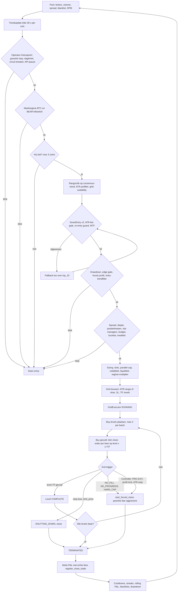

# Tradingstrategie — Multi Coin Grid Pro (geïmplementeerde werkelijkheid)

| | |
|---|---|
| Repository / branch | `/home/mo/repos/hummingbot` / `branch_20251109` |
| Code-stand | Bijgewerkt op HEAD `4d4728604` (2026-11-02), gelijk aan `origin/branch_20251109`. Hoofdstuk 1–6 en 8–11 zijn opgesteld op `7d1d060d4`; regelnummers (`≈L…`) komen uit die stand (controller sindsdien ca. +330 regels) en zijn alleen als functienaam leidend |
| Onderhoud | Permanent onderhouden document. Elke wijziging die tradinggedrag, risicobeheer, fees, P&L of strategie-YAML raakt, werkt dit bestand in dezelfde wijziging bij (regel in `.github/copilot-instructions.md`, check in `.github/scripts/check_trading_strategy_docs.py`). Wijzigingen staan onderaan onder `Strategiewijzigingen` |
| Doel van dit document | Feitelijke beschrijving van wat de code en configuratie nu doen, voor onafhankelijke review |
| Wat dit document niet is | Geen verbetervoorstellen, geen nieuwe strategie, geen winstclaims |
| Methode | Code gelezen (controller, executor, risicomodules), effectieve configuratie berekend door de drie YAML's in de Pydantic-modellen te laden (alleen lezen, geen bot gestart), executor-configs gevalideerd in de SQLite-databases (`Executors.config`, sinds 2026-10-18) |

## 0. Leeswijzer

### 0.1 Statuslabels

| Label | Betekenis |
|---|---|
| ENABLED | Actief en kan een beslissing blokkeren, sturen of uitvoeren |
| DISABLED | Uitgeschakeld in de effectieve configuratie |
| SHADOW | Berekent en logt, maar beïnvloedt geen beslissing |
| UNKNOWN / ONBEKEND | Niet vastgesteld met de beschikbare bronnen (zie hoofdstuk 12) |
| AFGELEID | Uit code en configuratie afgeleid, niet runtime-gemeten |
| GEVERIFIEERD (DB) | Bevestigd in `Executors.config` of andere databasedata |

### 0.2 Afkortingen en bronnen

| Code | Bot | YAML (bron van alle `U`/`B`/`O`-waarden) | Model | Status bot |
|---|---|---|---|---|
| U | Kraken USD | `multi_coin_grid_pro/config/spot_grid_kraken_usd.yaml` | `MultiCoinGridConfig` | Recent actief (laatste executor 2026-11-01 05:06 UTC, 610 executors totaal) |
| B | Bitget Spot (USDT) | `multi_coin_grid_pro/spot_bitget/config/spot_grid_bitget.yaml` | `SpotGridBitgetConfig` | Recent actief (laatste executor 2026-10-30 16:11 UTC, 1108 executors totaal) |
| O | OKX Spot (USDC) | `multi_coin_grid_pro/spot_okx/config/spot_grid_okx.yaml` | `SpotGridOKXConfig` | Inactief (laatste executor 2026-08-22 16:45 UTC, 35 executors totaal) |

Kraken EUR is inactief (laatste executor 2026-02-05) en wordt niet behandeld. Bij controle op 2026-11-01 (na 23:20) draaide geen botproces; alleen `momentum_signal_service` was actief. Of dit tijdelijk is, is `ONBEKEND`.

Alle regelnummers verwijzen naar de bestanden op HEAD en zijn indicatief (±20 regels bij latere bewerkingen).

- `CTRL` = `multi_coin_grid_pro/controllers/multi_coin_grid_controller.py`
- `CFG` = `multi_coin_grid_pro/controllers/multi_coin_grid_config.py`
- `EXE` = `hummingbot/strategy_v2/executors/grid_executor/grid_executor.py`
- `TC` = `multi_coin_grid_pro/utils/trend_calculator.py`
- `SE` = `multi_coin_grid_pro/logic/smart_entry.py`

### 0.3 Eenheden (cruciaal voor lezen van YAML)

De YAML's mengen fracties (`0.02` = 2%) en percentages (`2.0` = 2%). Per veld is in dit document de eenheid benoemd zoals de code het leest, niet zoals de YAML-opmerking het bedoelt. Afwijkingen staan in hoofdstuk 12.2. Uitzondering: `max_exposure_per_coin_pct` en `max_total_exposure_pct` worden sinds `855a1871b` bij het laden genormaliseerd naar fracties (7.1).

### 0.4 Implementatiestatus

| Status | Betekenis | Nu |
|---|---|---|
| GECOMMIT | In `HEAD` en gepusht naar `origin/branch_20251109`; alles in dit document is gecommit tenzij anders vermeld | HEAD `4d4728604` |
| LOKAAL | Alleen in de werkmap, nog niet gecommit | Alleen documentatie, onderhoudsregel en doc-check (`.github/`); geen tradinggedrag |
| ONDERZOCHT | Beoordeeld maar niet geïmplementeerd; staat in 7.8 en 12.4 | Zie 7.8 en 12.4 |

Gecommit betekent niet dat een draaiend proces de wijziging bevat: een herstart door de operator is nodig en het procesgebruik is niet geverifieerd (12.4).

---

## 1. Strategieoverzicht

### 1.1 Wat de bot werkelijk doet

Long-only spot-strategie op één exchange per bot. Per cyclus:

1. Een pool van liquide `…-QUOTE`-paren wordt gemonitord (hoofdstuk 2).
2. Elke 30 s wordt per coin een trendscore bijgewerkt uit prijs-ticks en 5-minutencandles.
3. Alleen coins met een positieve consensus-trend en een reeks filters (hoofdstuk 3) komen in aanmerking.
4. Voor de gekozen coin wordt een `GridExecutor` aangemaakt met uitsluitend BUY-kant (limit-buys onder en rond de huidige prijs). Elke gevulde buy-level krijgt een eigen limit-sell op `level_prijs × (1 + TP)` (hoofdstukken 4 en 5).
5. De executor sluit door per-level take-profit, of door een van de stop-/timeout-/risicoroutes (hoofdstuk 6).
6. Het resultaat gaat naar risicomodules die cooldowns, pauzes en blacklists sturen (hoofdstukken 7 en 8).

Het is dus een **trendgeselecteerde coin met een mean-reversion-grid erin**. Er is geen short-kant, geen margin en geen futures in dit pad. Alle drie de bots gebruiken dezelfde controller (`CTRL`) en dezelfde executor (`EXE`); verschillen zitten in YAML, exchange-specifieke configklassen en enkele connector-checks in code (o.a. `_fees_in_base_token`, CTRL ≈L10478, alleen `True` voor Bitget).

### 1.2 Entry-model in één zin

Een nieuwe grid wordt alleen gemaakt als er een vrij slot is, de coin de rangschikking op consensus-trend haalt, alle ENABLED gates (hoofdstuk 3) slagen en risico-, budget- en sizinglagen een geldige positie-omvang opleveren.

### 1.3 Exit-model in één zin

Normaal sluit elke buy-level via zijn eigen limit-sell; een grid wordt vroegtijdig beëindigd door stop-loss, timeouts (no-fill, no-progress, hard cap), controller-exits (PRO EXIT, profit lock, ATR-stop) of handmatige/graceful stop.

### 1.4 Gedeeld versus verschillend

| Onderdeel | Gedeeld (`CTRL`/`EXE`) | Per exchange (YAML/connector) |
|---|---|---|
| Pad coin → gates → executor | Ja | Drempels en enabled-vlaggen |
| Grid-opbouw en executor-levenscyclus | Ja | Aantal grids, ranges, TP/SL-waarden |
| Fee-gebruik in P&L | Echte fills | Fee-aannames in gates (`fee_aware_filter`) |
| Base-token fee (buy-fee in basisvaluta) | Code in `EXE` | Alleen Bitget (`_fees_in_base_token`) |
| Momentum-sleeve | Gedeelde module | U: paper, B: detect_only, O: paper (geen echte orders) |

---

## 2. Coin-selectie

### 2.1 Pool-opbouw (welke coins worden gemonitord)

| Stap | Functie / bron | Regel | Werking |
|---|---|---|---|
| Initiële discovery | `update_processed_data` (CTRL ≈L3440–3600) | – | Alle paren met `quote_asset` van de connector; volume/spread uit tickers; filter op blacklist en volumedrempel |
| Tickerbron | `_get_ticker_data_safe` (CTRL ≈L1634) | – | Kraken-formaat; Bitget heeft een eigen tickerfetcher (`_get_bitget_ticker_data`); OKX: `ONBEKEND` |
| Periodieke refresh | `_refresh_coin_pool` (CTRL ≈L3852) → `_update_monitored_coins_from_pool` (≈L3922) | – | Sorteert kandidaten op 24u-volume (aflopend), spreadlimiet vast **0,5%** (`spread_limit = 0.005`, hard-coded), neemt top `max_coins_to_monitor` (30). Coins met actieve positie blijven altijd. |
| Volumedrempel pool | `min_24h_volume_usdt` indien aanwezig, anders `min_24h_volume_eur` (CTRL ≈L3938) | – | U: 500 000 (`min_24h_volume_eur`, YAML-alias `min_24h_volume_quote`). B en O: 1 000 000 (schema-veld `min_24h_volume_usdt`, `spot_bitget/config_schema.py:33`, `spot_okx/config_schema.py:33`) |
| Rotatie | `_rotate_underperforming_coins` (CTRL ≈L4052) | – | Vervangt coins zonder trades na `rotation_threshold` updates door volumekandidaten; actieve coins nooit |
| Dynamic Pair Manager (DPM) | `_run_dynamic_pair_scan` (CTRL ≈L7979), `DynamicPairManager` (`utils/dynamic_pair_manager.py`) | – | `use_dynamic_pair_discovery` en `use_dynamic_pair_manager` zijn effectief `true` (alle drie). Voegt toe, verwijdert nooit: `monitored_coins = huidig ∪ DPM-selectie ∪ actieve coins` (CTRL ≈L8018). DPM-composite-score 0,4 / 0,4 / 0,2 (componenten niet verder getraceerd). Volumedrempel DPM = `min_24h_volume_eur` (CTRL ≈L1978): U 500 000, B 2 000 000, O 1 000 000 |
| Handmatige lijst | `manual_trading_pairs` | – | Effectief leeg (alle drie) |
| Blacklist | `get_effective_blacklist(connector)` | – | Config-blacklist (U 54, B 41, O 6 coins) + `auto_blacklisted_coins` + sessieblacklist + persistente NL-restrictielijst (`conf/nl_restricted_{connector}.json`) |

Gevolg voor Bitget (AFGELEID): het YAML-veld `min_24h_volume_quote: 2000000` (YAML-regel 198, opmerking "TUNED 2026-04-03: 500k→2M") is alias voor `min_24h_volume_eur`. Dat veld wordt alleen door de DPM gebruikt. De pool-refresh en `CoinSelector` lezen `min_24h_volume_usdt` (schemadefault 1 000 000). Voor de refreshpad is de effectieve Bitget-vloer dus 1 000 000, niet 2 000 000.

Overige intervals (`coin_discovery_refresh_interval_seconds`, `pair_scan_interval_seconds`, `pool_membership_cooldown_seconds`): effectieve waarde niet vastgelegd, `ONBEKEND` (codedefault DPM-scan: 300 s).

### 2.2 Trendberekening per coin

`TrendCalculator` (`TC`) werkt elke `price_update_interval` = **30 s** (alle drie) bij (CTRL ≈L3724 → `_update_coin_trend_with_price`, TC ≈L865).

| Grootheid | Definitie (code) | Eenheid |
|---|---|---|
| `price_history` | Eén tick-snapshot per update, max 1500 entries (`MAX_PRICE_HISTORY`); `has_sufficient_data` = ≥ 20 punten | – |
| `consensus_trend_pct` (TC ≈L2208) | `0,40·EMA(30 vs 60 ticks) + 0,40·lineaire-regressieslope·n + 0,15·(trend/volatiliteit, dimensieloos) + 0,05·ruwe trend` | percent |
| `trend_score` (multi-timeframe) | `0,2·trend_60m + 0,4·trend_240m + 0,4·trend_1440m`; tijdens warmup (bot-uptime < min(lange lookback, `warmup_max_minutes` = 120)) wordt `trend_1440m = (trend_240m + trend_60m)/2` en `long_trend_warmup = True` | percent |
| `volatility` | Standaarddeviatie van tick-op-tick procentuele veranderingen | percent |
| `atr_pct` (selectie) | 5m-candle ATR14 / prijs, alleen bijgewerkt als `atr_coin_selection` actief is | percent |

Opmerking (AFGELEID): de term `trend/volatiliteit` is dimensieloos en kan veel groter zijn dan de procenttermen; met gewicht 0,15 kan die term de rangschikking domineren. Niet runtime-gemeten.

### 2.3 Rangschikking en kandidaatselectie

`get_top_n_coins` (TC ≈L1530), aangeroepen vanuit `determine_executor_actions`:

1. Uitsluitingen: coins met actieve executor, auto-/config-/sessieblacklist, exit-cooldown (`risk_manager.coins_in_exit_cooldown`), insufficient-balance-cooldown.
2. Voorfilters: ≥ 20 prijspunten; orderboek-diepte (modus `live`, een onbekende diepte blokkeert hier niet); ATR-softprefilter (`atr_pct ≥ required_atr_pct × prefilter_ratio`, ratio 0,5 effectief) indien `atr_coin_selection` enabled (U en B: ENABLED, O: DISABLED).
3. Drempel: `consensus_trend_pct ≥ trend_min_change_pct`. **Eenheid: percent.** U: 0,007 (= 0,007%), B en O: 0,0015 (= 0,0015%). In de praktijk dus vrijwel "elke positieve consensus". De YAML-opmerking bij B en O ("0,15%") klopt niet met de code-eenheid.
4. Rangschikking: aflopend op `consensus_trend_pct`; als `atr_coin_selection.use_as_ranking_signal` aan staat (U en B): `0,70·min(|trend|,20)/20 + 0,30·min(atr/required,2)/2`.
5. Het aantal kandidaten is `slots × grid_suitability_candidate_multiplier` (3) als de grid-suitability scorer actief is (zie 2.4), anders de ruwe top-N. `GridSuitabilityScorer` wordt **niet** aan `get_top_n_coins` meegegeven; de rangschikking zelf is dus niet op grid-geschiktheid gebaseerd.
6. De fallback-lijst `_debug_info['top_10']` bevat alle coins met voldoende data, ook onder de trenddrempel, gesorteerd op trend. Na een afwijzing door SmartEntry of MTF itereert de fallback-lus over `top_10[1:]`; coins onder `trend_min_change_pct` kunnen zo toch geselecteerd worden, waarna alleen nog de MTF-condities (gates 16–17) en de overige gates gelden.

### 2.4 Grid-suitability (ACTIVE)

`GridSuitabilityScorer.filter_coins` (`utils/grid_suitability_scorer.py`; aangeroepen CTRL ≈L4518). Effectief `enabled = true`, `logging_only = false` (alle drie): het filter selecteert actief. Minimale `min_grid_score`: U 0,5, B 0,5, O 0,4; lookback 48 candles. Scorecomponenten niet in dit document uitgewerkt, `ONBEKEND` (niet getraceerd).

### 2.5 Monitoring-timeout en blacklist

`max_coin_monitoring_seconds` = 600 (effectief, alle drie; codedefault 60). Een beste coin die langer dan dat zonder uitvoering de beste blijft, komt op de sessieblacklist voor `session_blacklist_duration_seconds` = 7200 s.

---

## 3. Entry-beslissing

### 3.1 Volgorde en vorm

`determine_executor_actions` (CTRL L4154–6058) draait elke controllertick. Hieronder staat de verifieerde volgorde. "Fail" geeft aan hoe de gate zich gedraagt bij een uitzondering.

Drempels per exchange: **U / B / O**. Eenheden: P = percent, F = fractie.

### 3.2 Gate-tabel (in uitvoervolgorde)

| # | Gate | Functie (regel) | Input | Actieve drempel U / B / O | Status U / B / O | Fail |
|---|---|---|---|---|---|---|
| 1 | Risicostatus synchroniseren | `_sync_risk_state` (≈L4163) | Risk-manager state | – | ENABLED | – |
| 2 | Controller-exitsignalen | `_check_professional_exit_signals` (≈L4169) | Actieve coins | zie hoofdstuk 6 | ENABLED | – |
| 3 | Graceful stop | CTRL ≈L4174 | Runtime-vlag (operator) | – | ENABLED | – |
| 3a | Restartveiligheid (GECOMMIT `4d4728604`) | `_startup_exposure_gate` | Vergrendeld quote en inventory zonder executor in deze run | Blokkeert entries tot niets onverklaards meer staat of de operator het bevestigt (`startup_reconcile_*`); zie 7.8 | ENABLED (alle; `startup_reconcile_enabled` default true) | Fail-closed |
| 3b | Live risicoreferentie (GECOMMIT `4d4728604`) | `_ensure_risk_reference` | Totaal quote bij start, geen executors, geen onverklaarde exposure | Alleen actief als `risk_reference_use_live_balance`; referentie = min(plafond, live equity) | DISABLED (alle bots; operatorbeslissing) | Fail-closed |
| 4 | Time-based filter | `TimeBasedFilter` (CTRL ≈L4191; `filters/time_based_filter.py` ≈L115/146) | UTC-uur, weekdag | B: lage-liquiditeitsuren [17,18,19,21], hoge [13..16], weekendmult 1,0. Multipliers per uur: `ONBEKEND` | U DISABLED / B ENABLED / O DISABLED | – |
| 5 | Daglimiet verlies | `GlobalRiskManager` (≈L4202) | Daily loss % van `risk_reference_balance` | 3 (P) van referentie: U 300, B **50 000**, O 150 | ENABLED | – |
| 6 | Circuit breaker | CTRL ≈L4223 | Prijsrange actieve coin | ≥ 5% in 60 s (hard-coded) → alleen handmatig hervatten | ENABLED | – |
| 7 | API-error pauze | CTRL ≈L4241 | Opeenvolgende API-fouten | 10 achtereen (pauze), 100 totaal (permanent) | ENABLED | – |
| 8 | Marktregime (BTC) | `market_regime` (CTRL ≈L4275) | BTC 1u/4u/24u, altcoin-breadth | 1u ≥ −2; 4u ≥ **0,0 / −1,5 / −1,5**; 24u ≥ −5; dump −5% → 60 min pauze; breadth ≥ 30% (alle P) | ENABLED (alle) | `ONBEKEND` |
| 9 | BEAR-killswitch | CTRL ≈L4285 | `_last_detected_regime`, regime-score | Blokkeert in BEAR tenzij `bear_allow_meanrev` (effectief **false** alle drie) of BEAR-light (`bear_auto_light`, score > −5,0) | ENABLED | – |
| 10 | Insufficient-balance cooldown | CTRL `__init__` | Eerdere "insufficient funds" | 1800 s (hard-coded) | ENABLED | – |
| 11 | Slotcheck | `_get_current_max_slots` (≈L1392) | Dynamische slots − actieve coins | Max slots U 3 / B 12 / O 12, begrensd door `max_simultaneous_coins` = 3; regime-multipliers BULL 1,5 / CHOP 0,75 / BEAR 0,25 | ENABLED | Bij 0 vrij: SLOT_FULL-denial |
| 12 | Coin-ranking | `get_top_n_coins` (TC ≈L1530) | Trend/ATR/diepte | `trend_min_change_pct` (P): 0,007 / 0,0015 / 0,0015 | ENABLED | – |
| 13 | Grid-suitability | `filter_coins` (≈L4518) | 48 candles | min score 0,5 / 0,5 / 0,4 | ENABLED (logging_only=false) | – |
| 14 | BEAR-light divergentie | CTRL ≈L4300 e.v. | Coin vs BTC 24u | Grootte × 0,5 (`bear_size_multiplier`) | ENABLED | – |
| 15 | SmartEntry (v2) | `_check_smart_entry_filter` (≈L8893) → `_check_smart_entry_v2` (≈L9381) | 5m-candles (≥ 14), orderboek | zie 3.3 | ENABLED | **Fail-closed** |
| 16 | Multi-timeframe buy | `_check_multi_timeframe_buy` (≈L9607) | 1u/4u/24u trend uit ≥ 288 candles | `use_multi_timeframe_buy` = true. 1u ≥ −2,0/−3,0/−3,0; 4u ≥ −1,5/−2,5/−2,5; 24u ≥ −2,5 (alle); crash-reject als 1u < −4,0 én 4u < −2,0 (P) | ENABLED | Fail-closed (False) |
| 17 | MTF-condities | `_check_multi_timeframe_buy_conditions` (≈L11600) | `validate_trend`, trendstrength | zie 3.4 | ENABLED | **Fail-open** (True bij exception) |
| 18 | Monitoring-timeout | CTRL ≈L4800 e.v. | Tijd als beste coin | 600 s → sessieblacklist 7200 s | ENABLED | – |
| 19 | PRO EXIT op actieve coin | `should_exit_position` (≈L11871) | Zie hoofdstuk 6 | – | ENABLED | – |
| 20 | Idle-mode | CTRL ≈L5041 (ST-11) | Geen beste coin | Pauzeert zoeken; sluit niets af | ENABLED | – |
| 21 | Risk-blok nieuwe entries | `_risk_block_new_entries` | Eerdere blokkade | – | ENABLED | – |
| 22 | Drawdown-tracker | `DrawdownTracker.check_drawdown_limits` (≈L5092) | Portfoliowaarde (`_calculate_drawdown_portfolio`) | dag/week/maand (P): 3/7/10 / 3/8/12 / 3/8/12 | ENABLED | **Fail-closed** |
| 23 | Economic edge gate (ST-12) | CTRL ≈L5112 | ATR14 (5m), range, fee-model | `min_edge_pct` (P): 0,10 / 0,08 / 0,15; `include_spread_cost` false; slippagebuffer 0,05 / 0,03 / 0,02 (P); minimale level-spacing 0,8 / 0,75 / 0,6 (P) | ENABLED | **Fail-open** |
| 24 | Verwachte uurwinst (V2-04) | CTRL ≈L5212 (`FeeAwareFilter.estimate_hourly_profit`) | Spread, fills/uur | Blokkeert als `not passed`; formule en blokkeerdrempel niet getraceerd: `ONBEKEND`. Configvlag `hourly_profit_check_enabled`: false / false / true | ENABLED (uitvoering); blokkerend gedrag `ONBEKEND` | Fail-open |
| 25 | Entry trend filter | `_check_entry_trend_filter` (≈L8064) | `trend_score` | `min_entry_trend_score` (P): – / **1,5** / – | DISABLED / ENABLED / DISABLED | – |
| 26 | Nieuwe-grid-check | `_should_create_new_grid` (≈L8105) | Startup, budget, risk | Startupwacht `min_startup_wait_seconds` = 60; budget ≥ `num_grids × min_order_amount_quote`; `risk_manager.can_open_trade` | ENABLED | – |
| 27 | Spread | `_check_spread_acceptable` (≈L10138) | Live bid/ask | `max_entry_spread_pct` (P): 0,5 / 0,5 / 0,35 (SmartEntry-spread); CTRL-fallback 0,5 | ENABLED | Fail-closed |
| 28 | Orderboekdiepte | `_check_order_book_depth` (≈L10257) | Orderboek | `orderbook_liquidity`: modus live, 0,5% range, 10 niveaus, 5× ordergrootte | ENABLED | Fail-closed |
| 29 | Positielimieten (GECOMMIT `855a1871b`, `4d4728604`) | `_check_position_limits` aangeroepen vanuit `_create_grid_action` op het exacte executorbedrag; `RiskGuardV2` | Exposure vs `risk_reference_balance` | `max_exposure_per_coin_pct` 55 / 50 / 50 en `max_total_exposure_pct` 95 / 70 / 70 (YAML-percent) worden bij het laden genormaliseerd naar fracties (0,55/0,95; 0,50/0,70); geen eerste-positie-bypass | ENABLED (bindend; op Bitget t.o.v. referentie 50 000 zolang de live referentie uit staat, zie 7.1) | **Fail-closed** |
| 30 | Kapitaal-allocatie en sizing | zie 5.1 | Saldo, volatiliteit | zie 5.1 | ENABLED | – |
| 31 | `ProfessionalRiskManager.can_open_new_position` | `risk/professional_risk_manager.py`, via `_professional_risk_allows` | Rolling P&L, win rate, posities, dagverlies / risico-equity | zie 7.3 | ENABLED | **Fail-closed** bij onbekende equity (GECOMMIT `4d4728604`) |
| 32 | Dagelijkse coin-killswitch | CTRL ≈L5673 | Dag-P&L per coin in R | Uitgeschakeld bij < −2R, helft bij < −1R; `r_unit_quote` = 5,0 | ENABLED | – |
| 33 | Session edge detector | CTRL ≈L5706 | Sessie | Details `ONBEKEND` | ENABLED | `ONBEKEND` |
| 34 | Entry gateway | `core/entry_gateway.py` (CTRL ≈L5746) | `GlobalRiskManager.can_open_trade` | zie 7.2 | ENABLED | – |
| 35 | Risk-bucket check | `core/risk_buckets.py` (CTRL ≈L5762) | Bucketexposure | zie 7.4 | ENABLED | `ONBEKEND` voor BLOCKED-bucket |
| 36 | Kwaliteitsscore en sizing | `scoring/trade_quality_scorer.py` (CTRL ≈L5786) | Kwaliteitsfactoren | Multiplier op positiegrootte; details `ONBEKEND` | ENABLED | – |
| 37 | Budget | `BudgetAllocator.check_budget` | Saldo | fee-buffer 0,2%, quote-reserve 5% | ENABLED | – |
| 38 | Re-entry price guard | `_check_reentry_price_guard` (≈L10598), aangeroepen via SmartEntry | Prijs vs laatste exit | Max 0,5% onder laatste exitprijs; types TP/SL/EARLY_STOP | ENABLED (alle) | – |
| 39 | ATR-fee gate (US13) | `_check_atr_fee_gate` (≈L10554), aangeroepen via SmartEntry v2 | 5m ATR14 % | `ATR% ≥ (maker+taker)·100 × 2,0` (model "average") | ENABLED / ENABLED / DISABLED | – |

Het secundaire-coins-pad (extra grids op andere coins) herhaalt gates 15–17, 25–29 voor die coin.

### 3.3 SmartEntry v2 (gate 15), volgorde binnen `allows_entry` (`SE` ≈L534)

Voorafgaand in `_check_smart_entry_filter`: orderboek-subscriptie, pair-health quarantaine (`auto_quarantine`: drempel 10, venster 120, duur 900 — alle ENABLED), staleness guard (prijs maximaal 35 000 ms, orderboek 60 000 ms), re-entry price guard (gate 38) en daarna ATR-fee gate (gate 39).

| Stap | Controle | U / B / O | Status |
|---|---|---|---|
| 0 | Spread (`slippage_check_enabled`) | `max_entry_spread_pct` 0,5 / 0,5 / 0,35 (P) | ENABLED |
| 0B | Diepte (`depth_check_enabled`, `min_depth_multiplier` 5); **fail-closed** zonder orderboek | 5× | ENABLED |
| 1 | RSI | `rsi_block_min` 85 / 85 / 93; `rsi_buy_max` 65 / 65 / 80; `rsi_extreme_low` 18 / 15 / 12 | ENABLED |
| 2 | VWAP-afwijking | `|dev| ≤ vwap_max_deviation_pct` (12; coinprofiel kan afwijken) | ENABLED |
| 3 | Wick-ratio | `min_wick_ratio` = 0,0 (inactief) | DISABLED (waarde 0) |
| 4 | ATR% min / max | min 0,15 / 0,15 / 0,06; max 7 (P) | ENABLED |
| 5 | 5m-spike | `|Δ| ≤ max_5m_spike_pct` 4,0 (P) | ENABLED |
| 6 | Acceleratie (1u − 4u trend) | ≥ −6,0 en ≤ 5,0 (P) | ENABLED |
| 6b | `trend_4h ≤ max_trend_4h_pct` | 2,5 (P) | ENABLED |
| 6c | VWAP-slope guard | `shadow_mode`: false / true / true | **ENABLED (U) / SHADOW (B, O)** |
| 6d | Parabolic detector (cooldown 60 min, persistent) | `shadow_mode`: false / true / true | **ENABLED (U) / SHADOW (B, O)** |
| 7 | `trend_24h` binnen [−10, 15] | – | ENABLED |
| – | `market_exhaustion_enabled` (drempel 0,7, sample 10, cooldown 30 min) | – | Effectief gebruik `ONBEKEND` (niet getraceerd) |

Per-coin `coin_profiles` (U 50, B 90, O 21 profielen) kunnen drempels overschrijven; een adaptieve regime-resolver (RE-01) mag YAML-limieten niet verruimen. De waarden van individuele profielen zijn niet in dit document opgenomen.

Indicatoren komen uit 5m-candles (`CandleIndicatorsCalculator`). SmartEntry-uitzondering → entry geweigerd (fail-closed).

### 3.4 MTF-condities (gate 17) in detail

`_check_multi_timeframe_buy_conditions` (CTRL ≈L11600), alle drie `use_multi_timeframe = true`.

| Fase | Controle | Waarde |
|---|---|---|
| 1 | `trend_calculator.validate_trend` (360 candles, `MIN_TREND_THRESHOLD` ±0,5%) | – |
| 2 | Trend niet ouder dan 3 × `price_update_interval` (90 s) | – |
| 3 | `trend_strength ≥ trend_min_entry_strength` (−0,001 epsilon). **Eenheid: fractie.** U 0,007 (= 0,7%), B en O 0,0015 (= 0,15%) | zie 12.2 |
| 4 | Downtrend-gate: 1u ≥ −1,0, 4u ≥ −0,75, 24u ≥ −0,5 (P) | `downtrend_gate_enabled` true |
| 5 | Bevestiging: aantal timeframes > 0 ≥ `trend_confirmation_timeframes` (1), tenzij `trend_strength ≥ 0,02` | – |
| 6 | Warmup-modus: `warmup_4h_strong_min` U −0,5 / B −2,5 / O −2,5; `warmup_1h_min_if_4h_strong` U −1,5 / B −3,0 / O −3,0 | – |
| 7 | Normaal: 24u > `mtf_24h_min_pct`, 4u > `mtf_4h_min_pct`, 1u ≥ `mtf_1h_min_pct`; declining-reject volgens `mtf_declining_*` | waarden in gate 16 |

Afwijking docstring ↔ code: de docstring noemt vaste drempels (24u > +1%, 4u > +1%, 1u ≥ 0); de code gebruikt de configdrempels. De afwijsreden-teksten in `determine_executor_actions` (≈L4668–4690) noemen hard-coded "≤ +1%"; dat is alleen logtekst.

### 3.5 Entry-trendfilter (gate 25)

Alleen Bitget: `entry_trend_filter.enabled = true`, `min_entry_trend_score` = 1,5 (P, op de composiet `trend_score`). U en O: niet ingesteld (DISABLED).

### 3.6 Per-coin validatie vóór order

Spread- en diepte-checks (gates 27–28), `_is_trading_pair_tradeable` en klaar-zijn van het orderboek gelden direct voor het aanmaken. Orderniveaus worden daarna in de executor tegen `min_notional` en `min_order_amount_quote` getoetst (4.4).

---

## 4. Grid-constructie

### 4.1 Prijsrange (`_create_grid_action`, CTRL ≈L10653–11272)

| Stap | Regel |
|---|---|
| ATR-range | `use_atr_grid_ranges = true` (alle): `start = prijs − ATR × atr_multiplier_down` (1,5), `end = prijs + ATR × atr_multiplier_up` (2,0). Fallback: vaste `grid_range_pct_down/up` (U 4,0/12,0; B 2,0/5,0; O 2,0/5,0 — P) |
| ATR-bron range | `_calculate_atr` (≈L8809): gemiddelde van de laatste 14 **tick-op-tick** true ranges uit `price_history` (30 s-ticks). Dit is **niet** de 5m-candle-ATR die SmartEntry en de edge gate gebruiken |
| Asymmetrie | `use_asymmetric_grids = true`: consensus-trend > +1 → `end` +20% van `(end − prijs)`; < −1 → `start` −20% van `(prijs − start)` |
| Aantal grids | `_calculate_volatility_based_grid_count` (≈L9875), begrensd door `dynamic_grid_sizer` (min/max U 3/5; B 5/10; O 5/10) en `_dynamic_num_grids`; config-`num_grids` U 3 / B 7 / O 7. Wordt verlaagd tot `bedrag_per_level ≥ min_order_amount_quote` (U 15, B 10, O 10); onder dat totaal wordt geweigerd |
| **Minimale range (vloer)** | `min_spread_per_level_pct = taker + maker + min_net_profit` (fee-aware config). U: 0,3+0,3+0,3 = **0,9**; B: 0,2+0,1+0,2 = **0,5**; O: 0,2+0,1+0,4 = **0,7** (alle P). `min_range = max(1,0; (n−1) × min_spread_per_level; min_grid_level_spacing × (n−1))`. Is de range kleiner, dan wordt symmetrisch rond de prijs uitgebreid |
| Prijs buiten range | `start = prijs × 0,995`, `end = prijs × 1,005` |
| `limit_price` (grid-stop) | `start × 0,95` |

Gevolg (GEVERIFIEERD (DB), Executors sinds 2026-10-18; Bitget N = 13, Kraken USD N = 16): de range wordt in de praktijk bepaald door de vloer `(n−1) × min_spread`, niet door ATR. Geobserveerde `range_pct` Bitget mediaan 3,05% (3,05–3,82), Kraken USD mediaan 2,36% (1,82–6,33). `min_spread_between_orders`: B 0,005 (0,5%), U 0,009 (0,9%).

### 4.2 Executor-configuratie die de controller aanmaakt

Bron: `GridExecutorConfig` in `_create_grid_action`; waarden gevalideerd in `Executors.config`.

| Veld | U | B | O | Opmerking |
|---|---|---|---|---|
| `side` | BUY | BUY | BUY | Spot long-only |
| `max_open_orders` | 3 | 2–6 (mediaan 3) | `ONBEKEND` (geen recente executors) | `max(1, min(config, num_grids))`; config U 20 / B 100 / O 100 |
| `max_orders_per_batch` | 2 | 2 | 2 | – |
| `order_frequency` | 3 s | 3 s | 3 s | – |
| `safe_extra_spread` | 0,0001 | 0,0001 | – | – |
| Open-ordertype | LIMIT_MAKER (`use_post_only_orders` true) | LIMIT (post-only false; Bitget-`ORDER_TYPES` heeft geen LIMIT_MAKER) | LIMIT_MAKER (post-only true) | GEVERIFIEERD (DB) voor U en B |
| `deduct_base_fees` | false | **true** | false | `_fees_in_base_token` (CTRL ≈L10478) |
| `limit_price` | `start × 0,95` | idem | idem | – |
| `total_amount_quote` per executor | ≈ 49–65 USD | mediaan 37,6 (28,7–158,9) USDT | – | GEVERIFIEERD (DB) |
| `min_order_amount_quote` | 15 | 10 | 10 | – |
| `activation_bounds` | 6,25–7,5% | 6,25–7,5% | – | Gelijk aan opgeslagen TP (zie 4.3) |
| `time_limit` | niet gezet | niet gezet | niet gezet | Timeouts via `custom_info` (hoofdstuk 6) |

### 4.3 Take-profit en stop-loss zoals de executor ze ontvangt

| Onderdeel | Berekening | Effectieve waarde |
|---|---|---|
| Basis-TP | `take_profit_pct` = 0,05 (F) | Alle drie |
| Dynamische TP (controller) | `use_dynamic_take_profit`: U true, B true, **O false**. Trend > 2 ×1,5; > 1 ×1,25; > 0 ×1,0; > −1 ×0,85; anders ×0,70; geklemd op `[min_take_profit_pct, max_take_profit_pct]` | Opgeslagen TP in DB 0,0625–0,075 (F) = 5% × 1,25 of 1,5 (GEVERIFIEERD (DB), U en B). Config `max_take_profit_pct` 0,08 |
| **Per-level TP in de executor** | Als `custom_info.dynamic_tp_enabled` en `atr_pct > 0`: `tp = clamp(atr_pct × dynamic_tp_atr_multiplier, dynamic_tp_min_pct, dynamic_tp_max_pct)`, daarna `max(step, tp)` (EXE `_generate_grid_levels` ≈L568) | `dynamic_tp_enabled` = true, multiplier 0,6. **U: 1,2% (min = max = 0,012); B: 2% (min = max = 0,02); O: tussen 2% en 4%.** AFGELEID: de controller levert `atr_pct = trend.volatility` (percent-eenheid, bv. 0,37) terwijl de executor een fractie verwacht, waardoor het product de bovenklem raakt |
| Stop-loss | `use_professional_risk_mgmt = true`: `clamp(volatility × atr_stop_multiplier, min_stop_pct, max_stop_pct)` (CTRL ≈L10861; voor Bitget wordt volatiliteit eerst door 100 gedeeld, "Normalize only the Bitget Spot SL input"). Kraken: geen deling, waardoor de klem op `max_stop_pct` valt | **GEVERIFIEERD (DB): alle executors sinds 2026-10-18 hebben `stop_loss = 0,02`** (U en B). Config `stop_loss_pct` (U 0,015, B/O 0,05) is alleen fallback zonder volatiliteitsdata |
| Trailing stop | `trailing_stop_activation_pct` 0,015 / 0,015 / 0,02; `trailing_stop_delta_pct` 0,01 (F) | – |

Stored-TP (6,25–7,5%) stuurt alleen `activation_bounds` en de globale TP-voorwaarde, niet het per-level sell-niveau.

### 4.4 Levelgeneratie (EXE `_generate_grid_levels`, ≈L568)

1. `min_notional = max(min_order_amount_quote, exchange min_notional)` met 5% marge.
2. `n_levels = min(total / min_quote_amount, grid_range / min_step)` met `min_step = max(min_spread_between_orders, tick/prijs)`.
3. Lineaire verdeling `start → end`; gelijke quote-hoeveelheid per level; `step = range/(n−1)`.
4. Level-TP: `max(step, tp)` (bij `coerce_tp_to_step`) of de dynamische TP (4.3).

Levels boven de marktprijs vallen binnen `activation_bounds` en worden door `_get_open_order_candidate` (≈L2817) naar `current_open_quote × (1 − safe_extra_spread)` getrokken: ze worden dus near-market maker-buys. Guardrail B: buyprijs ≤ `mid × (1 − 0,0008)`. BUY-orders buiten `activation_bounds` ten opzichte van mid worden geannuleerd.

---

## 5. Positiemanagement

### 5.1 Kapitaaltoewijzing per nieuwe grid (volgorde)

1. `DynamicSlotManager.calculate_optimal_allocation` (`execution/dynamic_slot_manager.py` ≈L270): bruikbaar kapitaal = `saldo × (1 − 5%)`; minimaal 3 levels × `min_order`; kiest het aantal coins en grids met eerst minimale ordergrootte, dan maximale gridlevels, dan maximale coins. De saldotrappen van `_get_base_slots_from_balance`: `ONBEKEND`. Regime-multipliers BULL 1,5 / CHOP 0,75 / BEAR 0,25.
2. **Parallel-slot-cap** (CTRL ≈L5632): bij meer dan één coin ≤ `0,90 × ruw saldo / max_simultaneous_coins` (3) per slot.
3. Volatiliteitscorrectie `_calculate_volatility_adjusted_position_size` (≈L9951).
4. Liquiditeitscap (`liquidity_aware_sizer`).
5. Tijdgebonden multiplier (Bitget: gate 4) en BEAR-light ×0,5.
6. Kwaliteitsmultiplier (gate 36).
7. Budget (gate 37) en risk-bucket (gate 35).
8. Positielimieten (gate 29) op het uiteindelijke bedrag na alle multipliers, inclusief de kwaliteitsmultiplier tot 1,25×.

`total_amount_quote` in de YAML (U 300 / B 50 000 / O 150) is niet het feitelijk gebruikte kapitaal; allocatie volgt het werkelijke saldo. Bitget-saldo ≈ 1000 USDT is afgeleid uit eerder bekeken UI-cijfers (`AFGELEID`); het exacte saldo is `ONBEKEND`.

### 5.2 Levenscyclus van een executor

| Fase | Wat gebeurt er | Bron |
|---|---|---|
| Aanmaak | Controller geeft `CreateExecutorAction`; `register_open_trade` in risk-manager; exposure-tracking | CTRL `_create_grid_action` |
| RUNNING | Elke `control_task`: eerst `_check_timeout_triggers` (EXE ≈L800), daarna levels bijwerken, open orders plaatsen/annuleren, close orders plaatsen, triple-barrier | EXE `control_task` ≈L1661 |
| Buy plaatsen | Max 2 per batch, minimaal 3 s tussen batches, alleen als `n_open < max_open_orders` | `get_open_orders_to_create` ≈L3108 |
| Close plaatsen | Na `_balance_sync_delay` (3 s) na buy-fill. **Eén close-order tegelijk** (serialisatie tegen saldo-races); prijs = `level.price × (1 + level.take_profit)` (nominale levelprijs, niet de werkelijke fillprijs); als ≤ huidige ask: `ask × (1 + safe_extra_spread)`. Guardrail A: minimaal `level.price × (1 + fee_buffer(taker+maker) + 0,15%)`. Closebedrag = uitgevoerde basis − base-fee indien `deduct_base_fees` | `get_close_orders_to_create` ≈L3123 |
| Afsluiten | Zie hoofdstuk 6: `SHUTTING_DOWN` → `control_shutdown_process` ≈L2177 → `TERMINATED` | EXE |
| Stof | Restant < `min_order_size` → `TERMINATED` met "closed with dust" | EXE `place_close_order_and_cancel_open_orders` ≈L3393 |

### 5.3 Meerdere coins gelijktijdig

`max_simultaneous_coins = 3` (alle drie). Het controllerpad voor de "active coin" (`self.active_coin` = laatst aangemaakte coin) verschilt van het pad voor secundaire coins: de PRO EXIT-laag (6.2) werkt alleen op `active_coin`.

### 5.4 Rotatie en switch

`min_switch_interval` = 1800 s en `switch_grace_period_seconds` = 600 s gelden voor het wisselen van coin als alle slots vol zijn. "Geen betere coin gevonden" sluit nooit een lopende grid (idle-mode laat bestaande posities ongemoeid). `symbol_switch_cooldown_seconds` = 0 (geen effect).

---

## 6. Exit-strategie

### 6.1 Overzicht van alle exitroutes

| Route | Laag | Trigger | Sluitmechanisme | Fee-guard | Cooldown na exit |
|---|---|---|---|---|---|
| Per-level take-profit | Executor | Close-order op `level × (1+TP)` gevuld | Limit-sell vult | n.v.t. | TP: 15 min (algemene tabel), U: `take_profit_sec` 7200 |
| Globale TP | Executor `take_profit_condition` (≈L3265) | `mid > end_price` én netto-P&L na geschatte sell-fees > 0 én ≥ `max(dynamic_tp_min, min_grid_profit_pct/100, fee_aware_min_net_profit/100)` | Close | Ja (netto > 0) | TP |
| Stop-loss | Executor `stop_loss_condition` (≈L3355) | `position_pnl_pct ≤ −stop_loss` (effectief 2%) | Order-type LIMIT (controller), bij insufficient funds MARKET | **Nee** | STOP_LOSS 4 u; U: 21 600 s |
| Limit-price | Executor `limit_price_condition` | `mid ≤ limit_price` (`start × 0,95`) | Behandeld als STOP_LOSS (of POSITION_HOLD bij `keep_position`) | Nee | STOP_LOSS |
| Time-limit / expiry | Executor `is_expired` | `time_limit` | `TIME_LIMIT` | Ja | – |
| Trailing stop | Executor | Activatie 1,5% (O 2%), delta 1% | Close | Ja | – |
| NO_FILL_TIMEOUT | Executor `_check_timeout_triggers` | Geen enkele fill en leeftijd ≥ `no_fill_timeout_sec` (U 1800, B 3600, O 3600; regime-afhankelijk) | Cancel, `SHUTTING_DOWN` | n.v.t. | – |
| NO_PROGRESS_TIMEOUT | Executor | `since_last_progress ≥ no_progress_timeout_sec` (U 2700, B 3600, O 3600; regime-afhankelijk, zie 7.7; geobserveerd in DB: B 3600–7200, U 5400) en voorwaarden (6.3) | `start_forced_close` | Wisselend | U: 3600 s |
| HARD_CAP_TIME_LIMIT | Executor | Leeftijd ≥ `max_hold_time_sec` (U 5400, B/O 21 600) | `start_forced_close` | **Uitgezonderd** | – |
| Profit lock / ATR-stop / TIME_STOP | Controller `_check_professional_exit_signals` (≈L7536) | Zie 6.2 | `StopExecutorAction` → EARLY_STOP | Ja (EARLY_STOP) | EARLY_STOP: U 10 800 s |
| PRO EXIT | Controller `should_exit_position` (≈L11871) | Zie 6.2 | Stop/emergency | Ja, behalve emergency | zie 6.2 |
| Handmatig / graceful | Operator | Vlag | – | – | – |
| ACCUM_RISK_WATCH | Executor | ≥ 4 buy-orders en leeftijd ≥ 90 min | **Alleen log, geen actie** | – | – |

Standaardcooldowns per exit-type (`core/exit_types.py` `COOLDOWN_SECONDS`): TP 15 min; SMALL_LOSS 60 min; STOP_LOSS 4 u; TREND_EXIT tot einde dag (UTC); UNKNOWN 5 min. Kraken USD overschrijft met `close_cooldowns` (failed 21 600, early_stop 10 800, stop_loss 21 600, no_progress 3 600, take_profit 7 200, streak-multiplier 1,5, `max_streak_before_blacklist` 2). B en O hebben geen `take_profit_sec`. Of het per-exit-type pad of dit overschrijfpad prioriteit heeft in alle code-takken: `ONBEKEND`.

### 6.2 Controller-laag

**a) `_check_professional_exit_signals` (US-005, CTRL ≈L7536)**, per actieve coin:

- `pnl_pct = (trend.current_price − entry_prices[coin]) / entry_prices[coin]`; `entry_prices` is de prijs bij het aanmaken van de grid, **niet** de gemiddelde fillprijs.
- ATR-stop: `clamp(atr_pct × atr_stop_multiplier, min_stop, max_stop)` met `atr_stop_multiplier` U 1,5 / B 2,0 / O 2,0 en min/max U 0,01/0,02, B 0,02/0,05, O 0,02/0,05 (F). `trend.atr_pct` is in percent-eenheid maar wordt als fractie behandeld: het product overschrijdt meestal `max_stop`; is `trend.atr_pct = 0` (bv. O, waar `atr_coin_selection` uit staat), dan valt de stop op `min_stop`. AFGELEID.
- TIME_STOP: leeftijd ≥ 360 min én `pnl < 0` én "stalled" (prijsbeweging < 0,3 × ATR) én geen fills in 45 min.
- PROFIT_LOCK-tiers (piek, terugval, lock) volgens de ProfessionalRiskManager-defaults: (+1%, −0,5%, 0%), (+2%, −1,3%, +0,7%), (+3%, −1,5%, +1,5%); gratieperiode 600 s. De YAML overschrijft deze tiers niet in de effectieve configuratie voor zover vastgesteld; volledige verificatie: `ONBEKEND`.
- Resultaat: `StopExecutorAction` → executor `early_stop` → `start_forced_close` (graceful, daarna aggressive).

**b) PRO EXIT SYSTEM (`should_exit_position`, CTRL ≈L11871; aanroep ≈L4981)**, alleen voor `self.active_coin`, alleen als `use_multi_timeframe`. Volgorde:

1. `max_hold_time_exit` (`risk_manager.max_hold_seconds`; fee-aware voor niet-emergency)
2. `emergency_exit`: prijsverandering t.o.v. `entry_prices[coin]` ≤ `emergency_exit_pct` (P): U −3,0 / B −5,0 / O −5,0
3. `hard_stop_exit`: ≤ `hard_stop_pct` (P): U −5,0 / B −8,0 / O −8,0
4. `grid_profit_exit` (netto gerealiseerd ≥ `min_grid_profit_pct`, P: U 2,5 / B 1,5 / O 1,5) en een "grid profit block" (> 0,3% netto)
5. Trend-exits: 1u < `exit_short` (−4,0) of (4u < `exit_mid` (−3,0) én prijs < −1%), met harde minimale hold (≥ 600 s); `no_loss_exit` (netto ≥ 0 en zwakke trend)

Emergency-redenen leiden tot een emergency-stop plus blacklist.

### 6.3 Executor-laag: prioriteit binnen `control_task`

1. **`_check_timeout_triggers`** (draait eerst bij RUNNING): NO_FILL → NO_PROGRESS → HARD_CAP.
   - NO_PROGRESS bij een **vastgelopen grid** (inventory, 0 open orders, geen effectieve close-orders): geforceerde close, onafhankelijk van P&L (fee-guard omzeild).
   - NO_PROGRESS anders: alleen als onrealiseerd rendement < −`no_progress_min_loss_pct` (0,5%) en (bij `no_progress_atr_multiplier > 0`) de beweging t.o.v. gemiddelde entry > `atr_pct × multiplier` (U 1,5; B 1,5; O 1,0); daarna fee-guard. Bij uitblijven: verlenging tot `no_progress_max_extension_sec` (= 2 × regime-progress), dan geforceerde close (fee-guard actief).
2. **`control_triple_barrier`** (≈L3229), vaste volgorde: stop-loss → limit-price → expiry (fee-aware) → trailing (fee-aware) → globale take-profit.
3. Per-level close-orders blijven onafhankelijk van (1) en (2) liggen; ze worden niet door `activation_bounds` geannuleerd.

### 6.4 Prioriteit van conflicterende exits

Binnen de executor geldt de volgorde van 6.3. Tussen controller en executor is er **geen expliciete globale prioriteit**: beide lagen lopen in aparte lussen, en wie het eerst een stop-/close-actie uitvoert, bepaalt het resultaat (`ONBEKEND` voor het exacte tick-niveau-gedrag). Wel gelden vaste regels:

| Conflict | Uitkomst |
|---|---|
| Stop-loss vs fee-aware guard | Stop-loss en emergency-exits worden nooit door de fee-guard geblokkeerd |
| Fee-guard vs TIME_LIMIT / NO_PROGRESS / TRAILING / EARLY_STOP / SWITCH | Fee-guard blokkeert als prijs < break-even `(gem. entry × omvang + buy-fees) / (omvang × (1 − taker))`, tenzij leeftijd ≥ `fee_aware_timeout_bypass_sec` (U 3600, **B 0 = geen bypass**, O 1800). `HARD_CAP_TIME_LIMIT` is vrijgesteld |
| Graceful close geblokkeerd door fee-guard | De unwind wordt afgebroken en de executor keert terug naar RUNNING |
| Graceful vs aggressive | Na `close_grace_sec` (600 s effectief; custom_info-default 120 s) volgt aggressive (MARKET / IOC-limit); stale close-orders worden na 300 s geannuleerd |
| Controller-PRO-EXIT vs nog openstaande level-sells | Controller gebruikt `entry_prices` (creatieprijs); de executor gebruikt de gemiddelde fillprijs. De twee P&L-referenties kunnen dus verschillen |

### 6.5 Cooldown, blacklist en re-entry na exit

- `GlobalRiskManager.cooldown_for_exit(exit_type)`; per coin; zie 6.1.
- Re-entry price guard (gate 38): geen herentry meer dan 0,5% onder de laatste exitprijs na TP/SL/EARLY_STOP.
- Na stop-loss en herhaalde verliezen: zie 7.5.

---

## 7. Risicobeheer

### 7.1 Exposure-limieten

| Limiet | Waarde (YAML) | Gebruik in code | Effect |
|---|---|---|---|
| `max_exposure_per_coin_pct` | 55 / 50 / 50 (percent) | `exposure_pct_to_fraction` (`core/risk_units.py`) normaliseert bij het laden: (0,1] = fractie, (1,100] = percent, daarbuiten ValueError. `_check_position_limits`: `max_per_coin = risk_reference_balance × fractie` op elke nieuwe positie; `RiskGuardV2` krijgt dezelfde limiet als percent | GECOMMIT `855a1871b`. Bindend: U 165 van 300, O 75 van 150, B 25 000 van 50 000 (Bitget zie hieronder). Voor `855a1871b` werd 55 als fractie gelezen (55× kapitaal) |
| `max_total_exposure_pct` | 95 / 70 / 70 (percent) | idem; `total_exposure − huidig + nieuw` mag het totaal niet overschrijden, ook niet voor de eerste positie | GECOMMIT `855a1871b`; eerste-positie-bypass verwijderd |
| `risk_reference_balance_quote` | 300 / **50 000** / 150 | Basis voor alle %-limieten in `GlobalRiskManager`, `BucketExposureTracker`, `RealtimePnLTracker`/`RiskGuardV2` en `_check_position_limits`. Optioneel (`risk_reference_use_live_balance`, default false) begrensd door live equity bij opstart, zie 7.8 | Bitget: de referentie is nog 50 000 (niet het werkelijke saldo; ≈ 1000 is afgeleid uit UI-cijfers), dus de percentagelimieten zijn daar nog ruim. Operatorbeslissing open |
| Eindbedrag | – | De check staat in `_create_grid_action` (GECOMMIT `4d4728604`) en toetst het bedrag dat in `CreateExecutorAction.total_amount_quote` komt, na kwaliteitsmultiplier (≤ 1,25×) en parallel-slot-cap | Primair en secundair entrypad delen dezelfde bescherming |
| Foutafhandeling | – | `_check_position_limits` retourneert `False` bij exception, ongeldige limiet of referentie ≤ 0 | Fail-closed (voorheen fail-open) |

### 7.2 `GlobalRiskManager` (`core/global_risk_manager.py` ≈L54)

Alle limieten zijn percentages van `risk_reference_balance`. Effectieve `RiskLimits` (alle drie): `max_daily_loss_pct` 3; per-trade-cap U 55% / B 100% / O 100%; totaal open risico U 95% / B 100% / O 100%; `min_hold_seconds` U 2700 / B,O 7200; `max_hold_seconds` U 5400 / B,O 21 600; `exit_cooldown_seconds` 0; `symbol_switch_cooldown_seconds` 0; `consecutive_loss_cooldown_seconds` 3600.

Volgorde in `can_open_trade`: notional > 0 → dagverlies% ≥ limiet → per-coin opeenvolgend-verlies-cooldown → cycle-lock (`max_consecutive_failures` 2 verliezen per coin per dag) → coin vandaag uitgeschakeld (< −2R, `r_unit_quote` 5,0) → per-coin exit-cooldown → globale switch-cooldown → cap per trade → cap totaal open risico. `register_close_trade(pnl, exit_type)` voedt dagverlies en streaks.

### 7.3 `ProfessionalRiskManager` (`risk/professional_risk_manager.py`)

| Onderdeel | Waarde | Status |
|---|---|---|
| Max posities | `max_simultaneous_coins` (3) | ENABLED |
| Dagelijkse verliesgrens | `max_daily_loss_pct` (YAML 3,0 = percent) wordt als `pct_to_fraction` = 0,03 aan de manager gegeven (GECOMMIT `855a1871b`; voorheen 3,0 tegen een fractie, dus dood). Vergelijking: netto gerealiseerde P&L van vandaag (UTC) / risico-equity (`_calculate_risk_equity`, GECOMMIT `4d4728604`) ≤ −0,03 blokkeert. Onbekende equity (saldo ≤ 0, fout, niet gevolgde close-order) blokkeert entries | ENABLED, fail-closed |
| Rolling P&L-pauze | Gemiddeld rendement laatste 20 trades < −2% (`min_rolling_pnl_pct` −0,02) → pauze 120 min; `resume_min_pnl_pct` 0; max 1 verlenging; 30 min immuniteit na force-resume | ENABLED |
| Win-rate | < 35% (`min_win_rate`) in combinatie met rolling P&L | ENABLED |
| Correlatie | `max_correlation` 0,7 | Gebruik `ONBEKEND` (niet getraceerd) |

### 7.4 Risk buckets (`core/risk_buckets.py`)

`BucketExposureTracker(risk_bucket_limits, portfolio_value = risk_reference_balance)`. Limieten per bucket (P van referentie):

| Bucket | U | B | O |
|---|---|---|---|
| ILLIQUID | 60 | 10 | 10 |
| L1 | 10 | 15 | 15 |
| L2 | 60 | 40 | 40 |
| MEME | 30 | 20 | 20 |

Afhandeling van coins in een BLOCKED-bucket: `ONBEKEND`. Gate 35.

### 7.5 Verliesreeksen, cooldowns, blacklists

| Mechanisme | Werking | Status |
|---|---|---|
| Per-coin opeenvolgende verliezen | Cooldown 3600 s (`consecutive_loss_cooldown_seconds`); cycle-lock bij 2 verliezen/dag | ENABLED |
| Coin-killswitch | Uitgeschakeld < −2R, halve grootte < −1R (`daily_kill_switch_enabled`) | ENABLED |
| `close_cooldowns` (U) | Zie 6.1; streak-multiplier 1,5; blacklist na 2 streaks | ENABLED (U) |
| `auto_blacklisted_coins` | Na `max_errors_per_coin` = 5 | ENABLED |
| NL-restrictie | Persistent bestand; proactieve detectie (`NL_RESTRICTION_AUTO_BLACKLIST.md`) | ENABLED |
| Sessieblacklist | 7200 s na monitoring-timeout; `blacklist_after_timeout_sec` 1800 | ENABLED |
| Pair-health quarantaine | drempel 10 / venster 120 / duur 900 | ENABLED |
| `DrawdownTracker` | Dag/week/maand t.o.v. werkelijke portfoliowaarde; fail-closed | ENABLED |
| `RiskGuardV2` kill switch + `RealtimePnLTracker` | Dag/week/maand-limieten (U 3/7/10; B,O 3/8/12); `max_daily_loss_eur` U 9,0 (B,O niet gezet) | ENABLED |

### 7.6 Soft-risk-state versus shadow-logging

- `soft_risk_state_enabled` = **false** (alle drie): geen enkele entry-, exit- of sizingbeslissing leest de soft-risk-toestand.
- Shadow-telemetrie staat aan: `FillRiskSnapshot` per buy-fill, `PostFillRiskSnapshot` periodiek na fill 3 (`post_fill_sampling_start_fill` = 3, losgekoppeld van de soft-risk-baseline van 4 fills). Dit is **SHADOW**: alleen `data/fill_risk_snapshots.db` en een structureel `[FILL_RISK_LOG]`-logveld. De store zegt zelf "never read by any entry/exit decision path" (`persistence/fill_risk_snapshot_store.py`).
- Overige SHADOW-onderdelen: VWAP-slope guard en parabolic detector op B en O (gate 6c/6d); `ACCUM_RISK_WATCH` (alleen log).

### 7.7 Relatie met het marktregime

Drie lagen, alle ENABLED:

1. `market_regime` (BTC-trend en breadth, gate 8).
2. `RegimeDetector` (`utils/regime_detector.py`; `adaptive_regime_detection.enabled = true`, `logging_only = false`): drempels BULL ≥ 5, CHOP ≥ −3, BEAR < −3; `min_confidence` 0,65; smoothing 3 (O: 1); BEAR-auto-light drempel −5,0 met grootte ×0,5; `_detect_current_regime` (≈L12133), `_apply_adaptive_filters` (≈L12240).
3. Regime-afhankelijke timeouts (`_get_regime_timeouts`, ≈L10530): progress/no-fill-seconden voor BULL, CHOP en BEAR (U, B: 7200/5400, 5400/3600, 3600/2400; O: 3600/3600/2700 …) en slot-multipliers (7.1).

### 7.8 Restartveiligheid, risico-equity en exposure-reconciliatie (GECOMMIT `4d4728604`)

**Risico-equity** (`_calculate_risk_equity`): totaal quote (vrij + vergrendeld in orders) plus de mark-to-market van gevulde levels van RUNNING/NOT_STARTED-executors, minus het al ontvangen deel van gedeeltelijk gevulde take-profit-orders. Bewust een veilige ondergrens: SHUTTING_DOWN-executors, gedeeltelijke fills van open buy-orders en inventory buiten executors tellen niet mee. Ontbrekende data geeft `None` en blokkeert entries.

**Dagverlies-definities** (alle tegen de 3%-instelling, bewust verschillend):

| Component | Teller | Noemer | Eenheid |
|---|---|---|---|
| `GlobalRiskManager` | Bruto gerealiseerd verlies (wins niet verrekend) | Risicoreferentie | percent |
| `ProfessionalRiskManager` | Netto gerealiseerd (UTC-dag) | Risico-equity | fractie |
| `RiskGuardV2` | Equity-drawdown incl. niet-gerealiseerd | Start-equity van de dag (reset via referentie) | percent |
| `DrawdownTracker` | Werkkapitaal-drawdown (quote + actieve posities) | Live werkkapitaal | percent |

**Restartveiligheid** (`_startup_exposure_gate`, `_find_untracked_exposure`): zolang het account vergrendeld quote (boven `startup_reconcile_ack_locked_quote` + gereserveerd budget + `min_order_amount_quote`) of inventory (waarde ≥ min-notional en hoeveelheid ≥ min-order-size) toont die geen executor van deze run bezit, worden nieuwe entries geblokkeerd (CRITICAL-log met reden, elke 30 s herhaald; daarna sticky). Niet waardeerbare materiële balansen blokkeren ook. Er worden geen orders geannuleerd of verkocht. Config: `startup_reconcile_enabled` (default true), `startup_reconcile_ack_assets`, `startup_reconcile_ack_locked_quote`; open orders worden alleen via vergrendeld quote gezien (geen REST-query).

**Live risicoreferentie** (`_ensure_risk_reference`, `risk_reference_use_live_balance`, default false op alle bots): alleen te bepalen zonder onverklaarde exposure en zonder actieve executors; dan is de referentie `min(plafond, totaal quote − bevestigd vergrendeld quote)` en wordt die doorgegeven aan `GlobalRiskManager`, `BucketExposureTracker` en `RealtimePnLTracker`. Inschakelen is een operatorbeslissing: de code kan niet vaststellen of het quote-saldo van het account volledig botkapitaal is.

**Exposure-reconciliatie** (`_reconcile_stale_exposure`, `exposure_reconcile_grace_seconds` = 120): getrackte exposure van een executor die zo lang ontbreekt in `executors_info` (SHUTTING_DOWN telt als aanwezig) wordt idempotent vrijgegeven via de bestaande cleanup plus `GlobalRiskManager.release_allocation`. Bij resterende of niet-verifieerbare inventory blijft de exposure staan. Een gemiste P&L-hand-over wordt hiermee niet alsnog geboekt.

**Onderzocht, niet geïmplementeerd:** waardering van gedeeltelijke fills van open buy-orders; REST-query naar open orders; herberekening van historische P&L; aanvulling van de live referentie voor stortingen/opnames tijdens een run.

---

## 8. P&L en feedback

### 8.1 Hoe P&L wordt bepaald

| Grootheid | Bron | Opmerking |
|---|---|---|
| Positie en entry | `update_position_metrics` (EXE ≈L4862) | Gemiddelde entry uit werkelijke fills |
| Gerealiseerd rendement | `update_realized_pnl_metrics` (EXE ≈L4913) | Gematchte buy/sell, **echte fees per fill** (`cumulative_fee_paid_quote`), geen configfee |
| Controller-netto | `logic/exit_safety.py` `realized_net_pnl` | Gebruikt voor PRO EXIT en fee-aware beslissingen |
| Opgeslagen resultaat | `Executors.net_pnl_quote`, `net_pnl_pct`, `cum_fees_quote`, `custom_info` | Zie hoofdstuk 10 |
| Dubbeltelling-voorkoming | `RealisedPnlLedger` (exactly-once naar risk-manager) | – |

Bruto = som verkoop-quote − som koop-quote (vóór fees). Netto = bruto − werkelijk betaalde fees (in quote). Fee-aannames uit `fee_aware_filter` (U 0,3 / 0,3; B 0,1 / 0,2; O 0,1 / 0,2 — P, maker/taker) gelden **alleen** voor gates en minimale rangeberekening, niet voor de gerealiseerde P&L. De werkelijk gerekende fee per fill staat in `TradeFill.trade_fee` en `Order`-data (hoofdstuk 10). Het tariefniveau op de exchange zelf is niet in de repository vastgelegd: `ONBEKEND`.

### 8.2 Bitget base-fee-bug (historische data)

| Aspect | Feit |
|---|---|
| Oorzaak | Bitget rekent de buy-fee in basisvaluta. `deduct_base_fees = true` verlaagt het verkoopbare bedrag al, en `update_realized_pnl_metrics` telde dezelfde buy-fee daarna nogmaals in quote bij de kosten |
| Fix | GECOMMIT `7d1d060d4` (2026-11-01) "Enhance GridExecutor to correctly handle base-token buy fees and add regression tests for fee calculations" (`_buy_base_fee_deducted`, EXE ≈L4981). Aanwezig op `origin/branch_20251109`. Test: `test/hummingbot/strategy_v2/executors/grid_executor/test_grid_executor_base_fee_realized_pnl.py` |
| Draait de fix? | `ONBEKEND`: bij controle op 2026-11-01 werd geen draaiend botproces gevonden; een herstart door de operator is nodig om de fix in een draaiend proces actief te maken |
| Getroffen historie | Alle Bitget-executors met base-fee-buys vóór de fix. Grootteorde ≈ 0,1% van het buy-notional per volledig round-trip (AFGELEID). `Executors.net_pnl_quote` is voor die rijen te laag; de database is niet herschreven |
| Niet getroffen | Kraken USD (`deduct_base_fees = false`), OKX (`_fees_in_base_token` is alleen true voor connectornamen met "bitget") |
| Afgeleide inputs voor Bitget | Alle consumenten van `net_pnl` (`register_close_trade`, loss-streak, cycle-lock, coin-killswitch, rolling-P&L-pauze) kregen een licht negatief bevooroordeeld signaal. Marginale "winsten" kunnen als verlies zijn geboekt (AFGELEID). `DrawdownTracker` rekent op portfoliowaarde en is daarvoor minder gevoelig |

### 8.3 Hoe resultaten toekomstige beslissingen beïnvloeden

De strategie heeft **geen lerende parameteraanpassing**: YAML-waarden en `coin_profiles` zijn statisch. Terugkoppeling loopt uitsluitend via:

| Kanaal | Effect |
|---|---|
| `GlobalRiskManager` | Dagverlies, streaks, cycle-lock, coin-killswitch, exit-cooldown per exit-type |
| `close_cooldowns` (U) | Langere cooldown bij herhaalde verliezen, blacklist na 2 streaks |
| `ProfessionalRiskManager` | Rolling-20-trade P&L en win-rate → pauze van 120 min |
| `DrawdownTracker` / `RiskGuardV2` | Dag/week/maand-stop op portfoliowaarde |
| Blacklists | Auto-blacklist (errors), NL-restrictie, sessieblacklist |
| `CooldownStore` | Parabolic-cooldown persistent |
| `EntryPriceStore` en re-entry price guard | Herentry-prijsdrempel |
| Bucket-exposure | Open exposure per bucket |

Of de kwaliteitsscorer (gate 36) historische uitkomsten als input gebruikt: `ONBEKEND`.

---

## 9. Exchange-vergelijking (U / B / O)

Alle waarden zijn effectieve waarden uit het geladen model; bron = YAML (kolom "Key") tenzij anders gemarkeerd. Eenheid: F = fractie, P = percent, s = seconden.

| Onderdeel | Kraken USD (U) | Bitget Spot (B) | OKX Spot (O) | Key (YAML / model) |
|---|---|---|---|---|
| Quote / account | USD | USDT | USDC | `quote_asset` |
| Bot-status | Actief | Actief | Inactief sinds 2026-08-22 | DB |
| `total_amount_quote` | 300 | 50 000 (niet gebruikt voor sizing) | 150 | `total_amount_quote` |
| `risk_reference_balance_quote` | 300 | 50 000 | 150 | idem |
| Fee-model (gates) | average, 0,3 / 0,3 (P) | average, maker 0,1 / taker 0,2 (P) | best_case, maker 0,1 / taker 0,2 (P) | `fee_aware_filter` |
| `min_net_profit_pct` | 0,3 | 0,2 | 0,4 | `fee_aware_filter` |
| Basis-fee in base-token | Nee | **Ja** | Nee | `_fees_in_base_token` |
| Open-ordertype | LIMIT_MAKER | LIMIT | LIMIT_MAKER | `use_post_only_orders` |
| `order_refresh_time` | `ONBEKEND` | 30 s | 30 s | – |
| `max_simultaneous_coins` | 3 | 3 | 3 | – |
| Dynamische slots max | 3 | 12 | 12 | `dynamic_slots.max_slots` |
| `max_coins_to_monitor` | 30 | 30 | 30 | – |
| Volumevloer pool / DPM | 500k / 500k | 1M / 2M | 1M / 1M | `min_24h_volume_usdt` / `min_24h_volume_eur` |
| `max_spread_pct` | 0,5 | 0,20 | 0,50 | `max_spread_pct` (P) |
| `num_grids` (config) | 3 | 7 | 7 | – |
| `dynamic_grid_sizer` min/max | 3 / 5 | 5 / 10 | 5 / 10 | – |
| `min_order_amount_quote` | 15 | 10 | 10 | – |
| Fallbackrange down / up (P) | 4,0 / 12,0 | 2,0 / 5,0 | 2,0 / 5,0 | `grid_range_pct_*` |
| `min_grid_level_spacing_pct` | 0,8 | 0,75 | 0,6 | – |
| Minimale range-vloer per level | 0,9 | 0,5 | 0,7 | afgeleid (4.1) |
| `min_grid_profit_pct` (P) | 2,5 | 1,5 | 1,5 | – |
| `max_open_orders` (config) | 20 | 100 | 100 | – |
| TP basis (F) | 0,05 | 0,05 | 0,05 | `take_profit_pct` |
| Dynamische TP controller | Aan | Aan | **Uit** | `use_dynamic_take_profit` |
| `dynamic_tp_min` / `max` (F) | 0,012 / 0,012 | 0,02 / 0,02 | 0,02 / 0,04 | – |
| Effectieve per-level TP (AFGELEID) | 1,2% | 2,0% | 2–4% | 4.3 |
| `min_take_profit_pct` | 0,02 | 0,02 | 0,015 | – |
| `stop_loss_pct` (F, fallback) | 0,015 | 0,05 | 0,05 | – |
| Effectieve SL (GEVERIFIEERD (DB)) | 2% | 2% | `ONBEKEND` (geen recente executors) | 4.3 |
| `use_professional_risk_mgmt` | true | true | true | – |
| `atr_stop_multiplier` | 1,5 | 2,0 | 2,0 | – |
| `min_stop` / `max_stop` (F) | 0,01 / 0,02 | 0,02 / 0,05 | 0,02 / 0,05 | – |
| `hard_stop_pct` / `emergency_exit_pct` (P) | −5,0 / −3,0 | −8,0 / −5,0 | −8,0 / −5,0 | – |
| Trailing activatie (F) | 0,015 | 0,015 | 0,02 | – |
| `min_hold` / `max_hold` (s) | 2700 / 5400 | 7200 / 21 600 | 7200 / 21 600 | `risk_limits` / `*_hold_*` |
| `no_fill_timeout` / `no_progress_timeout` (s) | 1800 / 2700 | 3600 / 3600 | 3600 / 3600 | – |
| `fee_aware_timeout_bypass_sec` | 3600 | 0 (geen) | 1800 | – |
| `trend_min_change_pct` (P) | 0,007 | 0,0015 | 0,0015 | – |
| `trend_min_entry_strength` (F) | 0,007 | 0,0015 | 0,0015 | – |
| MTF-minima 1u / 4u / 24u (P) | −2,0 / −1,5 / −2,5 | −3,0 / −2,5 / −2,5 | −3,0 / −2,5 / −2,5 | `mtf_*_min_pct` |
| Entry-trend filter | DISABLED | ENABLED (1,5) | DISABLED | `entry_trend_filter` |
| Time-based rules | DISABLED | ENABLED | DISABLED | `time_based_rules.enabled` |
| ATR-fee gate / ATR-coin-selectie | ENABLED / ENABLED | ENABLED / ENABLED | DISABLED / DISABLED | – |
| Parabolic / VWAP-slope | ENABLED | SHADOW | SHADOW | `*_shadow_mode` |
| SmartEntry RSI (blok / buy max / extreem laag) | 85 / 65 / 18 | 85 / 65 / 15 | 93 / 80 / 12 | – |
| SmartEntry min ATR% | 0,15 | 0,15 | 0,06 | – |
| Economic edge `min_edge_pct` (P) | 0,10 | 0,08 | 0,15 | `economic_edge_gate` |
| Marktregime BTC 4u-minimum (P) | 0,0 | −1,5 | −1,5 | `market_regime` |
| Regime-smoothing | 3 | 3 | 1 | – |
| Grid-suitability min score | 0,5 | 0,5 | 0,4 | – |
| Exposure per coin / totaal (YAML-waarde) | 55 / 95 (→ 0,55 / 0,95) | 50 / 70 (→ 0,50 / 0,70) | 50 / 70 (→ 0,50 / 0,70) | zie 7.1 (genormaliseerd naar fractie) |
| Daglimiet verlies (P) | 3 | 3 | 3 | – |
| Week- / maandlimiet (P) | 7 / 10 | 8 / 12 | 8 / 12 | – |
| `max_daily_loss_eur` | 9,0 | niet gezet | niet gezet | – |
| Risk-buckets ILLIQUID / L1 / L2 / MEME (P) | 60 / 10 / 60 / 30 | 10 / 15 / 40 / 20 | 10 / 15 / 40 / 20 | – |
| Momentum-sleeve | Paper | detect_only | Paper | – |

---

## 10. Beschikbare handelsdata en reconstructie van één beslissing

### 10.1 Bronnen

| Bron | Locatie | Inhoud |
|---|---|---|
| `Executors` | SQLite per bot: `data/multi_coin_grid_v2_usd.sqlite` (U), `data/spot_grid_bitget.sqlite` (B); model `hummingbot/model/executors.py` | Volledige `config` (JSON), `status`, `close_type`, `net_pnl_quote`, `net_pnl_pct`, `cum_fees_quote`, `filled_amount_quote`, tijden, `custom_info` |
| `custom_info` | Kolom in `Executors` | Per executor: o.a. `realized_buy_size_quote`, `realized_sell_size_quote`, `atr_pct`, timeouts (`no_fill_timeout_sec`, `no_progress_timeout_sec`, `max_hold_time_sec`, `close_grace_sec`), `dynamic_tp_*`, per-level status |
| `TradeFill` | zelfde SQLite; `hummingbot/model/trade_fill.py` | Elke fill: prijs, bedrag, kant, `trade_fee` (JSON met echte fee en valuta), `order_id`, `exchange_trade_id` |
| `Order` / `OrderStatus` | idem; `order.py`, `order_status.py` | Ordertype, prijs, hoeveelheid, creatietijd en statusovergangen (`PendingCreate`, `Open`, `Filled`, `Cancelled`, …) |
| `FillRiskSnapshot` | `data/fill_risk_snapshots.db` (gedeeld door alle bots; `fill_risk_snapshot_store.py` ≈L25) | Per buy-fill: `executor_id`, `fill_number`, `fill_price`, `avg_entry_price`, `position_size_quote`, `unrealized_pnl_quote`, `unrealized_drawdown_pct`, `entry_atr_pct`, `entry_trend_score`, `effective_stop_pct`, `risk_state` |
| `PostFillRiskSnapshot` | idem (≈L90) | Periodieke samples vanaf fill 3 tot slot: `buy_fill_count`, `unrealized_pnl_pct`, `effective_stop_pct`, `shadow_stop_mild/medium/strong`, `is_final` |
| Eventlogs | `logs/events/events_YYYYMMDD_HHMMSS.jsonl` (`EventLogger`) | `gate_passed` / `gate_denied` met `stage` (RISK, EXECUTION, REGIME, …), `reason_code`, `correlation_id`, metadata |
| Botlogs | `logs/` (per bot, geroteerd) | Gate-afwijsredenen, `[FILL_RISK_LOG]`, PRO EXIT en timeout-regels |
| Overige stores | `trade_label_store`, `cooldown_store`, `EntryPriceStore` | Labels, persistente cooldowns, entry-prijzen |

### 10.2 Reconstructie van één trade

1. Zoek in `Executors` de executor (`id`, `trading_pair`); lees `config` voor de gebruikte range, aantal levels, SL, TP, `activation_bounds`, ordertype en `deduct_base_fees`.
2. Zoek via `TradeFill` en `Order` de buy- en sell-fills; bereken bruto en netto op werkelijke fees. Voor Bitget voor de fix: let op de dubbeltelling (8.2).
3. Lees `FillRiskSnapshot` (op `executor_id`) voor het verloop van entry, drawdown en effectieve stop per fill, en `PostFillRiskSnapshot` voor het periodieke verloop na fill 3.
4. Zoek in `logs/events/*.jsonl` op `symbol` en de tijdsvenster rond `created_at`: de laatste `gate_passed`-keten laat zien welke gates passeerden. Bij weigeringen: `gate_denied` met reden.
5. Gebruik de Botlog voor details die niet in events zitten: SmartEntry-redenen, MTF-redenen, PRO EXIT-redenen en timeouts.
6. Het exacte moment en de exit-reden volgen uit `close_type`, `custom_info` en de logregels `NO_PROGRESS`, `HARD_CAP`, `PRO EXIT` of `STOP_LOSS`.

Niet beschikbaar: een complete opslag van de trendinput (`price_history`, consensuscomponenten) bij elk besluit. Die staat alleen in logregels en wordt niet als losse tabel bewaard (`ONBEKEND` of er een aparte dump is).

---

## 11. Beslisflow: van coin-selectie tot gesloten executor

---

## 12. Afwijkingen, config zonder effect, onbekenden

### 12.1 YAML-instellingen zonder (volledig) codeffect

| Instelling | Bevinding |
|---|---|
| `regime_coin_selection` (incl. O: `bear_allow_trading: true`, `bear_max_grids: 1`) | `RegimeCoinSelector` (`logic/regime_coin_selector.py`) wordt nergens geïnstantieerd; alleen `format_status` verwijst ernaar via `hasattr`. **Geen effect** |
| `adaptive_filters.<regime>.max_active_grids`, `grid_spacing_mult`, `entry_confidence_min` | Niet gelezen door beslispaden, op één uitzondering na: `max_active_grids` voor BEAR wordt in CTRL ≈L2150 gelezen i.c.m. `bear_allow_meanrev`; die staat op false. In de praktijk geen effect |
| `smart_refill_threshold_pct` | Verwijdert alleen het `last_grid_price`-item; geen functionele rebuild |
| `min_24h_volume_quote` Bitget (2 000 000) voor pool-refresh | Alias van `min_24h_volume_eur`; pool-refresh en `CoinSelector` lezen `min_24h_volume_usdt` (1 000 000). Alleen DPM gebruikt 2 000 000 |
| `max_daily_loss_quote` (U) | Alias van `max_daily_loss_eur` (9,0); wel werkend (via `RiskGuardV2`) |
| `max_exposure_per_coin_pct`, `max_total_exposure_pct` | OPGELOST in `855a1871b`: genormaliseerd naar fracties en bindend (7.1) |
| `ProfessionalRiskManager.max_daily_loss_pct` | OPGELOST in `855a1871b`: 3,0 percent → 0,03 fractie (7.3) |
| `stop_loss_pct` (U 0,015; B en O 0,05) | Alleen fallback; effectieve SL is 2% (4.3) |
| `max_active_grids` (regime-secties) | Zie hierboven |

### 12.2 Eenheden en implementatieobservaties

| Observatie | Detail |
|---|---|
| `trend_min_change_pct` (percent) versus `trend_min_entry_strength` (fractie) | Zelfde YAML-getal (bv. 0,0015) betekent 0,0015% in selectie en 0,15% in de MTF-conditie. YAML-opmerking bij B en O ("0,15%") geldt alleen voor de tweede |
| Grid-ATR is tick-gebaseerd | `_calculate_atr` gebruikt 30 s-ticks; SmartEntry, edge gate, ATR-fee gate en sizing gebruiken 5m-candles |
| Range bepaald door vloer | De range wordt door `(n−1) × (taker + maker + min_net_profit)` bepaald, niet door ATR (GEVERIFIEERD (DB)) |
| Executor-TP versus opgeslagen TP | Per-level TP volgt de dynamische klem (1,2% / 2% / 2–4%); opgeslagen TP 6,25–7,5% stuurt alleen `activation_bounds` en de globale TP |
| `atr_pct`-eenheid | Controller levert percent (volatiliteit), executor en `ProfessionalRiskManager` verwachten fractie. Gevolg: stops en TP raken meestal de bovengrens van de klem |
| SL effectief 2% op U en B | GEVERIFIEERD (DB) |
| Slechts één close-order tegelijk | Serialisatie per executor |
| Levels boven markt | Worden near-market buys |
| Controller-exits gebruiken `entry_prices` | Creatieprijs, niet gemiddelde fillprijs |
| PRO EXIT-laag beperkt tot `active_coin` | Secundaire coins hebben alleen de executor-routes en `_check_professional_exit_signals` |
| Bitget `risk_reference_balance` 50 000 | Nog niet het werkelijke saldo; %-limieten zijn daar ruim tot de operator de live referentie inschakelt of een expliciete waarde kiest (7.8) |
| Fail-open/fail-closed mix | Fail-open: MTF-condities, edge gate, hourly profit. Fail-closed: SmartEntry, MTF-buy, drawdown, spread, diepte, positielimieten, `ProfessionalRiskManager`-equity, restartveiligheid |

### 12.3 Verschillen met oudere documentatie

| Document | Afwijking |
|---|---|
| `docs/RUNTIME_FLOW_MULTI_COIN_GRID.md` | Bootstrapketen (quickstart → TradingCore → script → controller → orchestrator → GridExecutor → connector) klopt in grote lijnen; regelverwijzingen naar de controller zijn verouderd |
| `docs/STRATEGIE_UITLEG.md`, `multi_coin_grid_pro/docs/BOT_FLOW_COMPLETE_UITLEG.md` | Beschrijven oudere drempels (Apr–mei 2026); niet gelijk aan de huidige effectieve waarden in hoofdstuk 3 en 9 |
| `PRO_EXIT_SYSTEM.md` | Beschrijft de 5-laagse PRO EXIT; de werking is beperkt tot `active_coin` en gebruikt creatieprijs (6.2) |
| YAML-opmerkingen | Meerdere bevatten waarden en percentages die niet overeenkomen met de code-eenheid (bv. 0,15%; "50% van $140") |
| Docstring `_check_multi_timeframe_buy_conditions` | Noemt vaste drempels (+1%), de code gebruikt config |

### 12.4 ONBEKEND / niet vastgesteld

| Onderwerp | Reden |
|---|---|
| Of de Bitget-fix al in een draaiend proces zit | Geen draaiend proces gevonden bij controle; operator beslist over herstart |
| Of de risicofixes (`855a1871b`, `4d4728604`) in een draaiend proces zitten | Gecommit en gepusht, maar activering vereist een herstart door de operator |
| Of het Bitget-, Kraken- en OKX-account uitsluitend botkapitaal bevat | Niet vast te stellen uit code; bepaalt of `risk_reference_use_live_balance` veilig aan kan |
| Waardering van gedeeltelijke fills van open buy-orders in de risico-equity | Niet geïmplementeerd; worden niet meegeteld (veilige richting) |
| Exacte tarieven per exchange en per fill (tier-niveau) | Alleen in `TradeFill.trade_fee`; niet in repo |
| Werkelijk saldo Bitget en Kraken USD | Saldi niet opgevraagd (geen API-acties); Bitget ≈ 1000 afgeleid uit UI-cijfers |
| `market_exhaustion` (SmartEntry), `max_correlation`, `session_edge_detector`, kwaliteitsscorer-details | Niet getraceerd |
| Handling van BLOCKED risk-bucket | Niet getraceerd |
| Blokkerend gedrag en drempel van V2-04 hourly profit check | Niet getraceerd |
| Intervals: `coin_discovery_refresh_interval_seconds`, `pair_scan_interval_seconds`, `pool_membership_cooldown_seconds` | Effectieve waarde niet vastgelegd |
| `_monitor_stop_loss_and_volatility` (CTRL ≈L6587) | Inhoud niet getraceerd |
| Tickerbron voor OKX en omgevingsvariabelen die YAML overschrijven | Niet nagegaan |
| Tijdzone/uur-multipliers `time_based_rules` Bitget | Multipliers niet vastgelegd |
| Prioriteit controller-exit versus executor-exit op tick-niveau | Aparte lussen, geen expliciete synchronisatie gevonden |
| Per-level effectieve TP in fills | Afgeleid uit code, niet uit fill-data bevestigd |
| Samenstelling van de grid-suitability score en saldotrappen `DynamicSlotManager` | Niet uitgewerkt |
| OKX en Kraken EUR gedrag in de huidige code-stand | Geen recente executors; effectieve waarden komen uit het model, niet uit DB-validatie |

---

## Strategiewijzigingen

Nieuwste onderaan. Per wijziging in dezelfde commit bijwerken (zie onderhoudsregel). Commitreferentie `LOKAAL` = nog niet gecommit.

| Datum | Component | Wijziging | Waarom | Impact op handel/risico | Tests | Commit |
|---|---|---|---|---|---|---|
| 2026-11-02 | Documentatie | Eerste volledige beschrijving van de geïmplementeerde strategie (`CURRENT_TRADING_STRATEGY_2026.md`) | Strategie niet telkens opnieuw reconstrueren | Geen | – | `fee6560c8` |
| 2026-11-01 | `GridExecutor.update_realized_pnl_metrics` | Bitget buy-fee in base-token niet meer dubbel verrekend in P&L | Bitget-P&L was ca. 0,1% van buy-notional te laag | Alleen P&L en daarvan afgeleide risicosignalen (streaks, rolling P&L, coin-killswitch) op Bitget; geen ordergedrag; historische DB niet herschreven | `test/hummingbot/strategy_v2/executors/grid_executor/test_grid_executor_base_fee_realized_pnl.py` | `7d1d060d4` |
| 2026-11-02 | Exposurelimieten, dagverlies | `max_exposure_per_coin_pct`/`max_total_exposure_pct` genormaliseerd naar fracties (`core/risk_units.py`); `ProfessionalRiskManager` krijgt 0,03; positielimiet zonder eerste-positie-bypass en fail-closed; opt-in `risk_reference_use_live_balance` (default uit) | YAML-percentages werden als fractie gelezen (limiet 50× kapitaal); dagverliescheck vergeleek 3,0 met een fractie | Limieten zijn bindend op Kraken USD, Bitget (t.o.v. referentie 50 000) en OKX; dagverlies blokkeert entries bij −3% | `multi_coin_grid_pro/tests/unit/test_risk_units_and_position_limits.py` | `855a1871b` |
| 2026-11-02 | Controller-risico | Positielimiet op het uiteindelijke executorbedrag (`_create_grid_action`); dagverlies op risico-equity, fail-closed; restartveiligheid (`startup_reconcile_*`); live referentie alleen zonder onverklaarde exposure; idempotente exposure-reconciliatie | Review R1–R5: 1,25×-multiplier kon limiet omzeilen, quote-only noemer, onzichtbare exposure na herstart, vastgelopen exposure | Entries blokkeren bij onverklaard vergrendeld quote/inventory, onbekende equity of overschreden limiet; verdwenen executors geven exposure vrij na 120 s | `multi_coin_grid_pro/tests/unit/test_pre_deploy_risk_safety.py` | `4d4728604` |
| 2026-11-02 | Documentatie-als-code | Document hernoemd naar `docs/TRADING_STRATEGY.md`; onderhoudsregel in `.github/copilot-instructions.md`; check `.github/scripts/check_trading_strategy_docs.py` (pre-commit `commit-msg` en CI) | Documentatie blijft gelijk met de code | Geen tradinggedrag; commits en PR's die strategiebestanden raken zonder doc-update worden afgekeurd (uitzondering via `Strategy-Docs: not-needed - <reden>`) | `multi_coin_grid_pro/tests/unit/test_check_trading_strategy_docs.py` | LOKAAL |
